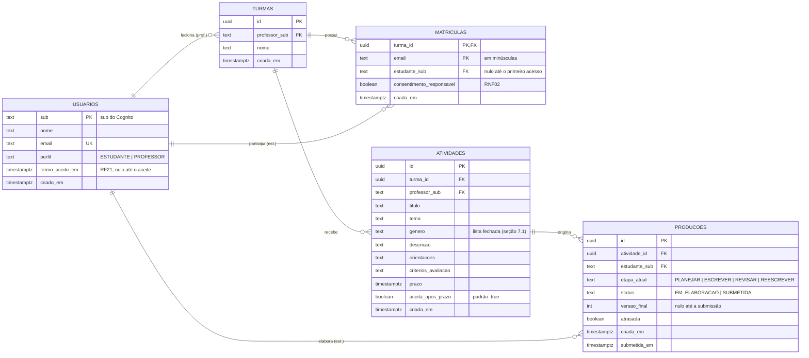
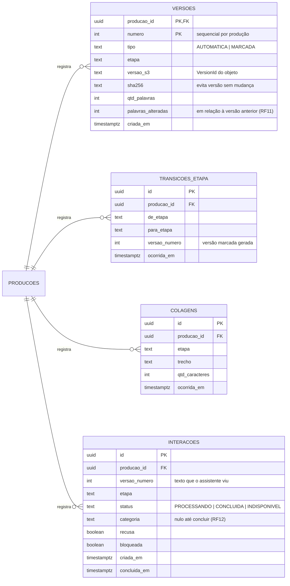

# Design: modelo de dados e contrato da API

| Campo | Valor |
|---|---|
| Versão | 0.3 |
| Data | 19/11/2026 (v0.1: 16/11/2026) |
| Autor | Danilo Galvão, com apoio de IA (Claude Code: Claude Fable 5.2 na v0.1, Claude Opus 5.5 nas v0.2 e v0.3) |
| Revisor | Felipe Nunes (pendente) |
| Estado | Aceita como base em 19/11/2026, aberta a mudanças; decisões D1 a D5 tomadas (seção 8) |

## 1. Objetivo e limites

Este documento define o modelo de dados e o contrato da API que faltam para levar o sistema do fluxo atual (o aluno envia um texto e recebe orientações genéricas) ao fluxo principal da ERS v2 (seção 6.1). Ele parte da arquitetura já implementada, descrita em `docs/arquitetura-aluno-processamento.png` e em `infra/README.md`, e não a altera: mesmos serviços, mesmas Lambdas, mesmo caminho assíncrono.

Fica fora deste documento: layout das telas, texto do prompt e parâmetros da similaridade. A persistência continua em Python, nas Lambdas, sem Java (decisão de 19/11/2026).

## 2. O que muda no que já existe

| Hoje | Proposta | Motivo |
|---|---|---|
| Cada envio cria um identificador isolado (`revisoes`) | A produção é uma entidade própria, com versões numeradas | RF04, RF05, RN04 |
| Histórico do aluno só no `sessionStorage` | Histórico lido do servidor | RF05, RF20 |
| Enviar o texto dispara o Bedrock | Salvar não dispara nada; só o **pedido de apoio** dispara | RF07; o salvamento automático a cada minuto não pode acionar o modelo |
| `consentimento: true` em cada envio | Aceite do termo gravado uma vez por usuário | RF21 |
| Um único perfil (aluno) | Perfis de estudante e professor, por grupos do Cognito | RF22 |
| Tabela DynamoDB `Sugestoes`, com chave `id_producao` | Tabela `Interacoes`, com chave `id_producao` + `id_interacao` (decisão D4) | Uma produção tem várias interações (RF10) |
| Bedrock recebe só contagens | Bedrock lê o texto e o pedido, mas devolve só códigos de um catálogo escrito pela equipe (decisão D1, seção 7) | RF07, RF08, RF12 |

As Lambdas continuam cinco. `ingestao` passa a atender todas as rotas de escrita (`POST`) e `consulta` todas as de leitura (`GET`), cada uma com um roteador interno por rota. `conexao_websocket` e `autorizador` não mudam.

## 3. Onde cada dado fica

A divisão segue o diagrama: o PostgreSQL guarda quem, o quê e quando; o S3 guarda o conteúdo; o DynamoDB guarda o que o assistente respondeu.

| Armazenamento | Conteúdo | Regra de imutabilidade |
|---|---|---|
| **RDS PostgreSQL** | Usuários, turmas, matrículas, atividades, produções, índice das versões, transições de etapa, colagens, índice das interações, conexões WebSocket | O usuário da aplicação recebe só `INSERT` e `SELECT` em `versoes`, `transicoes_etapa` e `colagens`; em `interacoes`, `UPDATE` apenas nas colunas de resultado |
| **S3 (bucket de redações, versionado)** | Conteúdo de cada versão e cada pedido de apoio | As Lambdas não têm permissão de exclusão; o versionamento preserva o que for sobrescrito |
| **DynamoDB** | Conteúdo das interações: pedido, orientações e marcações | Gravação condicional (`attribute_not_exists`); sem permissão de alteração ou exclusão |

Chaves no S3:

- `producoes/{id_producao}/conteudo.json`: uma chave por produção. Cada salvamento gera uma nova versão do objeto, e o `VersionId` devolvido pelo S3 é gravado no PostgreSQL. O conteúdo é `{"planejamento": "...", "texto": "..."}`, de modo que cada versão registra o estado completo (o planejamento da etapa Planejar e a redação).
- `pedidos/{id_producao}/{id_interacao}.json`: um objeto por pedido de apoio, com a mensagem, o trecho selecionado e a versão de referência. **Só este prefixo publica evento no SNS:** o filtro de notificação do bucket troca `redacoes/` por `pedidos/` (decisão D2).

Nenhum objeto, chave ou item contém nome ou e-mail do estudante. A ligação com a pessoa existe apenas no PostgreSQL, pelo `sub` do Cognito.

## 4. Modelo de dados (PostgreSQL)

Identificadores são `uuid`, datas são `timestamptz`, e o usuário é identificado pelo `sub` do Cognito.

Regras do modelo:

- **Uma produção por estudante e atividade:** restrição única em `(atividade_id, estudante_sub)`.
- **Matrícula por e-mail:** o professor inclui o estudante pelo e-mail (RF16). O vínculo com o `sub` é feito no primeiro acesso do estudante, comparando com o e-mail do token. Assim a Lambda não precisa consultar o Cognito.
- **Versão sem mudança não é gravada:** se o `sha256` do conteúdo for igual ao da última versão, o servidor devolve o número já existente.
- **Ordem de gravação da versão:** primeiro o S3, depois o PostgreSQL. Se o segundo passo falhar, sobra uma versão órfã no S3, sem efeito para o usuário. A ordem atual (PostgreSQL antes do S3) deixa registros presos em `PROCESSANDO`.
- **Progresso derivado (RF11):** tempo por etapa, número de versões, volume de alterações, interações e colagens saem de consultas sobre essas tabelas. Não há tabela de indicadores.
- **Volume de alterações:** ao salvar uma versão, a `ingestao` compara o conteúdo com a versão anterior e grava `palavras_alteradas`. A comparação é a mesma do RF06 (decisão D5), numa função compartilhada em `infra/lambdas/` usada pela `ingestao` e pela `consulta`.
- **`interacoes` no PostgreSQL é o índice:** permite contar por categoria e etapa com SQL (RF12). O conteúdo fica no DynamoDB.
- **Gênero em lista fechada:** `atividades.genero` usa os mesmos valores do catálogo de orientações (seção 7.1), mais `OUTRO`. Os valores são definidos junto com o catálogo.
- **`revisoes` deixa de ser usada** quando a fatia 3 entrar. `conexoes` permanece como está.
- **Fora do modelo por enquanto:** devolutiva (RF19, *Could*) e resultado da similaridade (RF15), detalhados quando chegarem as respectivas fatias.

Item do DynamoDB, na tabela `Interacoes`, que substitui a `Sugestoes` (chave de partição `id_producao`, chave de ordenação `id_interacao`; decisão D4). A tabela antiga fica retida pela política da stack e deve ser apagada à mão depois do deploy:

| Atributo | Conteúdo |
|---|---|
| `mensagem`, `trecho_selecionado` | O que o estudante pediu (RF07) |
| `versao_numero`, `etapa` | Contexto do pedido |
| `categoria` | `ESTRUTURA`, `COESAO`, `ARGUMENTACAO`, `GENERO`, `PEDIDO_DE_ESCRITA` ou `OUTRO` (RF12) |
| `orientacoes` | Lista de até três itens `{codigo, tipo, texto, inicio, fim}`. `codigo`, `tipo` e `texto` vêm do catálogo (seção 7.1); `tipo` é `PERGUNTA`, `APONTAMENTO` ou `CONCEITO` (RF08). `inicio` e `fim`, opcionais, são as posições do trecho apontado na versão lida |
| `recusa`, `bloqueada` | Recusa por pedido de escrita (FA01); resposta do modelo fora do formato, substituída pela orientação de reserva (FA02) |
| `modelo`, `versao_catalogo`, `criada_em` | Rastreabilidade |

## 5. Perfis e autorização

- **Perfil:** grupos `estudantes` e `professores` no Cognito, criados no template SAM. O administrador inclui o usuário no grupo ao criá-lo. A API lê o grupo do token (`cognito:groups`).
- **Estudante:** acessa apenas as próprias produções e as atividades das turmas em que está matriculado.
- **Professor:** acessa apenas as turmas que leciona, suas atividades e as produções delas (RNF03).
- **Recurso de outra pessoa** responde `404`, como já faz a consulta atual, para não revelar que o recurso existe.
- **Termo de ciência:** rotas de escrita do estudante exigem `termo_aceito_em` preenchido; sem ele, `403` com código `TERMO_PENDENTE`.

## 6. Contrato da API

REST no estágio `v1`, JSON, ID token do Cognito no cabeçalho `Authorization`. Corpo limitado a 100.000 bytes, como hoje.

**Identidade e turmas**

| Método e rota | Perfil | Finalidade | RF |
|---|---|---|---|
| `GET /eu` | Ambos | Perfil, nome e situação do termo; cria o registro do usuário no primeiro acesso e vincula matrículas pelo e-mail | RF22 |
| `POST /eu/termo` | Estudante | Registrar o aceite do termo | RF21 |
| `POST /turmas` · `GET /turmas` | Professor | Criar e listar turmas | RF16 |
| `POST /turmas/{id}/estudantes` `{email, consentimento_responsavel}` · `GET /turmas/{id}/estudantes` | Professor | Incluir e listar estudantes | RF16, RNF02 |

**Atividades**

| Método e rota | Perfil | Finalidade | RF |
|---|---|---|---|
| `POST /atividades` | Professor | Cadastrar atividade (título, tema, gênero e prazo obrigatórios) | RF01 |
| `GET /atividades` · `GET /atividades/{id}` | Ambos | Listar e consultar; o estudante vê só as das suas turmas | RF01, RF16 |

**Produção, etapas e versões**

| Método e rota | Perfil | Finalidade | RF |
|---|---|---|---|
| `POST /atividades/{id}/producoes` | Estudante | Iniciar a produção na etapa Planejar; se já existir, devolve a existente | RF02 |
| `GET /producoes/{id}` | Ambos | Situação e conteúdo da última versão | RF03 |
| `POST /producoes/{id}/versoes` `{planejamento, texto, tipo}` | Estudante | Salvar versão automática ou marcada; `201` com `numero` | RF04 |
| `GET /producoes/{id}/versoes?etapa=&tipo=` · `GET /producoes/{id}/versoes/{n}` | Ambos | Histórico com filtro; conteúdo de uma versão | RF05 |
| `POST /producoes/{id}/etapa` `{para, planejamento, texto}` | Estudante | Avançar ou voltar de etapa; grava versão marcada e a transição | RF17 |
| `GET /producoes/{id}/comparacao?de=&para=` | Ambos | Comparação calculada no servidor, por palavras e pontuação; devolve trechos `IGUAL`, `REMOVIDO` e `INSERIDO`. Padrão: primeira marcada × final | RF06 |
| `POST /producoes/{id}/colagens` `{trecho}` · `GET /producoes/{id}/colagens` | Estudante (escrita); ambos (leitura) | Registrar e consultar colagens; a etapa vem do servidor | RF18 |
| `POST /producoes/{id}/submissao` `{planejamento, texto}` | Estudante | Gravar a versão final e bloquear a edição | RF14 |

**Assistente e acompanhamento**

| Método e rota | Perfil | Finalidade | RF |
|---|---|---|---|
| `POST /producoes/{id}/apoios` `{mensagem, trecho_selecionado, planejamento, texto}` | Estudante | Pedir apoio; `202` com `id_interacao` e `status` | RF07 |
| `GET /producoes/{id}/apoios` · `GET /producoes/{id}/apoios/{id_interacao}` | Ambos | Interações com pedido e orientações | RF10, RF20 |
| `GET /producoes/{id}/indicadores` | Ambos | Tempo por etapa, versões, colagens e apoio por categoria e etapa | RF11, RF12 |
| `GET /atividades/{id}/acompanhamento` | Professor | Produções da atividade, em ordem alfabética, sem ordenar por indicador | RF13, RN05 |

**Erros comuns**

| Código | Situação |
|---|---|
| `400` | Corpo inválido ou campo obrigatório ausente |
| `401` | Sem token válido |
| `403` | Perfil sem permissão para a rota, ou termo pendente |
| `404` | Recurso inexistente ou de outra pessoa |
| `409` | Produção já submetida (edição bloqueada) ou prazo expirado sem aceite de atraso |
| `413` | Corpo acima do limite |
| `503` | Falha temporária de armazenamento |

**WebSocket:** a conexão não muda. A mensagem passa a ser `{"tipo": "APOIO_DISPONIVEL", "id_producao": "...", "id_interacao": "..."}`, e o cliente busca o resultado pela API REST. Sem WebSocket, o cliente consulta a interação a cada 10 segundos, como hoje.

O RF20 (estudante consulta os próprios registros) não precisa de rota própria: são as mesmas rotas de leitura, restritas ao dono.

## 7. Fluxo do pedido de apoio

O caminho é o do diagrama; muda apenas o que entra nele.

1. `POST /producoes/{id}/apoios`: a `ingestao` grava a versão atual (se mudou), insere a interação como `PROCESSANDO` no PostgreSQL e grava o pedido em `pedidos/…` no S3. Responde `202`.
2. O S3 publica o evento no SNS, que entrega à fila SQS.
3. O `processador_bedrock` lê o pedido, a versão exata do conteúdo e o contexto da atividade (tema, gênero, orientações, etapa) e numera os parágrafos e as frases do texto.
4. O Bedrock recebe o texto numerado, o pedido, o contexto e a lista de códigos do catálogo (seção 7.1), cada um com uma descrição curta. Devolve apenas um JSON com a categoria e até três códigos, cada um com o parágrafo e, se for o caso, a frase a que se refere.
5. A **conferência determinística** valida a resposta e monta as orientações com os textos do catálogo. Resposta inválida: usa a orientação de reserva e marca `bloqueada`. Categoria `PEDIDO_DE_ESCRITA`: exibe o texto fixo de recusa antes dos itens escolhidos e marca `recusa`.
6. O processador converte parágrafo e frase em posições de caracteres da versão lida, grava o item no DynamoDB, conclui a interação no PostgreSQL e avisa o estudante pelo WebSocket. O editor destaca o trecho apontado.

Se o Bedrock falhar até esgotar as tentativas da fila, a interação fica `INDISPONIVEL` e o estudante segue escrevendo e salvando normalmente (FA04, RNF08).

**Latência do gatilho (decisão D2).** Segundo a AWS, o aviso do S3 costuma chegar em segundos, mas às vezes leva um minuto ou mais. Se o primeiro deploy mostrar que isso compromete o RNF06, a `ingestao` passa a publicar direto no SNS. A mudança fica restrita a ela e à leitura do evento no processador.

**Saída fechada (decisão D1).** O modelo lê o texto do estudante, mas nada do que ele escreve chega à tela: o estudante só lê textos do catálogo, escritos pela equipe, e trechos do próprio texto. No pior caso, uma instrução escondida na redação produz uma orientação fora de contexto. Regras da conferência:

- JSON no formato exato, com a categoria dentro da lista do RF12;
- de um a três itens, e cada código existe no catálogo;
- parágrafo e frase, quando presentes, são inteiros que existem na versão enviada;
- qualquer outro campo ou texto livre da resposta é ignorado, e qualquer falha leva à orientação de reserva.

O pedido enviado ao Bedrock não contém `sub`, nome nem e-mail, o que um teste do montador do pedido verifica (RNF04). O termo de ciência informa que o texto é processado pelo Amazon Bedrock, dentro da AWS, sem uso para treinamento de modelos (RF21).

### 7.1 Catálogo de orientações

Arquivo versionado no repositório e empacotado com o `processador_bedrock`. Cada item tem:

| Campo | Conteúdo |
|---|---|
| `codigo` | Identificador estável, como `CONCLUSAO_RETOMA_TESE` |
| `categoria` | Uma das categorias do RF12 |
| `tipo` | `PERGUNTA`, `APONTAMENTO` ou `CONCEITO` (RF08) |
| `parte` | `INTRODUCAO`, `DESENVOLVIMENTO`, `CONCLUSAO` ou `GERAL` |
| `generos` | Gêneros a que o item se aplica; vazio vale para todos |
| `descricao` | Frase curta enviada ao modelo para ele escolher o item |
| `texto` | O que o estudante lê |

Regras de redação, conferidas na revisão do catálogo:

- nenhum texto que possa ser copiado para uma redação;
- exemplos de conceitos tratam de temas sem relação com as atividades (RF09, RN09);
- nenhuma nota, conceito ou julgamento de aprovação (RN07).

Como o estudante só lê textos do catálogo, os limites da decisão B5 passam a valer para a redação desses itens, e não para a saída do modelo.

O catálogo traz também o texto fixo de recusa (FA01) e a orientação de reserva. As quatro orientações que existem hoje (`ESTRUTURA`, `PARAGRAFOS`, `FRASES`, `REVISAO`) são os primeiros itens. O tamanho esperado é de algumas dezenas de itens *(sugerido)*. A interação grava o código, o tipo e o texto exibido, além da versão do catálogo, para que editar o catálogo não altere o histórico (RN04).

## 8. Decisões de design

| ID | Decisão | Recomendação | Alternativa |
|---|---|---|---|
| **D1** | O texto do estudante é enviado ao Bedrock? | **Decidida em 19/11/2026: o texto entra, a saída é fechada.** O modelo lê o texto, o pedido e o contexto, mas devolve só códigos do catálogo e a localização do trecho; o estudante só lê textos escritos pela equipe (seção 7). Atende RF07, RF08, RF09 e RF12, e a ERS já prevê o envio (RNF04) | Só contagens (código atual): o assistente fica genérico e não classifica pedidos. Saída livre validada: respostas personalizadas, mas a autoria passa a depender de um validador que não detecta paráfrase nem frase nova sobre o tema; fica como evolução futura |
| **D2** | O que dispara o processamento? | **Decidida em 19/11/2026: o objeto do pedido no S3 (`pedidos/`).** Mantém o diagrama e guarda o pedido antes do processamento (RF10) | A `ingestao` publicar direto no SNS: menor latência e roteamento por tipo mais simples na fatia 5, mas muda o passo 7 do diagrama. Fica como saída se a latência do S3 comprometer o RNF06 |
| **D3** | Turmas entram agora? | **Decidida em 19/11/2026: sim**, na fatia 1. São duas tabelas e definem quem vê cada atividade. O `CLAUDE.md` lista o RF16 como *Must* | Adiar, como indica "Turmas V2" no diagrama, e deixar toda atividade visível a todos os estudantes |
| **D4** | Recriar a tabela do DynamoDB com chave de ordenação? | **Decidida em 19/11/2026: sim**, com o recurso renomeado para `Interacoes`. Não há dados reais; a tabela antiga fica retida pela política da stack e é apagada à mão | Um item por produção com lista de interações: limite de 400 KB, gravação concorrente frágil e permissão de alteração, que quebra a imutabilidade da seção 3 |
| **D5** | Onde calcular a comparação de versões? | **Decidida em 19/11/2026: no servidor**, com `difflib` (biblioteca padrão do Python), por palavras e pontuação. A mesma função calcula `palavras_alteradas` para o RF11 | No navegador, com uma biblioteca JavaScript: troca de par instantânea, mas o RF11 exigiria um segundo cálculo no servidor, e o trabalho cairia na área com menos folga no cronograma |

A D1 muda uma escolha deliberada do código atual, que não envia nenhuma palavra do texto ao modelo, mas mantém o princípio dele: o modelo escolhe, e só a aplicação escreve o que o estudante lê.

## 9. Fatias de implementação

A migração `002` cria todas as tabelas de uma vez. Com o contrato fixado, as fatias 1 a 3 podem andar em paralelo.

| Fatia | Entrega | Rotas | Telas |
|---|---|---|---|
| **1. Identidade e atividades** | Grupos do Cognito, usuário, termo persistido, turma, matrícula, atividade | `/eu`, `/eu/termo`, `/turmas`, `/atividades` | Professor: turmas e atividades. Estudante: aceite do termo e lista de atividades |
| **2. Produção e versões** | Produção por atividade, salvamento automático com volume de alterações, etapas, histórico, comparação no servidor, submissão | `/atividades/{id}/producoes`, `/producoes/{id}` e as de versões, etapa, comparação e submissão | Editor com etapas, histórico e comparação |
| **3. Assistente** | Catálogo de orientações, pedido de apoio (gatilho em `pedidos/`), classificação, conferência da saída, registro da interação (tabela `Interacoes`) | `/producoes/{id}/apoios` | Painel de apoio no editor, com destaque do trecho apontado |
| **4. Acompanhamento** | Painel do professor, indicadores, colagens | `/atividades/{id}/acompanhamento`, `/producoes/{id}/indicadores`, `/producoes/{id}/colagens` | Painel do professor; "meus registros" do estudante |
| **5. Similaridade e devolutiva** | Outro consumidor do tópico SNS, acionado pela submissão | A definir | A definir |

A ordem difere da que foi discutida antes (versões primeiro): a produção depende da atividade, então identidade e atividades vêm na frente.
