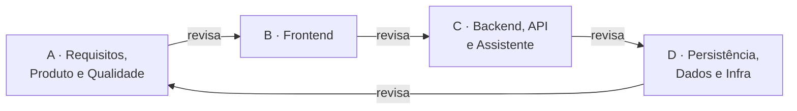
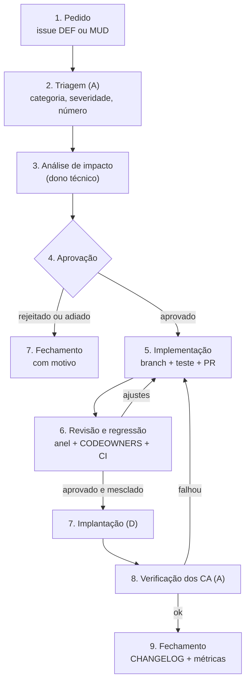

# Processo de manutenção

| Campo | Valor |
|---|---|
| Versão | 0.1 |
| Data | 26/11/2026 |
| Autor | Luiz Augusto Godinho, com apoio de IA (Claude Code, Claude Opus 5.5) |
| Revisor | Danilo Galvão (pendente) |
| Estado | Proposta para a equipe (tarefa T68, issue #74) |

## 1. Objetivo e alcance

Este documento define como o projeto recebe, analisa, aprova, implementa, valida, implanta e fecha cada pedido de manutenção: correção de defeito, adaptação de ambiente, prevenção, funcionalidade nova ou melhoria. Ele atende aos itens M01, M08, M09, M13 e M18 e à competência C3 da [conformidade com Manutenção de Software](../conformidade/01-manutencao-de-software.md) (PR #68), e torna operacionais as seções 9.6, 10.4 e 12.3 e o Apêndice C do [plano mestre v1.2](../plano/v1.2/plano-mestre-v1.2.md).

Vale para código (`frontend/`, `infra/`), dados (migrações, buckets, tabelas) e documentos (`docs/`). Não substitui o controle de mudanças de escopo da seção 12.3 do plano: mudanças de requisito continuam precisando da aprovação do professor, e mudanças de arquitetura continuam virando ADR.

Referências: ISO/IEC/IEEE 14764:2022 (processo e categorias de manutenção) e SWEBOK v4, capítulos 7 (Software Maintenance) e 8 (Software Configuration Management), as duas bibliografias básicas da disciplina.

## 2. Papéis

As áreas são as da seção 7 do plano. Quem fica em cada uma ainda não foi definido (tarefa T70); até lá, o [`.github/CODEOWNERS`](../../.github/CODEOWNERS) usa uma divisão provisória.

| Papel | Quem | Responsabilidade no processo |
|---|---|---|
| Solicitante | Qualquer integrante, o professor ou um usuário da demonstração | Abre a issue com o formulário de defeito ou de mudança |
| Triagem e aceitação | Área A (Requisitos, Produto e Qualidade) | Confirma a categoria e a severidade, numera o registro (DEF/MUD), verifica os CA no fim |
| Análise de impacto | Dono técnico da área afetada (B, C ou D) | Levanta o que muda em código, dados, documentos e testes e estima o esforço |
| Aprovação | Conforme a seção 5 | Decide aceitar, adiar ou rejeitar e registra a decisão na issue |
| Implementação | Responsável designado na issue | Faz a mudança em branch própria, com teste que a cobre |
| Revisão | Revisor do anel (seção 2.1) e *code owner* do caminho alterado | Aprova ou pede ajustes no PR |
| Implantação | Área D (Persistência, Dados e Infra) | Faz o deploy da stack ou publica a SPA e confirma o ambiente |

### 2.1 Anel de revisão

A revisão segue o anel **A → B → C → D → A**: o trabalho de A é revisado por B, o de B por C, o de C por D e o de D por A. **O autor nunca aprova o próprio trabalho**, nem a análise de impacto que ele mesmo escreveu. Quando um PR toca mais de uma área, o revisor do anel aprova e o *code owner* de cada caminho alterado também precisa aprovar (o GitHub exige isso quando a proteção da `main` estiver ativa).

Leitura da seta: "o trabalho de A é revisado por B", e assim por diante.

## 3. Categorias de manutenção

Toda issue de defeito ou de mudança recebe **uma** categoria da ISO/IEC/IEEE 14764 (SWEBOK v4, 7.1.6). A categoria orienta a análise de impacto, o tipo de commit e a nota do `CHANGELOG`.

| Categoria | Quando usar | Exemplo no projeto | Commit típico |
|---|---|---|---|
| Corretiva | Corrige um defeito já observado | Health check do frontend aponta para `/api/health`, rota que não existe na API SAM (T111, DEF-001) | `fix` |
| Preventiva | Corrige um defeito latente antes que ele cause falha em produção | Reconciliar revisões presas em `PROCESSANDO`; alarme na DLQ (T107) | `fix`, `feat` ou `refactor` |
| Adaptativa | Mantém o software utilizável num ambiente que mudou | Troca do monólito Java/Spring por Lambdas Python e AWS SAM (T66, MUD-001); troca de versão de runtime | `refactor`, `build` ou `feat` |
| Aditiva | Acrescenta uma funcionalidade nova, sem alterar as existentes | Listagem de versões da produção (T83) | `feat` |
| Perfectiva | Melhora desempenho, manutenibilidade, documentação ou outro atributo de qualidade | Refatoração com testes de proteção; plano v1.3 alinhado à arquitetura implementada (T70) | `refactor`, `perf` ou `docs` |
| Emergencial | Correção não programada feita às pressas para manter o sistema em operação | Vazamento de dado do aluno na demonstração; credencial exposta | `fix` |

Corretiva e emergencial são **correções**; preventiva, adaptativa, aditiva e perfectiva são **melhorias**, no vocabulário da norma. Uma emergencial sempre é seguida de um registro corretivo normal, que documenta a causa e acrescenta o teste de regressão (seção 6).

## 4. Numeração dos registros

| Prefixo | O que é | Onde vive | Exemplo |
|---|---|---|---|
| DEF-nnn | Defeito (categoria corretiva ou emergencial) | Issue aberta com o formulário **Defeito**; título começa com o número | `DEF-001 — Health check do frontend usa rota inexistente` |
| MUD-nnn | Pedido de mudança (preventiva, adaptativa, aditiva ou perfectiva, ou mudança de escopo da seção 12.3 do plano) | Issue aberta com o formulário **Pedido de mudança**; mudanças grandes também ganham `docs/manutencao/MUD-nnn-<assunto>.md` | `MUD-001 — Reengenharia de Java/Spring para Lambda/Python` |

Regras:

- os números são sequenciais, com três dígitos, e **nunca são reaproveitados**, mesmo quando o pedido é rejeitado ou duplicado;
- quem atribui o número é a área A, na triagem: o próximo número livre é o maior DEF (ou MUD) existente nas issues mais um;
- a issue continua com o número do GitHub (`#74`); o DEF/MUD é o identificador do registro de manutenção e aparece no título, nos commits e no `CHANGELOG`;
- quando a mudança também é de arquitetura, o ADR e a MUD citam um ao outro (ex.: ADR-010 ↔ MUD-001).

## 5. Fluxo

### 5.1 Pedido

Quem encontra o problema ou quer a mudança abre uma issue com o formulário certo (`.github/ISSUE_TEMPLATE/`):

- **Defeito:** passos para reproduzir, resultado esperado, resultado obtido, severidade proposta, RF/RN afetado.
- **Pedido de mudança:** descrição, motivo, categoria proposta, RF/RN afetado.

Nenhum dado real de aluno entra na issue, em prints ou em logs colados (RNF01).

### 5.2 Triagem

A área A, em até 1 dia útil *(sugerido)*:

1. confirma ou corrige a categoria (seção 3) e, para defeito, a severidade (seção 6);
2. atribui o número DEF-nnn ou MUD-nnn e o coloca no título;
3. marca a issue com a área afetada (`área: B`, `área: C`, `área: D`) e a prioridade;
4. fecha como duplicada ou inválida quando for o caso, com comentário (o número continua consumido).

### 5.3 Análise de impacto

O dono técnico da área afetada preenche na própria issue (SWEBOK 7.2.1.3):

- **código:** arquivos, Lambdas, componentes ou rotas alterados;
- **dados:** migração, objetos no S3, itens no DynamoDB, compatibilidade com dados já gravados (RN04: o histórico de versões nunca é apagado);
- **documentos:** ERS, plano, ADR, READMEs, contrato da API;
- **testes:** testes novos e suítes de regressão que precisam rodar;
- **riscos:** autoria (RN01/RN02), privacidade (RNF01), custo na AWS;
- **estimativa** em horas, dentro da capacidade fixa (B12); itens acima de 4 h são quebrados (DoR, seção 4.7 do plano).

### 5.4 Aprovação

Quem aprova depende do tipo, conforme a seção 12.3 do plano:

| Tipo | Quem aprova |
|---|---|
| Defeito | A confirma a severidade; o dono da área corrige sem nova aprovação |
| Melhoria dentro do escopo da ERS (preventiva, perfectiva, adaptativa sem mudar requisito) | Uma área diferente da do autor, na própria issue |
| Requisito ou escopo (muda a ERS) | Professor + equipe |
| Arquitetura | Duas áreas além do autor, por meio de ADR |
| Stack ou versão de tecnologia | Equipe |

A decisão é registrada na issue: **aprovado**, **adiado** (com o marco previsto) ou **rejeitado** (com o motivo). Durante a sprint, o Sprint Goal não muda: pedido aprovado vai para o backlog, salvo defeito bloqueante.

### 5.5 Implementação

1. Branch `tipo/Txx-descricao` (ou `fix/DEF-nnn-descricao`) a partir da `main`, com vida de no máximo 2 dias úteis.
2. Para defeito, **primeiro** um teste que reproduz o problema e falha; depois a correção.
3. Commits em Conventional Commits citando a issue: `fix(frontend): usa GET /saude no health check (#nnn)`.
4. PR para a `main` no modelo do `.github/pull_request_template.md` (Apêndice C do plano), com `Fecha #<issue>`, o número DEF/MUD e o checklist de segurança.

### 5.6 Revisão e regressão

- CI verde: testes do frontend e da infra, lint e `sam validate` (tarefa T69). A falha bloqueia o merge.
- Aprovação do revisor do anel e do *code owner* de cada caminho alterado; o autor não aprova.
- Conversas resolvidas antes do merge.
- Merge por *squash*.

Até a T69 entrar, o autor roda os comandos do `CLAUDE.md` (`python -m unittest discover -s infra/tests -v`; `npm test`, `npm run lint` e `npm run build` em `frontend/`) e cola o resultado na seção "Evidências" do PR.

### 5.7 Implantação

A área D faz o deploy (`sam build` e `sam deploy`, ou publicação da SPA no S3/CloudFront) e confirma que a stack subiu e que `GET /saude` responde. Migração de banco é aplicada com backup antes (T73). Se a implantação falhar, volta-se para a versão anterior e reabre-se a issue.

### 5.8 Verificação e fechamento

1. A área A verifica os critérios de aceitação no ambiente implantado e comenta o resultado.
2. Para defeito, quem abriu confirma que o problema não se repete.
3. O PR fecha a issue (`Fecha #nnn`). A entrada no `CHANGELOG.md` cita o DEF/MUD e a categoria.
4. Ficam registradas na issue as datas de abertura e de fechamento, para o indicador de tempo de correção (T113).

## 6. Severidade de defeitos

Conforme a Tabela 88 do plano (seção 9.6):

| Severidade | Definição | Prazo de correção |
|---|---|---|
| Bloqueante | Impede o fluxo principal, viola RN01/RN02/RN04, expõe dados de outro usuário ou envia identificador do estudante ao provedor de LLM | Antes do fim da sprint corrente; interrompe trabalho novo do responsável |
| Alta | Um RF não atende seus CA | Antes do marco seguinte |
| Média | Comportamento incorreto com contorno simples | Planejado no backlog; corrigido até M5 se houver capacidade |
| Baixa | Cosmético ou de texto | Backlog; não bloqueia entrega |

Defeito bloqueante em ambiente de demonstração pode seguir o **caminho emergencial**: o responsável corrige direto em branch `fix/`, com um revisor de qualquer outra área, e o registro corretivo completo (causa, teste de regressão, análise de impacto) é preenchido em até 1 dia útil *(sugerido)* depois. Mesmo nesse caminho não há push direto na `main` nem autoaprovação.

Os defeitos abertos por severidade são apresentados em cada Sprint Review.

## 7. Rastreabilidade

Cada registro liga, nos dois sentidos:

- issue DEF/MUD ↔ RF/RN/RNF afetado ↔ HU/CA;
- issue ↔ PR (`Fecha #nnn`) ↔ commits (`(#nnn)` na mensagem);
- PR ↔ testes (o nome do teste cita o CA, ex.: `deveRejeitarEdicaoAposSubmissao_CA14_2`);
- MUD de arquitetura ↔ ADR.

A matriz consolidada fica em `docs/manutencao/rastreabilidade.md` (tarefa T72).

## 8. Ferramentas

| Arquivo | Para que serve |
|---|---|
| `.github/ISSUE_TEMPLATE/defeito.yml` | Formulário de defeito (DEF-nnn) |
| `.github/ISSUE_TEMPLATE/mudanca.yml` | Formulário de pedido de mudança (MUD-nnn) |
| `.github/pull_request_template.md` | Modelo de PR do Apêndice C do plano, com checklist de segurança |
| `.github/CODEOWNERS` | Revisores obrigatórios por pasta (divisão provisória até a T70) |
| Proteção da `main` (configuração do GitHub, exige admin) | Bloqueia push direto; exige PR com revisão de *code owner*, conversas resolvidas e CI verde |

## 9. Uso de IA

Documento redigido com apoio do Claude Code (Anthropic, modelo Claude Opus 5.5) em 26/11/2026, a partir do plano mestre v1.2 (seções 4.3, 4.7, 4.8, 9.6, 10.2–10.4, 12.3 e Apêndice C), do documento de conformidade com Manutenção de Software e do backlog (T68). A equipe deve revisar os prazos marcados como *(sugerido)* e a divisão provisória de *code owners* antes de adotar o processo.
