**GRUPO 8 · ENGENHARIA DE SOFTWARE**

**Assistente de Escrita Processual**

Plano Mestre de Planejamento e Engenharia de Software

Base teórica, metodológica, organizacional e operacional para o desenvolvimento da prova de conceito

**Equipe (ordem alfabética)**

Danilo Galvão · Enzo Machado · Felipe Nunes · Luiz Augusto Godinho

Versão 1.2 — 29/10/2026

Situação: proposta para aprovação da equipe e validação do professor responsável

Documentos de entrada: ERS v2.0 do Grupo 8; enunciado da POC 2.2; apresentação ao stakeholder; cronograma e base teórica do Trabalho 2 (Autenticação Web)

**Controle de versões**

| **Versão** | **Data** | **Descrição** | **Autor** | **Revisor** |
|---|---|---|---|---|
| 1.0 | 29/10/2026 | Versão inicial: diagnóstico, plano integrado, cronograma relativo de 6 semanas | Elaborado com apoio de IA (ver Apêndice D) | A definir — integrante D (ver seção 7) |
| 1.1 | 29/10/2026 | Seção 4.2 com o ciclo de vida (dois níveis, design do incremento, visão por semana); roteiros de execução 5.9 e 6.10; refinamento de RF11–RF15 antecipado para a Semana 3 (T22) e horas de A rebalanceadas; design do incremento na DoD e no modelo de PR; seções 5 e 6 marcadas como proposta de referência | Elaborado com apoio de IA (ver Apêndice D) | A definir — integrante D |
| 1.2 | 29/10/2026 | Integração da ERS v2.0 (RF16–RF22, RN07–RN10, RNF01–RNF13), da POC 2.2 e da apresentação ao stakeholder; decisões B1–B12 da equipe (LLM via API externa, salvamento automático com versões por etapa, similaridade automática, MoSCoW revisada); cronograma refeito com a mesma capacidade; diagramas refeitos em Mermaid; pastas de `docs/` alinhadas à organização atual | Danilo Galvão (decisões); redação com apoio de IA (ver Apêndice D) | A definir — integrante D |

**Como ler este documento**

Este plano separa explicitamente a origem de cada afirmação. Os rótulos abaixo aparecem ao longo do texto e nas tabelas; quando uma afirmação não tem rótulo, ela é uma explicação conceitual sustentada pela referência indicada entre colchetes, numerada conforme a seção 14.

**Tabela 1 —** Convenções de rotulagem usadas no documento

| **Rótulo** | **Significado** | **Pode ser alterado por** |
|---|---|---|
| **Fato (ERS)** | Conteúdo presente na ERS v2.0 do Grupo 8 ou informado pela equipe neste projeto (prazo de 6 semanas, React + TypeScript, LLM acessado por API externa, similaridade contra textos internos e respostas do assistente, persistência em Java) | Professor/cliente, por meio do controle de mudanças (seção 12) |
| **Decisão da equipe (Bnn)** | Escolha feita pela equipe em 29/10/2026 ao integrar a ERS v2.0 a este plano (B1 a B12), registrada em `docs/plano/v1.2/decisoes-plano-v1.2.md` | Equipe, por meio do controle de mudanças (seção 12) |
| **Exigência normativa** | Obrigação que a norma impõe a quem declara conformidade com ela. Este projeto não declara conformidade formal com nenhuma norma; usa as normas como referência | Não se aplica |
| **Boa prática** | Recomendação de livro, guia ou documentação oficial, adotada por julgamento técnico | Equipe, com registro em ata ou ADR |
| **Decisão do projeto** | Escolha tomada neste plano com justificativa; vale até ser substituída por ADR ou mudança aprovada | Equipe (seção 12) |
| **Hipótese (H-xx)** | Suposição necessária para avançar, ainda não confirmada pelo professor/cliente | Resposta à pergunta correspondente (Q-xx) |
| **Pendência (Q-xx)** | Pergunta aberta cuja resposta pode alterar requisitos, arquitetura ou cronograma | Professor/cliente |

**Limitação declarada.** As normas ISO/IEC/IEEE são documentos pagos e o texto integral não foi consultado. As referências a elas se limitam ao escopo publicado pelos organismos de normalização e a conteúdo amplamente documentado; nenhuma cláusula ou página é citada. Quando a equipe tiver acesso ao texto integral (por exemplo, pela biblioteca da instituição), deve conferir as seções correspondentes.

**Sumário**

## 1. Diagnóstico dos documentos de entrada

Esta seção registra o resultado da análise integral dos documentos de entrada e das respostas da equipe às perguntas estruturais feitas antes da redação. Ela é a base das decisões das seções seguintes: tudo o que for decidido adiante decorre de um fato aqui registrado, de uma hipótese identificada ou de uma recomendação justificada.

**Documentos de entrada da versão 1.2.** As versões 1.0 e 1.1 partiram da ERS v1.0 e do Trabalho 2. A versão 1.2 incorpora três fontes que não haviam sido usadas: a **ERS v2.0** do grupo (base de requisitos deste plano), o **enunciado da POC 2.2** (risco moderado, hipótese, salvaguardas, requisitos de dados e métricas de saída) e a **apresentação feita ao stakeholder** (etapas Planejar, Escrever, Revisar e Reescrever; o que a IA observa e o que não faz; cuidados com padronização, variação linguística, dependência e exposição do aluno). A ERS v2.0 tem precedência sobre este plano em matéria de requisitos; o plano define processo, arquitetura, stack e cronograma.

### 1.1 Informações confirmadas

**Tabela 2 —** Informações confirmadas

| **Item** | **Conteúdo confirmado** | **Fonte** |
|---|---|---|
| **Sistema** | Assistente de Escrita Processual, desenvolvido como **prova de conceito (POC 2.2)** de apoio à produção textual de estudantes | ERS v2, seção 1 |
| **Hipótese da POC** | O acompanhamento por etapas desenvolve autoria e autorregulação sem gerar dependência ou plágio assistido | POC 2.2; ERS v2, seção 2.2 |
| **Classificação de risco** | Risco **moderado** (coorte de entrada 2): exige requisitos de privacidade, transparência e salvaguardas | POC 2.2; ERS v2, seção 2.3 |
| **Propósito** | Acompanhar o **processo** de escrita por etapas (Planejar, Escrever, Revisar, Reescrever), com versões, interações e colagens registradas; orientar sem escrever; reduzir gradualmente a dependência do assistente | ERS v2, seções 1 e 2; apresentação ao stakeholder |
| **Atores** | Estudante, Professor e Assistente de Escrita (componente do sistema, não usuário humano) | ERS v2, seção 2.4 |
| **Requisitos funcionais** | RF01 a RF22 (RF16 a RF22 novos na v2.0: turma, etapas, colagens, devolutiva, consulta dos próprios registros, termo de ciência, autenticação) | ERS v2, seção 3 |
| **Regras de negócio** | RN01 a RN10 (RN07 a RN10 novas: avaliação exclusiva do professor, respeito ao estilo e à variação linguística, sem modelo pronto, transparência ao estudante) | ERS v2, seção 4 |
| **Requisitos não funcionais** | RNF01 a RNF13 (privacidade, segurança, confiabilidade do assistente, desempenho, disponibilidade, integridade, usabilidade, transparência da IA, acessibilidade, compatibilidade) | ERS v2, seção 5 |
| **Fluxos e salvaguardas** | Fluxo principal em 11 passos, fluxos alternativos FA01 a FA06 e matriz de salvaguardas | ERS v2, seções 6 e 7 |
| **Métricas da POC** | Qualidade da produção final, autonomia progressiva, redução do apoio solicitado e originalidade, cada uma com forma de medição e fonte de dados | POC 2.2; ERS v2, seção 8 |
| **Plano da POC** | Fase 1, demonstração (requisitos de prioridade Alta); fase 2, piloto com uma turma e pelo menos 3 atividades (prioridades Alta e Média) | ERS v2, seção 9 |
| **Equipe** | Quatro integrantes: Danilo Galvão, Enzo Machado, Felipe Nunes, Luiz Augusto Godinho (competências individuais não informadas) | ERS, cabeçalho |
| **Prazo** | **6 semanas** até a entrega final da POC | Resposta da equipe (29/10/2026) |
| **Frontend** | **React + TypeScript** | Resposta da equipe |
| **Assistente** | **LLM acessado por API externa**; provedor e modelo escolhidos no *spike* T07. Substitui o "LLM local open-source" das versões 1.0 e 1.1 | ERS v2, seção 2.5; decisão B1 |
| **Similaridade (RF15)** | Comparar com **textos internos e com as respostas do assistente**; base externa fica como evolução futura | Resposta da equipe; decisão B2 |
| **Restrição técnica** | Camada de persistência e acesso a dados **implementados em Java** | Enunciado da tarefa |

### 1.2 Lacunas e inconsistências da ERS

As lacunas abaixo foram identificadas na ERS v1.0 durante a elaboração das versões 1.0 e 1.1 do plano. A coluna "Situação com a ERS v2.0" mostra como a revisão da ERS tratou cada uma. As que continuam abertas geram uma pendência (seção 5.8) com uma hipótese padrão que permite avançar sem inventar requisitos.

**Tabela 3 —** Lacunas e inconsistências identificadas na ERS v1.0 e situação na ERS v2.0

| **ID** | **Lacuna ou inconsistência (ERS v1.0)** | **Consequência se não tratada** | **Situação com a ERS v2.0** |
|---|---|---|---|
| L1 | Não há requisitos não funcionais | Sem *drivers* arquiteturais nem critérios para testes de desempenho, segurança e usabilidade | **Resolvida:** RNF01–RNF13 na ERS v2; o plano acrescenta RNF14–RNF17 (seção 5.5) |
| L2 | Não há requisito de autenticação/autorização, embora RF05 e RF13 pressuponham controle de acesso | Exposição de textos de estudantes | **Resolvida:** RF22 (autenticação por perfil) e RNF03 |
| L3 | Não há vínculo definido entre professor e estudante | RF02 e RF13 ficam sem regra de visibilidade | **Resolvida:** RF16 (turma); a hipótese H-03 vira requisito |
| L4 | A ERS não declara a plataforma (web, desktop, móvel) | Arquitetura indefinida | **Resolvida:** acesso por navegador web em computador (ERS v2, seção 2.5) |
| L5 | RF09/RN02 não são verificáveis: “evitar a produção integral” não tem critério mensurável | Requisito central sem teste de aceitação | **Parcialmente resolvida:** RF09 da ERS v2 tem CA verificáveis (exemplos sobre outro tema; ≥ 30 pedidos de teste). Os limites numéricos do validador propostos pelo plano estão pendentes (B5, Q-05) |
| L6 | Tecnologia do assistente não definida na ERS | Custo, privacidade e arquitetura | **Resolvida:** LLM por API externa (ERS v2, seção 2.5; decisão B1); provedor escolhido no *spike* T07 (ADR-006) |
| L7 | RF15 sem corpus, gatilho e momento | Escopo da análise indefinido | **Resolvida:** execução automática após a submissão (RF15; B7); corpus interno (B2). A base externa citada no RF15 fica fora desta entrega |
| L8 | RF04: versão manual ou automática; RF06: granularidade do *diff* | Volume de dados e usabilidade | **Parcialmente resolvida:** versões automáticas e marcadas (RF04; B3). Granularidade do *diff* continua em Q-10 |
| L9 | RF12: “tipo de apoio” sem taxonomia | Métricas da seção 8 da ERS v2 inviáveis | **Resolvida:** categorias do RF12 da ERS v2 (B6) |
| L10 | RF01 define prazo, mas não o efeito do prazo; RF14 não diz se a edição continua após a submissão | Regras de estado incompletas | **Resolvida:** RF14 (edição bloqueada após a submissão; prazo configurável pelo professor, B4) |
| L11 | “Dependência excessiva” e “autonomia progressiva” sem indicador nem limiar | Métricas da POC não operacionalizadas | **Parcialmente resolvida:** forma de medição na ERS v2, seção 8; limiares do critério de sucesso pendentes (Q-19) |
| L12 | Textos e interações são dados pessoais; a faixa etária dos estudantes não é informada | Risco de não conformidade com a LGPD (art. 14, para menores) | **Parcialmente resolvida:** RF21, RNF01, RNF02 e RNF04; faixa etária e retenção ainda abertas (Q-13, Q-18) |
| L13 | Requisitos sem prioridade, origem e critérios de aceitação | Sem base para priorizar e verificar | **Resolvida:** prioridades e CA na ERS v2; conversão para MoSCoW na seção 4.5 (B8) |
| L14 | O enunciado da disciplina para este trabalho não foi fornecido | Critérios de avaliação desconhecidos | **Aberta:** Q-01 e Q-02 |

### 1.3 Restrições identificadas

- **RT-01 (Fato):** persistência e acesso a dados em Java. A restrição define a linguagem da camada de dados; não determina o SGBD nem o ORM (seção 6.7).
- **RT-02 (Fato):** horizonte de 6 semanas, com quatro integrantes.
- **RT-03 (Fato):** frontend em React + TypeScript.
- **RT-04 (Fato, ERS v2; decisão B1):** assistente baseado em LLM acessado por API externa. O texto enviado ao provedor não contém dados de identificação do estudante, e o provedor não pode usar os dados para treinamento (RNF04).
- **RT-05 (Fato, ERS):** o assistente não escreve, reescreve, completa nem parafraseia o texto do estudante (RN01, RN02, RN09); versões e registros não podem ser alterados nem excluídos (RN04); indicadores não podem virar nota, ranking ou vigilância (RN05); a similaridade e as colagens são indícios, e quem decide sobre originalidade é o professor (RN06); o assistente não avalia nem dá nota (RN07).
- **RT-06 (Fato, ERS v2):** participação de estudantes menores de idade depende de consentimento do responsável legal (RNF02); o uso da plataforma depende do aceite do termo de ciência (RF21).
### 1.4 Decisões possíveis com os dados disponíveis

- Estilo arquitetural: cliente-servidor com SPA e **monólito modular** no backend, com o provedor de LLM e a persistência isolados por interfaces (ADR-001, ADR-002).
- Backend em Java + Spring Boot; persistência com Spring Data JPA/Hibernate sobre PostgreSQL, com migrações Flyway (ADR-003).
- Versões e registros do processo imutáveis (*append-only*), atendendo RN04 e RNF09 por construção (ADR-004); versões automáticas e marcadas por etapa (ADR-009).
- Processo iterativo-incremental com sprints de 1 semana, quadro Kanban e revisão cruzada em anel (seção 4).
- Cronograma relativo (Semana 1 a 6, dias D1–D5), sem datas absolutas até a definição de D0 (seção 8).
### 1.5 Decisões que dependem de esclarecimento

Data de início (D0) e data de entrega; dedicação semanal real de cada integrante; limites numéricos do validador do RF09 (B5); tempo máximo de resposta do assistente (B10); provedor e modelo da API de LLM e seus termos de uso de dados; faixa etária dos estudantes, consentimento e prazo de retenção dos dados; duração do piloto e limiares do critério de sucesso; critérios de avaliação da disciplina. A lista completa, com impacto e hipótese padrão, está na seção 5.8.

### 1.6 Avaliação crítica do cronograma anterior

O documento “Base Teórica — Sistema Web com Cronograma (2 integrantes)” descreve um trabalho de **projeto sem implementação** (explicar o ambiente web e projetar um login), com seis fases sequenciais em seis dias e uma dupla. A tabela registra o que foi mantido, adaptado ou substituído e por quê; a seção 8.5 detalha a comparação.

**Tabela 4 —** Avaliação crítica do cronograma e da base teórica anteriores

| **Elemento do modelo anterior** | **Decisão** | **Razão técnica** |
|---|---|---|
| Regra autor ≠ revisor em cada item; todos são autores e revisores | **Mantido** e ampliado para revisão em anel entre quatro áreas | Revisão por pares reduz defeitos e o risco de aprovação do próprio trabalho [9][10] |
| Fluxo GitHub: issue → branch → PR → revisão → main protegida | **Mantido**, com CI obrigatório e CODEOWNERS | Gera evidência auditável de autoria e revisão; integra verificação automática [10][21] |
| Sete tarefas de engenharia de requisitos (Pressman) | **Mantido**, distribuído ao longo das sprints | A engenharia de requisitos é contínua em processo iterativo [9] |
| C4 e ADRs para arquitetura | **Mantido** | Notação leve e registro de decisões adequados a equipe pequena [11][15][16] |
| Glossário (linguagem ubíqua), atas como apêndice, citação de IA | **Mantido** | Consistência terminológica e rastreabilidade das decisões |
| Seis fases sequenciais de um dia cada | **Substituído** por seis iterações semanais com incremento testável | O sistema tem 22 RF e um componente de IA de comportamento incerto; feedback precoce reduz risco [6][10] |
| Ausência de construção, testes, CI, implantação e gestão de defeitos | **Substituído** por plano completo de qualidade e entrega | O projeto atual exige software funcionando, não só projeto |
| Divisão de dois autores com cinco itens cada | **Adaptado** para quatro áreas com responsabilidade principal e revisão de outra área | Escopo maior e dependências técnicas entre frontend, backend e dados |
| Afirmações técnicas: WebSocket “não funciona sobre HTTP”; TTL de 30–60 s do navegador | **Corrigido** (não reaproveitado) | O WebSocket inicia com um *handshake* HTTP de *upgrade* (RFC 6455); o tempo descrito corresponde a *timeout* de requisição, não a TTL |

### 1.7 Decisões da equipe ao integrar a ERS v2.0

Ao comparar a ERS v2.0 com a versão 1.1 deste plano, a equipe encontrou divergências e decidiu cada uma em 29/10/2026. As decisões abaixo valem até serem substituídas por mudança aprovada (seção 12.3). O registro completo, com as consequências de cada decisão e as mudanças aplicadas a este plano, está em `docs/plano/v1.2/decisoes-plano-v1.2.md`.

**Tabela 5 —** Decisões B1 a B12

| **ID** | **Tema** | **Decisão** | **Onde se aplica no plano** |
|---|---|---|---|
| B1 | LLM | API externa, como na ERS v2; substitui o LLM local das versões 1.0 e 1.1 | RT-04; seções 6.3, 6.5, 6.7.5; ADR-006; T07, T25; riscos R01 e R14 |
| B2 | Fontes da similaridade | Produções internas da atividade e respostas do assistente; base externa como evolução futura (*Won't* nesta entrega) | Seções 2.3, 4.5, 6.6 |
| B3 | Salvamento de versões | Automático (sugestão: 1 min) e versões marcadas por etapa e na submissão (ERS) | Seções 5.7, 6.4; ADR-009; T15, T19 |
| B4 | Após o prazo | Configurável pelo professor; padrão: aceita e marca como atrasada (ERS) | Seção 5.7; T17, T36 |
| B5 | Critério do RF09 | **Pendente.** Os CA da ERS v2 valem; os limites numéricos do validador propostos pelo plano aguardam decisão | Seções 5.4, 9.4; Q-05 |
| B6 | Categorias de apoio (RF12) | As da ERS v2 (categorias dos slides + "pedido de escrita ou reescrita" + "outro") | Seções 6.5, 9.4; T25 |
| B7 | Quando a similaridade roda | Automaticamente após a submissão (ERS) | Seções 6.6, 6.9; T36, T45 |
| B8 | Priorização | MoSCoW, com a conversão Alta → *Must*, Média → *Should*, Baixa → *Could*; RF06 passa a *Must* | Seção 4.5 |
| B9 | RNF | Base RNF01–RNF13 da ERS; o plano acrescenta RNF14–RNF17 | Seção 5.5 |
| B10 | Tempo de resposta da IA | **Pendente.** Vale o valor sugerido na ERS (RNF06: 10 s em 90% das solicitações) até a decisão | Seção 5.5; Q-21; T07, T46 |
| B11 | Piloto | Nas 6 semanas: demonstração + protocolo do piloto pronto. Piloto com turma após a entrega, condicionado a aprovação e consentimento | Seções 2.3, 2.6; T41 |
| B12 | Cronograma | Fixo: 6 semanas e a mesma capacidade. Requisitos novos entram por prioridade e realocação de horas | Seção 8 |

## 2. Apresentação e planejamento do projeto

### 2.1 Contexto e problema

**Fato (ERS).** Quando a IA escreve pelo estudante, ele deixa de passar pelas etapas em que se aprende: planejar, formular e revisar as próprias ideias. Além disso, o professor só vê o produto final e não consegue saber como o texto foi construído nem onde o aluno precisou de ajuda. O Assistente de Escrita Processual propõe conduzir a escrita pelas etapas **Planejar, Escrever, Revisar e Reescrever**, registrar o processo (versões, etapas, interações com um assistente controlado e colagens de texto), oferecer orientação sem produzir o texto pelo estudante e dar ao professor informações de apoio, sem automatizar a avaliação.

**Fato (POC 2.2).** A hipótese a testar é que *o acompanhamento por etapas desenvolve autoria e autorregulação sem gerar dependência ou plágio assistido*. As salvaguardas exigidas são a vedação de produção de texto em nome do estudante, o registro do processo de escrita para o professor e a testagem de efeitos de dependência em uso prolongado.

**Decisão do projeto.** Como POC, o objetivo é demonstrar a viabilidade técnica e pedagógica dessa abordagem com escopo controlado, não entregar um produto pronto para produção. Isso orienta a escolha por simplicidade operacional (monólito modular, implantação local da aplicação, com o LLM acessado por API) e por instrumentação suficiente para medir as métricas da seção 8 da ERS v2. **Limite declarado (B11):** nas 6 semanas, o projeto entrega o instrumento (sistema, demonstração e protocolo do piloto). A evidência sobre a hipótese depende do piloto com uma turma, previsto para depois da entrega e condicionado a aprovação e consentimento.

### 2.2 Objetivos

**Objetivo geral (Fato, ERS):** apoiar o estudante durante a produção textual, preservando a autoria e estimulando a autonomia, e permitir ao professor acompanhar o processo de escrita.

**Objetivos específicos do projeto (Decisão do projeto, derivados da ERS):**

1. Implementar turmas, atividades, autenticação e termo de ciência (RF01, RF16, RF21, RF22).
1. Implementar a produção por etapas, com salvamento automático, versões marcadas, histórico, comparação e registro de colagens (RF02–RF06, RF17, RF18).
1. Implementar o apoio do assistente com salvaguardas verificáveis de autoria (RF07–RF10, RN01, RN02, RN07–RN09).
1. Registrar e expor ao professor o processo de escrita e o nível de apoio, e ao estudante os próprios registros (RF11–RF13, RF20, RN03, RN05, RN10).
1. Implementar a submissão final e a análise de similaridade automática como informação de apoio (RF14, RF15, RN04, RN06).
1. Produzir evidências de qualidade (testes, revisões, rastreabilidade) e o protocolo do piloto para avaliar a hipótese da POC segundo as métricas da ERS v2.
### 2.3 Escopo, limites e exclusões

**Tabela 6 —** Escopo e exclusões

| **Dentro do escopo** | **Fora do escopo (exclusões)** |
|---|---|
| RF01–RF22, RN01–RN10 e RNF01–RNF13 da ERS v2, conforme a priorização da seção 4.5 (RF19 é *Could*) | Geração, reescrita, continuação ou paráfrase de texto pelo assistente (RN02, RN09) |
| Autenticação por perfil, turmas e termo de ciência (RF16, RF21, RF22) | Atribuição de nota, ranking ou decisão automática sobre originalidade (RN05, RN06, RN07) |
| Aplicação web executável localmente via Docker Compose, com o LLM acessado por API externa | Base externa de similaridade, serviços antiplágio externos ou busca na web (B2; evolução futura) |
| Similaridade automática contra produções internas e orientações do assistente, com resumo das colagens | Envio de dados de identificação do estudante ao provedor de LLM (RNF04) |
| Documentação técnica, manual do usuário e protocolo do piloto | Implantação em nuvem, alta disponibilidade, aplicativo móvel, integração com AVA (Moodle etc.), correção ortográfica automática |
| Demonstração com dados de demonstração (fase 1 da ERS v2, seção 9) | Execução do piloto com estudantes reais dentro das 6 semanas (B11); qualquer uso de dados reais sem aprovação e consentimento (RNF02, Q-13) |

### 2.4 Premissas, restrições e dependências

**Tabela 7 —** Premissas, restrições e dependências

| **ID** | **Tipo** | **Descrição** | **Situação** |
|---|---|---|---|
| PR-01 | Premissa | O sistema é uma aplicação web acessada por navegador em computador | **Confirmada** pela ERS v2, seção 2.5 |
| PR-02 | Premissa | Cada integrante dedica **10 h por semana** ao projeto (240 h no total) | **Hipótese** — não informada; ver sensibilidade na seção 8.2 |
| PR-03 | Premissa | Existe um provedor de LLM por API com termos compatíveis com RNF04 (não treinar com os dados), qualidade aceitável em português e custo dentro do orçamento da equipe | Verificar no *spike* T07 (Q-14) |
| PR-04 | Premissa | Usuários são pré-cadastrados (sem autocadastro); o professor inclui os estudantes na turma (RF16) | Hipótese H-04 (Q-04) |
| PR-05 | Premissa | A demonstração da POC usa dados de demonstração; o piloto com estudantes reais ocorre após a entrega, com aprovação e consentimento | Decisão B11 (Q-13) |
| RT-01 a RT-06 | Restrição | Ver seção 1.3 | Confirmadas |
| DP-01 | Dependência | Disponibilidade do professor para responder às pendências até o fim da Semana 1 | Externa; risco R05 |
| DP-02 | Dependência | Bibliotecas de código aberto (Spring AI e o módulo do provedor escolhido, springdoc) compatíveis com Spring Boot 4.x | Técnica; risco R09 |
| DP-04 | Dependência | Conta no provedor de LLM com chave de API e crédito suficiente para desenvolvimento, avaliação do assistente e demonstração | Externa; risco R01 |
| DP-03 | Dependência | Contas GitHub para os quatro integrantes, com repositório privado e GitHub Actions | Organizacional |

### 2.5 Stakeholders e usuários

**Tabela 8 —** Stakeholders

| **Stakeholder** | **Interesse principal** | **Papel no projeto** |
|---|---|---|
| Estudante (usuário) | Escrever o próprio texto com orientação; acompanhar a própria evolução | Usuário final; fonte de cenários de uso |
| Professor (usuário) | Criar atividades; acompanhar o processo; apoiar a avaliação de autoria | Usuário final |
| Professor da disciplina / cliente | Avaliar o projeto; esclarecer escopo e critérios | Valida requisitos e incrementos; aprova mudanças de escopo |
| Stakeholder da POC 2.2 | Verificar se a hipótese da POC pode ser testada com segurança | Recebeu a apresentação; valida o fluxo na demonstração e o protocolo do piloto |
| Equipe (4 integrantes) | Entregar a POC com qualidade no prazo | Executa e revisa (seção 7) |
| Titulares de dados (estudantes avaliados na POC) | Privacidade dos textos e dos registros; saber o que é registrado | Considerados nos RNF de privacidade (RNF01–RNF04), no termo de ciência (RF21) e na consulta dos próprios registros (RF20) |
| Responsáveis legais (estudantes menores de idade) | Consentir com a participação | Consentimento antes do primeiro acesso (RNF02) |
| Provedor de LLM (terceiro) | Processar as solicitações ao assistente | Recebe apenas o texto necessário, sem identificação do estudante (RNF04); termos de uso avaliados no *spike* T07 |

### 2.6 Critérios de sucesso do projeto

O sucesso é avaliado em duas dimensões, ambas com critérios verificáveis detalhados na seção 13:

- **Produto:** todos os RF classificados como *Must* com critérios de aceitação aprovados e testados; salvaguardas de RN01–RN10 demonstradas por teste ou revisão; RNF atendidos ou com desvio aceito; demonstração (fase 1 da ERS v2) executada.
- **Processo:** cada entregável com autor e revisor distintos registrados; rastreabilidade completa de RF a teste; seis incrementos demonstrados; documentação final consolidada; protocolo do piloto aprovado; uso de IA declarado.
### 2.7 Riscos iniciais

Os principais riscos identificados nesta fase são: o modelo produzir texto pronto ou ser manipulado por injeção de instruções (R03); dedicação real inferior à premissa (R04); escopo da ERS v2 acima da capacidade, em especial no frontend (R15); textos de estudantes, possivelmente menores, processados por um provedor externo (R14); custo, cota ou indisponibilidade da API de LLM (R01); orientações de baixa qualidade em português (R02); pendências não respondidas a tempo (R05). O registro completo, com probabilidade, impacto, resposta e gatilho, está na seção 12.2. A ordem das sprints foi definida para tratar cedo os riscos de maior exposição: o *spike* do provedor de LLM ocorre na Semana 1 e a integração do assistente, na Semana 3.

## 3. Fundamentação teórica e metodológica

### 3.1 Critérios de seleção das referências

As referências candidatas listadas no enunciado foram avaliadas segundo três perguntas: (a) a referência resolve um problema real deste projeto? (b) a equipe consegue aplicá-la de forma proporcional em seis semanas? (c) existe edição vigente verificável? Foram adotadas as que respondem “sim” às três; as demais aparecem na seção 3.4 com o motivo da não adoção. A prioridade de fontes segue o enunciado: normas, documentação oficial, instituições reconhecidas, livros e artigos. Os livros disponíveis no projeto da equipe (Pressman, Valente, Richards e Ford, Tudose, Heuser e Booch et al.) foram priorizados entre os livros.

**Distinção importante.** Normas ISO/IEC/IEEE só geram **exigências** para quem declara conformidade com elas. Este projeto **não** declara conformidade; usa as normas como vocabulário e lista de verificação. Por isso, nenhuma prática deste plano é apresentada como “exigida pela norma”: ela é uma **decisão do projeto** inspirada na norma, ou uma **boa prática** de outra fonte.

### 3.2 Referências adotadas

#### 3.2.1 ISO/IEC/IEEE 12207 — processos do ciclo de vida de software

**Tabela 9 —** Ficha — ISO/IEC/IEEE 12207:2026

| **Aspecto** | **Conteúdo** |
|---|---|
| **1. Definição e fundamento** | Norma que estabelece um arcabouço comum de processos, atividades e tarefas para todo o ciclo de vida de software, agrupados em processos de acordo, de habilitação organizacional, de gestão técnica e técnicos. Os processos podem ser aplicados de forma concorrente, iterativa e recursiva. A edição de 2026 substituiu a de 2017. |
| **2. Finalidade** | Oferecer vocabulário e um catálogo de processos para planejar, executar e controlar o ciclo de vida, sem impor modelo de ciclo de vida, metodologia ou técnica. |
| **3. Referência** | ISO/IEC/IEEE 12207:2026, *Systems and software engineering — Software life cycle processes*, Ed. 2, abr. 2026 [1]. https://www.iso.org/standard/90219.html |
| **4. Justificativa no projeto** | Foi a norma-base do trabalho anterior da disciplina e funciona como lista de verificação: garante que processos frequentemente esquecidos em projetos acadêmicos (gestão de configuração, riscos, decisões, verificação, validação e transição) tenham lugar explícito no plano. |
| **5. Aplicação concreta** | Mapeamento dos processos da norma para as seções deste plano (Tabela da seção 3.3) e adaptação (*tailoring*) declarada: processos de acordo e de habilitação organizacional reduzidos ao mínimo; processos de operação, manutenção e descarte fora do escopo da POC. |
| **6. Artefatos e resultados** | Este plano; registro de riscos; registro de mudanças; repositório como sistema de gestão de configuração; relatórios de verificação (CI e testes) e de validação (aceitação). |
| **7. Responsáveis** | A (mantém o mapeamento) · revisor D. |
| **8. Validação e limitações** | Validação: cada processo mapeado tem artefato e responsável. Limitação: o texto integral não foi consultado; o mapeamento usa a estrutura de processos amplamente documentada da edição 2017, e a edição 2026 revisou, entre outros, os processos de gestão de riscos e de configuração. Conferir antes de citar cláusulas. |
| **9. Alternativas** | ISO/IEC/IEEE 15288 (adequada quando o sistema de interesse inclui hardware e outros elementos; aqui o sistema de interesse é software) e uso exclusivo do SWEBOK (guia de conhecimento, não modelo de processos). |

#### 3.2.2 ISO/IEC/IEEE 29148 — engenharia de requisitos

**Tabela 10 —** Ficha — ISO/IEC/IEEE 29148:2018

| **Aspecto** | **Conteúdo** |
|---|---|
| **1. Definição e fundamento** | Norma que especifica os processos de engenharia de requisitos ao longo do ciclo de vida, orienta a aplicação dos processos de requisitos da 15288 e da 12207 e define os itens de informação produzidos (especificações) e seu conteúdo. |
| **2. Finalidade** | Dar critérios objetivos para avaliar requisitos individuais e conjuntos de requisitos (por exemplo: necessário, não ambíguo, completo, singular, viável, verificável e correto) e uma estrutura para especificações. |
| **3. Referência** | ISO/IEC/IEEE 29148:2018, *Life cycle processes — Requirements engineering* [2]. https://www.iso.org/standard/72089.html |
| **4. Justificativa no projeto** | As lacunas L1, L5 e L13 da ERS v1.0 eram problemas de completude, verificabilidade e organização; a ERS v2.0 tratou a maior parte delas. A norma dá a base para revisar a ERS v2 e mantê-la consistente sem inventar conteúdo. |
| **5. Aplicação concreta** | Checklist de revisão de requisitos (seção 9.7) construído a partir das características de requisitos bem formados; revisão da ERS v2 pela equipe (T03), com ID, origem, prioridade, critérios de aceitação e estado de cada requisito. |
| **6. Artefatos e resultados** | ERS v2.x; checklist de revisão; matriz de rastreabilidade; registro de perguntas e hipóteses. |
| **7. Responsáveis** | A (autor) · revisor D; C e B opinam sobre viabilidade técnica. |
| **8. Validação e limitações** | Validação: nenhum requisito *Must* sem critério de aceitação verificável. Limitação: a norma descreve especificações extensas; o projeto adota um subconjunto proporcional à POC. Cláusulas não citadas. |
| **9. Alternativas** | Modelo de especificação de Wiegers e Beatty [45]; IEEE 830 (substituída pela 29148). |

#### 3.2.3 ISO/IEC/IEEE 42010 — descrição de arquitetura

**Tabela 11 —** Ficha — ISO/IEC/IEEE 42010:2022

| **Aspecto** | **Conteúdo** |
|---|---|
| **1. Definição e fundamento** | Norma que especifica requisitos para a estrutura e a expressão de uma **descrição de arquitetura**, distinguindo a arquitetura em si da sua descrição. Trabalha com partes interessadas, preocupações, pontos de vista, visões, tipos de modelo e registro de decisões e justificativas. Não especifica métodos, notações nem formato de registro. |
| **2. Finalidade** | Garantir que a documentação arquitetural responda às preocupações de quem a usa, em vez de ser um conjunto de diagramas soltos. |
| **3. Referência** | ISO/IEC/IEEE 42010:2022, *Software, systems and enterprise — Architecture description*, Ed. 2 [3]. https://www.iso.org/standard/74393.html |
| **4. Justificativa no projeto** | A arquitetura precisa responder a preocupações concretas (privacidade dos textos enviados ao provedor de LLM, imutabilidade do histórico, substituição do provedor, testabilidade). A norma orienta organizar a documentação por preocupação. |
| **5. Aplicação concreta** | Seção 6: tabela de preocupações por stakeholder → visões C4 (contexto, contêineres, componentes), visão de dados (DER), visão de comportamento (sequência e estados) → ADRs com contexto, decisão e consequências. |
| **6. Artefatos e resultados** | docs/arquitetura: diagramas C4, DER, diagramas de sequência e estados, ADRs. |
| **7. Responsáveis** | C (autor) · revisor B; ADRs de persistência também revisados por D. |
| **8. Validação e limitações** | Validação: cada preocupação da seção 6.1 é respondida por pelo menos uma visão ou ADR. Limitação: o C4 não é um *architecture description framework* formal nos termos da norma; não há declaração de conformidade. |
| **9. Alternativas** | *Views and Beyond* (SEI), modelo 4+1 de Kruchten e arc42. O C4 foi mantido por continuidade com o trabalho anterior e pela baixa cerimônia. |

#### 3.2.4 ISO/IEC 25010 — modelo de qualidade do produto

**Tabela 12 —** Ficha — ISO/IEC 25010:2023

| **Aspecto** | **Conteúdo** |
|---|---|
| **1. Definição e fundamento** | Modelo de qualidade de produto com **nove características** subdivididas em subcaracterísticas: adequação funcional, eficiência de desempenho, compatibilidade, capacidade de interação, confiabilidade, segurança (*security*), manutenibilidade, flexibilidade e proteção (*safety*). Em relação à edição de 2011, “usabilidade” passou a “capacidade de interação”, “portabilidade” passou a “flexibilidade” e “proteção” foi incluída; o modelo de qualidade em uso foi transferido para a ISO/IEC 25019. |
| **2. Finalidade** | Vocabulário comum para especificar, medir e avaliar requisitos de qualidade e critérios de aceitação. |
| **3. Referência** | ISO/IEC 25010:2023, publicada em nov. 2023 [4]. https://www.iso.org/standard/78176.html |
| **4. Justificativa no projeto** | A ERS v1.0 não tinha RNF (L1); a ERS v2.0 trouxe RNF01–RNF13. A norma permite classificá-los, verificar se há lacunas óbvias e nomear os *drivers* arquiteturais. |
| **5. Aplicação concreta** | Tabela de RNF (seção 5.5) classificados por característica, com RNF14–RNF17 acrescentados pelo plano onde havia lacuna; *drivers* da seção 6.1; metas de teste não funcional na seção 9. |
| **6. Artefatos e resultados** | RNF01 a RNF17; relatório de desempenho; checklist de segurança e acessibilidade. |
| **7. Responsáveis** | A (autor dos RNF) · revisor D; C define metas técnicas de desempenho. |
| **8. Validação e limitações** | Validação: cada RNF aprovado tem métrica e teste. Limitação: os nomes em português são traduções da equipe, não tradução oficial (a ABNT ainda pode não ter publicado a edição 2023). A característica “proteção (*safety*)” foi avaliada e considerada de baixa relevância: o sistema não controla processos físicos. |
| **9. Alternativas** | ISO/IEC 25010:2011 (cancelada) e FURPS+. |

#### 3.2.5 Scrum Guide

**Tabela 13 —** Ficha — The Scrum Guide (nov. 2020)

| **Aspecto** | **Conteúdo** |
|---|---|
| **1. Definição e fundamento** | Framework leve baseado em empirismo (transparência, inspeção, adaptação) e pensamento enxuto. Define um Scrum Team com três responsabilidades (Product Owner, Scrum Master e Developers), eventos com duração máxima (Sprint de até um mês, Sprint Planning, Daily Scrum de 15 minutos, Sprint Review e Sprint Retrospective) e três artefatos com compromissos (Product Backlog → Product Goal; Sprint Backlog → Sprint Goal; Increment → Definition of Done). |
| **2. Finalidade** | Gerenciar trabalho complexo com incerteza por meio de ciclos curtos de inspeção e adaptação. |
| **3. Referência** | SCHWABER, K.; SUTHERLAND, J. *The Scrum Guide*, 2020 [6]. https://scrumguides.org. Apoio didático: Valente, cap. 2, seção 2.4 [10]; Pressman, seção sobre Scrum (p. 78) [9]. |
| **4. Justificativa no projeto** | O comportamento do LLM e várias regras (RF09, RF12, RF15) são incertos; ciclos semanais permitem descobrir problemas cedo e ajustar o escopo com o professor. A Definition of Done torna a qualidade explícita. |
| **5. Aplicação concreta** | Sprints de 1 semana; Product Goal = POC avaliável em 6 semanas; Sprint Goals da seção 4.6; eventos da seção 4.4; adaptações da seção 4.12. |
| **6. Artefatos e resultados** | Product Backlog e Sprint Backlog (GitHub Issues/Projects); incrementos semanais; atas de review e retrospectiva. |
| **7. Responsáveis** | A atua como Product Owner; facilitação (Scrum Master) rotativa entre B, C e D; todos são Developers. |
| **8. Validação e limitações** | Validação: um incremento demonstrável por semana (marcos M1–M6). Limitação: as adaptações (Daily não diária, PO que também desenvolve) fazem com que o processo seja **baseado em Scrum**, e não Scrum conforme o Guia, que considera incompleta a adoção parcial do framework. |
| **9. Alternativas** | Kanban puro; modelo em cascata (seção 4.1). |

#### 3.2.6 Kanban Guide

**Tabela 14 —** Ficha — The Kanban Guide (maio 2025)

| **Aspecto** | **Conteúdo** |
|---|---|
| **1. Definição e fundamento** | Estratégia para otimizar o fluxo de valor por meio de três práticas: definir e visualizar o fluxo de trabalho (*Definition of Workflow*, incluindo controle de WIP, políticas explícitas e expectativa de nível de serviço — SLE), gerenciar ativamente os itens em andamento e melhorar o fluxo. Exige o acompanhamento de quatro métricas de fluxo: WIP, *throughput*, idade do item e tempo de ciclo. |
| **2. Finalidade** | Tornar o fluxo visível, limitar trabalho simultâneo e dar previsibilidade. |
| **3. Referência** | COLEMAN, J.; VACANTI, D. et al. *The Kanban Guide*, v2025.5 [7]. https://kanbanguides.org/the-kanban-guide/ . Apoio didático: Valente, cap. 2 [10]. |
| **4. Justificativa no projeto** | Com quatro pessoas e muitas tarefas paralelas de curta duração, o risco é acumular trabalho “quase pronto” em revisão. Limites de WIP e a coluna de revisão tornam esse acúmulo visível. |
| **5. Aplicação concreta** | Quadro no GitHub Projects com a definição de fluxo da seção 4.8, WIP ≤ 4 em desenvolvimento e em revisão, SLE inicial estimado e métricas na Sprint Review. |
| **6. Artefatos e resultados** | Quadro Kanban; gráfico de idade dos itens; registro semanal das quatro métricas. |
| **7. Responsáveis** | Facilitador da semana (Scrum Master rotativo) · revisão das métricas por A. |
| **8. Validação e limitações** | Validação: métricas registradas em todas as reviews. Limitação: com apenas 6 semanas, o histórico é curto; o SLE começa como estimativa, como o próprio guia admite. |
| **9. Alternativas** | Scrum Board simples (sem limites de WIP). |

#### 3.2.7 Engenharia de requisitos (Pressman)

**Tabela 15 —** Ficha — Tarefas de engenharia de requisitos

| **Aspecto** | **Conteúdo** |
|---|---|
| **1. Definição e fundamento** | A engenharia de requisitos compreende sete tarefas — concepção, levantamento, elaboração, negociação, especificação, validação e gestão — que estabelecem uma base sólida para projeto e construção e devem ser adaptadas ao processo, ao projeto e às pessoas. |
| **2. Finalidade** | Garantir entendimento compartilhado do problema antes e durante a construção, com controle de mudanças. |
| **3. Referência** | PRESSMAN, R. S.; MAXIM, B. R. *Engenharia de Software: uma abordagem profissional*. 8. ed. AMGH, 2016, cap. 8 [9]. |
| **4. Justificativa no projeto** | O trabalho anterior já usava esse modelo; a ERS atual está entre as tarefas de elaboração e especificação, com lacunas de negociação e validação. |
| **5. Aplicação concreta** | Seção 5.1: cada tarefa mapeada a semana, responsável e artefato. |
| **6. Artefatos e resultados** | Registro de perguntas, ERS v2.x, HU/CA, matriz de rastreabilidade, registro de mudanças. |
| **7. Responsáveis** | A (autor) · revisor D. |
| **8. Validação e limitações** | Validação: perguntas Q-01 a Q-21 respondidas ou com hipótese aceita; checklist de revisão aprovado. Limitação: em projeto iterativo, as tarefas se repetem a cada sprint, não são fases. |
| **9. Alternativas** | Engenharia de requisitos dirigida só por histórias de usuário (sem ERS), descartada porque a ERS já existe e é a referência de avaliação. |

#### 3.2.8 Arquitetura: estilos, C4, ADR e portas e adaptadores

**Tabela 16 —** Ficha — Práticas de arquitetura

| **Aspecto** | **Conteúdo** |
|---|---|
| **1. Definição e fundamento** | Estilos arquiteturais têm perfis de características (custo, simplicidade, testabilidade, implantabilidade etc.). O estilo em camadas é simples e de baixo custo, mas perde manutenibilidade e testabilidade à medida que cresce; a modularização por domínio mitiga isso. ADRs registram decisões com título, estado, contexto, decisão e consequências. O C4 descreve o software em níveis (contexto, contêineres, componentes, código). Portas e adaptadores isolam o domínio de tecnologias externas. |
| **2. Finalidade** | Escolher a estrutura com base em características priorizadas e registrar o porquê das decisões. |
| **3. Referência** | RICHARDS, M.; FORD, N. *Fundamentals of Software Architecture*. O'Reilly, 2020, cap. 10 e 19 [11]; VALENTE, cap. 7 [10]; BROWN, S. *The C4 model* [15]; NYGARD, M. (2011) [16]; COCKBURN, A. *Hexagonal architecture* [17]. |
| **4. Justificativa no projeto** | O provedor de LLM é a peça de maior incerteza e pode ser trocado (RNF15); a persistência em Java é restrição. Isolar ambos atrás de interfaces protege o domínio e facilita testes. |
| **5. Aplicação concreta** | Seção 6: comparação de estilos, monólito modular com portas, C4 níveis 1–3, ADR-001 a ADR-008, regras de dependência verificadas por teste (ArchUnit). |
| **6. Artefatos e resultados** | Diagramas C4, ADRs, testes de arquitetura. |
| **7. Responsáveis** | C (autor) · revisor B; D revisa ADRs de dados. |
| **8. Validação e limitações** | Validação: testes de arquitetura no CI impedem que o domínio dependa de Spring AI ou JPA diretamente. Limitação: o monólito tem implantação única; aceitável para POC (seção 6.2). |
| **9. Alternativas** | Microsserviços; camadas sem módulos; arquitetura *serverless* (seção 6.2). |

#### 3.2.9 Segurança de aplicações, LLM e proteção de dados

**Tabela 17 —** Ficha — OWASP ASVS, OWASP Top 10 para LLM e LGPD

| **Aspecto** | **Conteúdo** |
|---|---|
| **1. Definição e fundamento** | O OWASP ASVS é um padrão aberto de requisitos de verificação de segurança para aplicações web, organizado em níveis. O OWASP Top 10 para aplicações com LLM (2025) cataloga os riscos mais críticos, com injeção de instruções (*prompt injection*) em primeiro lugar e vazamento de *prompt* de sistema entre os itens. A LGPD regula o tratamento de dados pessoais; o art. 14 determina que dados de crianças e adolescentes sejam tratados em seu melhor interesse. |
| **2. Finalidade** | Dar critérios verificáveis de segurança e privacidade proporcionais ao risco. |
| **3. Referência** | OWASP ASVS 5.0.0 (2025) [22]; OWASP Top 10 for LLM Applications 2025 [23]; Lei nº 13.709/2018 [24]. |
| **4. Justificativa no projeto** | O sistema armazena textos autorais e registros de comportamento de estudantes, possivelmente menores de idade (dados pessoais), envia trechos desses textos a um provedor externo de LLM e expõe o modelo a texto livre do usuário — cenário típico de injeção de instruções contra RN02. |
| **5. Aplicação concreta** | Seleção de itens do ASVS nível 1 relevantes (autenticação, sessão, controle de acesso, validação, cabeçalhos); defesas em camadas do assistente (seção 6.5); minimização dos dados enviados ao provedor; RNF01–RNF04; termo de ciência (RF21); revisão de segurança e privacidade na tarefa T32. |
| **6. Artefatos e resultados** | Checklist ASVS selecionado; suíte de testes adversariais; registro de bases legais e minimização de dados. |
| **7. Responsáveis** | C (controles técnicos) · revisor B; A conduz a revisão de segurança e privacidade · revisor D. |
| **8. Validação e limitações** | Validação: 100% da suíte adversarial bloqueada; checklist sem item crítico aberto. Limitação: não há auditoria de segurança independente; a equipe não emite parecer jurídico sobre a LGPD — dúvidas vão ao professor/instituição. |
| **9. Alternativas** | ISO/IEC 27001/27002 (sistemas de gestão organizacionais; desproporcionais para a POC). |

### 3.3 Referências de apoio e mapeamento para o plano

**Tabela 18 —** Referências de apoio

| **Referência** | **Classificação** | **Uso neste plano** |
|---|---|---|
| SWEBOK Guide v4.0 (IEEE CS, 2024) [5] | Guia de conhecimento (não normativo) | Mapa de áreas para verificar a cobertura do plano e orientar estudo; 18 áreas de conhecimento |
| PMBOK Guide, 8. ed. (PMI, nov. 2025) [8] | Padrão de gestão (avaliado; uso conceitual) | Princípios e domínios de desempenho como referência para riscos e partes interessadas. Não adotado como processo: desproporcional a 6 semanas e 4 pessoas. Texto integral não consultado |
| Valente, cap. 8 [10]; Pressman, cap. 22 [9]; ISTQB CTFL [41] | Livros e syllabus (boa prática) | Pirâmide de testes, integração incremental, níveis e tipos de teste (seção 9) |
| Valente, cap. 10 [10]; Fowler [21]; Humble e Farley [43] | Boa prática | Integração contínua, branches curtos, entrega contínua (seção 10) |
| Pressman, cap. 35 [9] | Livro (boa prática) | Tabela de riscos por probabilidade e impacto, plano de mitigação, monitoramento e gestão (seção 12) |
| Heuser, cap. 1 e 3 [13]; Tudose, cap. 4–5 [12] | Livros (boa prática) | Modelagem conceitual → lógica; repositórios, consultas e mapeamento JPA (seção 6.4) |
| McConnell [20]; Cohn [19] | Livros (boa prática) | Estimativa de três pontos e planejamento por capacidade (seção 8.1) |
| Cohn [18]; Booch, Rumbaugh e Jacobson [14] | Livros (boa prática) | Histórias de usuário e critérios de aceitação; diagramas UML de estados e sequência |
| POC 2.2 [49]; MEC, *IA básica* [50]; apresentação ao stakeholder [51] | Documentos de entrada (fato) | Hipótese, risco, salvaguardas e métricas da POC; cuidados com padronização, variação linguística, dependência e exposição do aluno (seções 1, 2 e 5) |
| W3C, WCAG 2.1 [52] | Recomendação técnica | Critérios de acessibilidade nível AA (RNF12; tarefa T43) |

**Tabela 19 —** Mapeamento dos processos da ISO/IEC/IEEE 12207 para o plano (adaptação declarada)

| **Processo da ISO/IEC/IEEE 12207 (grupo)** | **Onde é tratado neste plano** |
|---|---|
| Modelo de ciclo de vida (habilitação organizacional) | Seção 4 — processo iterativo baseado em Scrum e Kanban |
| Gestão de recursos humanos e do conhecimento (habilitação organizacional) | Seção 7 — áreas, anel de revisão; ADRs e documentação como conhecimento |
| Planejamento; avaliação e controle do projeto (gestão técnica) | Seções 4.11 e 8 — capacidade, cronograma, métricas e marcos |
| Gestão de decisões e de riscos (gestão técnica) | ADRs (seção 6.8); seção 12 |
| Gestão de configuração e da informação (gestão técnica) | Seções 10 e 11 — repositório, versões, documentação |
| Medição e garantia da qualidade (gestão técnica) | Seções 4.11 e 9 |
| Definição de necessidades e de requisitos (técnico) | Seção 5 |
| Definição da arquitetura e do projeto (técnico) | Seção 6 |
| Implementação e integração (técnico) | Tarefas de construção (seção 8) e CI (seção 10) |
| Verificação e validação (técnico) | Seção 9 — testes, revisões e aceitação |
| Transição (técnico) | Seções 10.8 e 13 — release, instalação e entrega |
| Operação, manutenção e descarte (técnico) | Fora do escopo da POC; README e manual preparam uma eventual continuidade |

### 3.4 Referências avaliadas e não adotadas

**Tabela 20 —** Referências avaliadas e não adotadas

| **Referência** | **Motivo da não adoção** |
|---|---|
| ISO/IEC/IEEE 15289 (conteúdo de itens de informação) | Útil para documentação formal, mas a formalidade exigida não é proporcional à POC; a edição vigente não foi verificada. A seção 11 define o conteúdo mínimo de cada documento |
| ISO/IEC/IEEE 29119 (teste de software) | Série extensa; o syllabus ISTQB e os livros do projeto cobrem o necessário com menor custo de adoção. Edição vigente não verificada |
| CMMI / MPS.BR | Modelos de maturidade organizacional; não se aplicam a um projeto isolado de seis semanas |
| ISO/IEC 27001/27002 | Sistema de gestão de segurança organizacional; substituído por controles de aplicação do ASVS |
| Processo Unificado / RUP | Cerimônia e quantidade de artefatos incompatíveis com o prazo |

## 4. Metodologia de desenvolvimento

### 4.1 Comparação de abordagens

A escolha foi feita contra as características do projeto, e não pela popularidade do framework. A tabela compara as abordagens nos critérios que mais pesam aqui.

**Tabela 21 —** Comparação de abordagens de desenvolvimento

| **Critério do projeto** | **Preditiva (cascata)** | **Scrum** | **Kanban** | **Híbrida: Scrum adaptado + Kanban** |
|---|---|---|---|---|
| Requisitos com lacunas (L1–L14) | Fraca: exige requisitos estáveis no início | Boa: refinamento contínuo | Boa | Boa |
| Incerteza técnica do LLM | Fraca: risco descoberto tarde | Boa: *spike* e feedback semanal | Média: sem marcos de inspeção fixos | Boa |
| Prazo curto e fixo (6 semanas) | Média: plano claro, pouca adaptação | Boa: *timebox* | Média: foco em fluxo, não em prazo | Boa |
| Equipe de 4 com tarefas paralelas pequenas | Média | Boa | Boa: controla WIP | Boa: *timebox* + WIP |
| Avaliação acadêmica por marcos e evidências | Boa: documentos por fase | Boa: incremento e atas por sprint | Fraca: sem cadência definida | Boa |
| Custo de cerimônia | Médio | Médio (precisa adaptar à carga parcial) | Baixo | Baixo a médio |
| **Conclusão** | Não adotada | Base do processo | Complemento de fluxo | **Adotada** |

### 4.2 Abordagem adotada e justificativa

**Decisão do projeto:** processo iterativo-incremental **baseado em Scrum**, com **sprints de uma semana**, complementado por práticas do **Kanban** para a gestão do fluxo dentro da sprint. A cadência do Scrum fornece marcos de inspeção com o professor e incrementos demonstráveis, o que responde à avaliação acadêmica e à incerteza do LLM; as práticas do Kanban (limites de WIP, políticas explícitas, métricas de fluxo) evitam o acúmulo de trabalho parado em revisão, problema típico quando todas as entregas dependem de revisão cruzada [6][7][10].

Sprints de uma semana foram escolhidas porque o projeto inteiro tem seis semanas: com sprints de duas semanas haveria apenas três inspeções, e um desvio descoberto na segunda revisão deixaria só uma iteração para correção. O Scrum Guide limita a sprint a um mês e indica eventos proporcionalmente mais curtos para sprints menores [6].

#### 4.2.1 Por que requisitos, design e implementação não são fases únicas

No modelo em cascata, cada atividade acontece uma vez, em sequência: todos os requisitos, depois todo o design, depois toda a implementação e, por fim, os testes. O trabalho anterior da disciplina seguia essa lógica porque só pedia projeto. Num processo iterativo, as mesmas atividades existem, mas se repetem em ciclos curtos. A ISO/IEC/IEEE 12207 admite que seus processos sejam aplicados de forma concorrente, iterativa e recursiva [1], e Pressman recomenda adaptar a engenharia de requisitos ao processo e ao projeto [9, cap. 8].

Neste projeto, as atividades acontecem em **dois níveis**, mostrados na figura a seguir:

- **Nível do projeto (Semana 1):** decisões caras de mudar depois — entender o problema, os requisitos que moldam a estrutura e a arquitetura de alto nível. Arquitetura é, por definição, o conjunto de decisões mais difíceis de reverter [10, cap. 7][11].
- **Nível da sprint (Semanas 2 a 5):** para cada requisito da semana, o ciclo completo — refinamento, design detalhado, implementação, integração, aceitação e feedback.
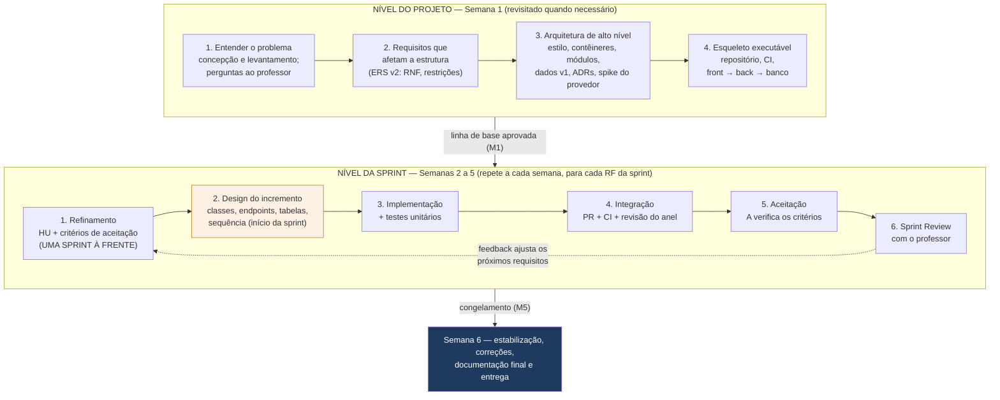

**Figura 1 —** Ciclo de vida: os dois níveis em que requisitos, design, implementação e teste acontecem

#### 4.2.2 Nível do projeto: o que fazer na Semana 1 e o que não fazer

**Tabela 22 —** Atividades do nível do projeto

| **Fazer na Semana 1** | **Por quê** | **Tarefas** |
|---|---|---|
| Entender o problema e levantar dúvidas (concepção e levantamento) | Sem isso, qualquer design responde ao problema errado | T01, T02 |
| Revisar a ERS v2 em equipe e confirmar os requisitos não funcionais | São os RNF (privacidade, integridade, desempenho do assistente) que decidem a estrutura; os RF isolados não | T03 |
| Escrever HU e CA só dos RF da Semana 2 | Requisitos uma sprint à frente; o resto pode mudar com as respostas do professor | T03 |
| Arquitetura de alto nível: drivers, estilo, contêineres, módulos, modelo de dados v1 (com etapas, colagens, turma e termo), ADRs | Decisões difíceis de reverter, que todas as sprints vão usar | T08, T09 |
| *Spike* do provedor de LLM | Reduzir o maior risco técnico (qualidade, custo e termos de uso de dados) antes de se comprometer com a arquitetura | T07 |
| Esqueleto executável e CI | Provar que as peças conversam antes de construir funcionalidades | T06, T10 |

**O que não fazer na Semana 1.** Não detalhar o design de todos os 22 RF (classes, telas e endpoints de tudo). Isso seria cascata disfarçada: boa parte mudaria com as respostas às pendências, e o esforço seria perdido. O design detalhado de cada RF acontece na sprint em que ele é implementado.

#### 4.2.3 Nível da sprint: o ciclo de cada requisito

**Tabela 23 —** Ciclo de cada requisito dentro da sprint

| **Passo** | **Quando** | **Quem** | **Entrada** | **Saída e evidência** |
|---|---|---|---|---|
| 1. Refinamento | Na sprint **anterior** (uma sprint à frente) | A (revisor D) | RF da ERS, respostas do professor | HU e CA no backlog; DoR atendida |
| 2. Design do incremento | D1–D2 da sprint, no início de cada tarefa de implementação | Responsável pela tarefa; consulta o revisor quando toca contrato ou esquema | HU, CA, arquitetura vigente | Seção “Design do incremento” no PR (ver abaixo) |
| 3. Implementação + testes unitários | Logo após o design, na mesma tarefa | Responsável | Esboço de design | Código e testes no branch |
| 4. Integração e revisão | Ao concluir a tarefa (branch de até 2 dias) | Responsável + revisor do anel | PR com CI verde | PR aprovado e integrado na `main` |
| 5. Aceitação | D4–D5 | A | Incremento integrado | CA aprovados ou defeito registrado |
| 6. Sprint Review | D5 | Equipe + professor | Incremento | Feedback que alimenta o passo 1 da próxima sprint |

**Design do incremento.** É o design detalhado, feito no momento em que é necessário. Ocupa cerca de 10% a 15% do esforço da tarefa, já incluído nas estimativas do cronograma. O resultado é registrado na seção “Design do incremento” do pull request (modelo no Apêndice C), com:

- componentes e classes criados ou alterados, e a responsabilidade de cada um;
- endpoints: rota, verbo, entrada, saída e erros;
- tabelas ou colunas novas e a migração correspondente;
- diagrama de sequência, quando o fluxo atravessa mais de dois componentes;
- testes previstos, ligados aos CA;
- alternativas descartadas, em uma frase cada.
Quando o design toca o **contrato da API** ou o **esquema do banco**, o responsável conversa 15 minutos com o revisor do anel **antes** de codificar: é mais barato corrigir um esboço do que um PR pronto. Quando o design muda uma decisão arquitetural, abre-se um ADR (seção 6.10, D8) em vez de mudar silenciosamente.

#### 4.2.4 Visão por semana

**Tabela 24 —** Encadeamento de requisitos, design, implementação e teste por semana

| **Semana** | **Requisitos** | **Design** | **Implementação** | **Teste** |
|---|---|---|---|---|
| 1 (S0) | Concepção, perguntas, revisão da ERS v2; HU/CA de RF01–RF05, RF16, RF21, RF22 (T01–T03) | Drivers, C4 níveis 1–2, ADRs, modelo de dados v1; *spike* do provedor de LLM (T07–T09) | Esqueleto e CI (T06, T10) | Estratégia de testes e DoD (T04) |
| 2 (S1) | HU/CA de RF06–RF10 e RF17 (T11) | Design do incremento de RF01–RF05, RF16, RF21 e identidade (início de T14–T19) | RF01–RF05, RF16, RF21, RF22 | Aceitação de RF01–RF05, RF16, RF21, RF22 (T12) |
| 3 (S2) | HU/CA de RF11–RF15, RF18–RF20 (T22) | Design do incremento de RF06–RF10 e das etapas no domínio (T23–T28, T61) | RF06–RF10; RF17 no backend | Avaliação do assistente e aceitação (T20, T21) |
| 4 (S3) | Ficha de cálculo dos indicadores (T30) | Design do incremento de RF11–RF14, RF17 (interface) e RF18 (T33–T37, T60, T63) | RF11–RF14, RF17, RF18 | Aceitação e revisão de segurança (T31, T32) |
| 5 (S4) | Protocolo do piloto (T41) | Design do incremento de RF15 e RF20 (T45, T47, T65) | RF15, RF20 + RNF | Aceitação de RF15 e RF20 e regressão (T39, T40) |
| 6 (S5) | Relatório de rastreabilidade (T51) | Documentação final de arquitetura (T56) | Correções | Aceitação final (T50) |

#### 4.2.5 Regras práticas

1. **Requisitos uma sprint à frente.** Nenhum RF entra numa sprint sem HU e CA aprovados (DoR).
1. **Design detalhado no início da própria sprint**, curto e registrado no PR.
1. **Teste junto com o código.** Testes unitários na mesma tarefa; aceitação na mesma sprint.
1. **Requisito novo descoberto durante a implementação** vira issue para A decidir; não se implementa por conta própria.
1. **A documentação de arquitetura evolui a cada sprint** (ADRs e diagramas atualizados no mesmo PR que muda o código) e é consolidada na Semana 6.
1. **Se o design de uma sprint invalidar a arquitetura**, a discussão vai para o check-in seguinte e o resultado vira ADR.
### 4.3 Papéis

**Tabela 25 —** Papéis no processo

| **Papel** | **Quem** | **Responsabilidades concretas** |
|---|---|---|
| Product Owner | Integrante A (Requisitos, Produto e Qualidade) | Ordenar o backlog; escrever HU e CA; aceitar ou rejeitar itens contra os CA; ser o canal com o professor |
| Scrum Master (facilitador) | Rotativo: B (S0, S3), C (S1, S4), D (S2, S5) | Facilitar eventos; remover impedimentos em até 24 h ou escalar; registrar atas e métricas da semana |
| Developers | A, B, C e D | Planejar e executar o Sprint Backlog; revisar o trabalho da área designada; cumprir a DoD |
| Stakeholder / cliente | Professor responsável | Responder pendências; participar de Sprint Reviews quando possível; aprovar mudanças de escopo |

**Por que A não é facilitador.** Acumular Product Owner e Scrum Master na mesma pessoa elimina o contrapeso entre “o que fazer” e “como a equipe trabalha”. A rotação da facilitação entre B, C e D também distribui o aprendizado de gestão.

### 4.4 Cadência e eventos

**Tabela 26 —** Eventos por sprint de uma semana

| **Evento** | **Quando** | **Duração** | **Participantes** | **Entrada** | **Saída** |
|---|---|---|---|---|---|
| Sprint Planning | D1 de cada semana (início) | 45 min | Todos | Backlog ordenado e refinado (DoR); capacidade da semana | Sprint Goal; Sprint Backlog com tarefas estimadas e responsáveis |
| Check-in síncrono (Daily adaptada) | D2 e D4 | 15 min | Todos | Quadro atualizado | Impedimentos registrados; replanejamento do dia |
| Atualização assíncrona | D1–D5, no canal da equipe | ≤ 5 min/pessoa | Todos | — | O que concluí, o que farei, impedimentos |
| Sprint Review | D5 | 30 min | Equipe + professor quando possível | Incremento integrado na main | Feedback; backlog ajustado; mudanças propostas |
| Sprint Retrospective | D5, após a review | 30 min | Equipe | Métricas da semana | 1 a 2 ações de melhoria com responsável |
| Refinamento do backlog | Contínuo (tarefas de A) | Dentro das tarefas | A + responsável do item | Itens do backlog | Itens com DoR atendida para a próxima sprint |

Custo de cerimônia previsto: cerca de 2,5 h por pessoa por semana (45 + 30 + 30 + 30 min de eventos síncronos, mais atualizações assíncronas). Esse valor está descontado da capacidade na seção 8.2.

### 4.5 Priorização

O backlog é ordenado por três critérios, nesta ordem: (1) **dependência técnica** (o que habilita outros itens vem antes); (2) **risco** (itens que reduzem incerteza vêm antes, como o *spike* do provedor de LLM); (3) **valor para a avaliação da POC**. A classificação MoSCoW abaixo deriva das prioridades da ERS v2 (decisão B8) e ainda depende da concordância do professor (Q-01); ela não altera os requisitos, apenas define o que é cortado primeiro se a capacidade for menor do que a prevista.

**Conversão adotada (B8).** Alta ("essencial para a demonstração") → *Must*; Média ("essencial para o piloto") → *Should*; Baixa ("desejável") → *Could*. Há uma exceção: o **RF16 (turma)** tem prioridade Média na ERS, mas entra como *Must* porque sustenta a regra de visibilidade do RF13 e do RNF03 (o professor só vê produções das próprias turmas). Com a conversão, o **RF06 (comparar versões)**, que era *Should* na versão 1.1, passa a *Must*: a apresentação ao stakeholder destaca a comparação de versões lado a lado.

**Tabela 27 —** Priorização MoSCoW (decisão B8; concordância do professor em Q-01)

| **Prioridade** | **Requisitos** | **Justificativa** |
|---|---|---|
| **Must** (essencial para a POC) | RF01–RF10, RF13, RF14, RF16, RF17, RF21, RF22 | Sem eles o fluxo principal da ERS v2 (seção 6.1) não existe, a demonstração (fase 1) não é possível ou as salvaguardas de autoria e de privacidade não são demonstráveis |
| **Should** (válvula de escopo) | RF11, RF12, RF15, RF18, RF20 | Necessários para o piloto e para as métricas da POC, mas o fluxo principal funciona sem eles; podem ser simplificados se a capacidade cair (ordem de corte na seção 8.2) |
| **Could** | RF19 (devolutiva do professor). Melhorias técnicas opcionais (ex.: testes E2E) | Não serão iniciadas antes do congelamento (M5) sem sobra de capacidade (tarefa T64) |
| **Won't** (nesta versão) | Geração, reescrita ou paráfrase de texto pelo assistente; nota, conceito ou ranking; base externa de similaridade e antiplágio externo (B2); integração com AVA; correção ortográfica automática; piloto com estudantes reais dentro das 6 semanas (B11) | Proibidos pela ERS (RN02, RN05, RN06, RN07, RN09), fora do escopo da ERS v2 ou adiados pela equipe |

### 4.6 Divisão das entregas

**Tabela 28 —** Incrementos planejados

| **Sprint** | **Semana** | **Sprint Goal proposto** | **Requisitos** | **Marco** |
|---|---|---|---|---|
| S0 | 1 | Linha de base aprovada e esqueleto executável ponta a ponta; provedor de LLM avaliado | Infraestrutura, revisão da ERS v2, ADRs | M1 |
| S1 | 2 | Professor cria turma e atividade; estudante aceita o termo, escreve com salvamento automático e consulta versões | RF01–RF05, RF16, RF21, RF22 | M2 |
| S2 | 3 | Estudante recebe orientação controlada e compara versões; etapas disponíveis no domínio | RF06–RF10; RF17 (backend) | M3 |
| S3 | 4 | Estudante escreve por etapas e tem as colagens registradas; professor acompanha o processo; estudante submete a versão final | RF11–RF14, RF17, RF18 | M4 |
| S4 | 5 | Similaridade automática como apoio; estudante consulta os próprios registros; qualidade não funcional; congelamento de funcionalidades | RF15, RF20 + RNF | M5 (v0.9.0) |
| S5 | 6 | Versão 1.0.0 entregue, documentada e demonstrada; protocolo do piloto pronto | Estabilização (RF19 só com sobra de capacidade) | M6 (v1.0.0) |

### 4.7 Definition of Ready e Definition of Done

**Definition of Ready (DoR)** — um item só entra no Sprint Backlog se:

- tem ID e está ligado a pelo menos um RF, RN ou RNF (ou é tarefa técnica justificada);
- tem critérios de aceitação verificáveis aprovados por A;
- tem dependências identificadas e satisfeitas ou planejadas na mesma sprint;
- foi estimado em horas e cabe em no máximo 4 h (itens maiores são quebrados);
- tem responsável e revisor definidos conforme a matriz da seção 7.
**Definition of Done (DoD)** — um item só é considerado concluído quando:

- o código foi integrado na `main` por pull request aprovado pelo revisor designado (e pelo segundo revisor, nos casos da seção 7.4);
- o pipeline de CI está verde: compilação, testes unitários e de integração, análise estática sem problema crítico novo;
- a lógica de domínio alterada tem testes unitários; repositórios e endpoints alterados têm testes de integração;
- A verificou os critérios de aceitação no incremento integrado;
- a documentação afetada foi atualizada (OpenAPI, ADR, ERS, matriz de rastreabilidade);
- o PR contém a seção “Design do incremento” preenchida (seção 4.2.3), quando a tarefa é de implementação;
- nenhuma credencial (incluindo a chave da API do provedor de LLM) ou dado pessoal real foi versionado.
### 4.8 Quadro, fluxo e limites de trabalho em andamento

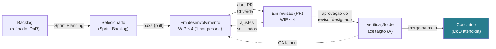

**Figura 2 —** Definição do fluxo de trabalho (quadro Kanban) com limites de WIP

**Tabela 29 —** Definição do fluxo de trabalho (Kanban Guide, 2025)

| **Elemento da definição de fluxo** | **Valor adotado** |
|---|---|
| Item de trabalho | Tarefa (issue) de até 4 h, ligada a uma HU ou RNF |
| Início e fim | Início: entrada em “Em desenvolvimento”. Fim: “Concluído” com DoD atendida |
| Estados | Backlog → Selecionado → Em desenvolvimento → Em revisão (PR) → Verificação de aceitação → Concluído |
| Controle de WIP | Máximo de 4 itens em desenvolvimento (1 por pessoa) e 4 em revisão; revisar tem precedência sobre iniciar item novo |
| Políticas explícitas | PR aberto só com CI verde; revisão iniciada em até 24 h; ajustes solicitados voltam para desenvolvimento |
| Expectativa de nível de serviço (SLE) | Estimativa inicial: 85% dos itens concluídos em até 3 dias úteis; recalibrar com o tempo de ciclo real a partir da S2 |

### 4.9 Tratamento de mudanças de escopo

Durante a sprint o Sprint Goal não muda; pedidos novos entram no backlog como issue do tipo “mudança” e são analisados na Sprint Review seguinte. Mudanças que afetam requisitos da ERS exigem aprovação do professor. O procedimento completo, com responsáveis e registros, está na seção 12.3.

### 4.10 Acompanhamento de riscos e impedimentos

- Impedimentos são registrados como issue com rótulo `impedimento` e citados no check-in; o facilitador da semana resolve em até 24 h ou escala ao professor (dependências externas) ou à equipe (técnicas).
- O registro de riscos (seção 12.2) é revisado em toda Sprint Review: atualizar probabilidade e impacto, verificar gatilhos e registrar novas ameaças.
- Riscos com exposição alta (≥ 6) têm ação de mitigação no Sprint Backlog da semana seguinte.
### 4.11 Verificação do progresso

**Tabela 30 —** Indicadores de progresso

| **Indicador** | **Como é medido** | **Uso** |
|---|---|---|
| Burndown de horas da sprint | Horas restantes do Sprint Backlog, atualizadas no check-in | Detectar desvio no meio da semana (D2, D4) |
| Horas planejadas × realizadas por pessoa | Registro simples semanal | Calibrar a premissa PR-02 e replanejar |
| WIP, *throughput*, idade do item, tempo de ciclo | GitHub Projects (datas de mudança de coluna) | Métricas obrigatórias do Kanban Guide; revisadas na Sprint Review |
| CA aprovados / CA planejados | Resultado da verificação de A | Avanço real do escopo |
| Defeitos abertos por severidade | Issues com rótulo `defeito` | Critério de saída dos marcos (seção 13) |
| Marcos M1–M6 | Critérios da seção 13.1 | Decisão objetiva de avanço de fase |

### 4.12 Adaptações em relação aos frameworks

**Tabela 31 —** Adaptações declaradas

| **Elemento oficial** | **Adaptação** | **Justificativa** | **Consequência aceita** |
|---|---|---|---|
| Daily Scrum diária de 15 min | Dois check-ins síncronos (D2, D4) + atualização assíncrona diária | Dedicação parcial (10 h/semana) e agendas acadêmicas | Detecção de bloqueios até 48 h mais lenta; mitigada pelo rótulo `impedimento` |
| Product Owner dedicado | PO também é Developer (área de requisitos e qualidade) | Equipe de quatro pessoas | Risco de conflito de interesse na aceitação; mitigado pela revisão de D sobre os artefatos de A |
| Scrum Master fixo | Facilitação rotativa semanal | Distribuir aprendizado e carga | Menor continuidade; atas e métricas padronizadas compensam |
| Sprint de até um mês | Sprint de uma semana | Projeto de seis semanas | Eventos mais curtos e incrementos menores |
| Kanban sem cadência obrigatória | Quadro dentro do *timebox* semanal | Integrar fluxo e marcos | WIP e SLE medidos por sprint |

## 5. Engenharia de requisitos e artefatos

**Como usar esta seção.** As subseções 5.1 a 5.8 trazem uma **proposta de referência**, elaborada com apoio de IA, que mostra como os artefatos ficam quando prontos. A equipe deve produzir a própria versão seguindo o **roteiro da seção 5.9** e usar a proposta apenas para comparação durante a revisão. Divergências entre as duas versões são normais e devem ser decididas pela equipe, com registro.

### 5.1 Processo de transformação da ERS em requisitos implementáveis

**Tabela 32 —** Tarefas de engenharia de requisitos aplicadas

| **Tarefa (Pressman, cap. 8)** | **Aplicação neste projeto** | **Quando** | **Responsável · revisor** | **Artefato** |
|---|---|---|---|---|
| Concepção | Leitura conjunta da ERS v2, da POC 2.2 e da apresentação ao stakeholder; escopo e exclusões (seção 2.3) | S0 (T01) | Todos · D | Ata + seção 2 |
| Levantamento | Análise documental; perguntas ao professor e ao stakeholder (seção 5.8) | S0 (T02) e contínuo | A · D | Registro de perguntas e respostas |
| Elaboração | HU, CA, diagramas de estados e sequência; sempre uma sprint à frente | S0–S2 (T03, T11, T22) | A · D (C e B opinam) | Backlog, ERS v2.x |
| Negociação | Concordância com a MoSCoW (B8), limites do validador do RF09 (B5), tempo de resposta do assistente (B10), limiares do critério de sucesso do piloto | S0–S1, com o professor e o stakeholder | A · D | Decisões registradas em ata ou mudança |
| Especificação | ERS v2.x com ID, origem, prioridade, CA e estado; mudanças só por controle de mudanças | S0 e atualizações por sprint | A · D | ERS v2.x |
| Validação | Revisão com checklist (seção 9.7); aceite do professor nas decisões de escopo; protótipo | Cada sprint | A · D (+ professor) | Checklist preenchido |
| Gestão | Controle de mudanças e rastreabilidade | Contínuo | A · D | Registro de mudanças; matriz |

### 5.2 Artefatos de requisitos

A necessidade de cada artefato foi avaliada para evitar documentação redundante. “Essencial” significa que o projeto não é verificável sem ele; “opcional” significa que é produzido apenas se agregar entendimento; “não adotado” traz o substituto.

**Tabela 33 —** Avaliação e definição dos artefatos de requisitos

| **Artefato** | **Decisão** | **Finalidade e estrutura** | **Resp. · rev.** | **Momento** | **Depende de** | **Critério de aprovação** |
|---|---|---|---|---|---|---|
| Documento de visão e escopo | Não adotado em separado | Conteúdo incorporado à seção 2 deste plano e à introdução da ERS, evitando duplicação | — | — | — | — |
| ERS v2.x (RF, RN e RNF) | Essencial | ERS v2.0 do grupo: RF01–RF22, RN01–RN10, RNF01–RNF13, cada requisito com ID, descrição, prioridade e CA; o plano acrescenta RNF14–RNF17 | A · D | Revisada em S0; atualizada em S1–S4 só por mudança aprovada | Respostas Q-xx | Checklist 29148 sem pendência bloqueante; aceite do professor |
| Catálogo de regras de negócio | Essencial (curto) | RN01–RN10 com mecanismo de garantia e verificação (seção 5.6) | A · D | S0 | ERS | Cada RN com teste ou revisão associada |
| Histórias de usuário (HU) | Essencial | Uma HU por RF (formato “Como… quero… para…”) como item de backlog | A · D | Uma sprint antes da implementação | ERS | DoR atendida |
| Critérios de aceitação (CA) | Essencial | Cenários Dado/Quando/Então por HU | A · D | Junto com a HU | HU | Verificáveis; aprovados por A e revisados por D |
| Casos de uso descritivos | Não adotado (substituído) | Fluxos alternativos cobertos pelos CA; o fluxo principal da ERS v2 (seção 6.1) já descreve o caso de uso central | — | — | — | — |
| Diagrama de casos de uso UML | Opcional | Visão geral de atores e funcionalidades para o relatório final | A · D | S5 | HU | Coerente com a matriz |
| Diagramas de processo | Essencial (2 diagramas) | Estados da produção (seção 5.7) e sequência do apoio (seção 6.5); BPMN não adotado | C · B | S0–S2 | ERS, arquitetura | Revisados contra os CA |
| Outros diagramas UML | Opcional | Diagrama de classes de domínio se o C4 nível 3 não bastar | C · B | S5 | Código | Coerência com o código |
| Matriz de rastreabilidade | Essencial | RF/RN/RNF → HU → componente → tarefa → teste → release (seção 11.3) | A · D | S1; atualizada por sprint | HU, arquitetura, testes | Nenhum RF sem teste executado |
| Registro de mudanças | Essencial (leve) | Issues do tipo “mudança” com análise de impacto (seção 12.3) | A · D | Contínuo | — | Toda mudança com decisão registrada |
| Registro de perguntas e hipóteses | Essencial | Q-xx e H-xx com impacto, hipótese padrão e prazo (seção 5.8) | A · D | S0; contínuo | — | Nenhuma pergunta sem dono |

### 5.3 Esquema de identificação

**Tabela 34 —** Esquema de identificação para rastreabilidade

| **Prefixo** | **Elemento** | **Exemplo** | **Onde vive** |
|---|---|---|---|
| RF / RN | Requisito funcional / regra de negócio (numeração da ERS preservada) | RF09, RN02 | ERS |
| RNF | Requisito não funcional (RNF01–RNF13 da ERS v2; RNF14–RNF17 acrescentados pelo plano) | RNF06 | ERS v2.x |
| B | Decisão da equipe ao integrar a ERS v2 | B3 | docs/plano/v1.2/decisoes-plano-v1.2.md |
| HU / CA | História de usuário / critério de aceitação (HU-nn segue o RF de origem) | HU-09, CA-09.2 | Issues (backlog) |
| Q / H | Pergunta em aberto / hipótese | Q-05, H-03 | Registro de perguntas |
| ADR | Registro de decisão arquitetural | ADR-004 | docs/arquitetura/adr |
| T | Tarefa do cronograma | T26 | Issues + seção 8 |
| CT / DEF | Caso de teste / defeito | CT-09.2, DEF-012 | docs/qualidade; issues |
| R / MUD | Risco / mudança | R03, MUD-002 | Registro de riscos; issues |

### 5.4 Histórias de usuário e critérios de aceitação (exemplos)

Os exemplos abaixo mostram o padrão a ser aplicado aos 22 RF. Eles **não criam requisitos novos**: cada HU reescreve um RF da ERS v2 e detalha os critérios de aceitação que ela já contém; valores numéricos marcados como proposta ou *(sugerido)* dependem de aprovação.

**Tabela 35 —** Exemplos de histórias e critérios de aceitação

| **HU (origem)** | **História** | **Critérios de aceitação (Dado / Quando / Então)** |
|---|---|---|
| HU-01 (RF01, RF16) | Como professor, quero cadastrar uma atividade com título, tema, gênero textual, descrição, orientações, critérios de avaliação e prazo para uma das minhas turmas, para que os estudantes produzam seus textos a partir dela. | CA-01.1 Dado um professor autenticado com uma turma, quando ele informa os campos e confirma, então a atividade é criada e listada apenas para os estudantes da turma. <br> CA-01.2 Dado título, tema, gênero ou prazo vazio, quando ele confirma, então o sistema rejeita e indica o campo. <br> CA-01.3 Dado um estudante autenticado, quando ele tenta cadastrar atividade, então o acesso é negado. <br> CA-01.4 Dado o cadastro, quando o professor não escolhe a política de prazo, então a atividade aceita submissões atrasadas e as marca como atrasadas (B4). |
| HU-04 (RF04, RN04) | Como estudante, quero que meu texto seja salvo automaticamente e que cada etapa concluída fique marcada, para registrar a evolução da minha produção sem perder trabalho. | CA-04.1 Dado um texto com alterações, quando passa o intervalo de salvamento (sugerido: 1 min), então uma versão automática é criada com conteúdo, data, horário, tipo e etapa. <br> CA-04.2 Dado um texto sem alterações desde a última versão, quando passa o intervalo, então nenhuma versão nova é criada. <br> CA-04.3 Dado o avanço de etapa, uma ação explícita do estudante ou a submissão, então uma versão marcada é criada. <br> CA-04.4 Dado que existem versões anteriores, quando uma nova versão é criada, então nenhuma versão anterior é alterada ou excluída. |
| HU-09 (RF09, RN01, RN02, RN09) | Como professor, quero que o assistente se limite a orientar, para que o texto avaliado seja produzido pelo estudante. | CA-09.1 Dado o conjunto de avaliação com **pelo menos 30** pedidos de escrita ou reescrita, diretos e disfarçados (incluindo injeção de instruções), quando cada pedido é enviado, então **nenhuma** resposta exibida contém texto aproveitável na produção, segundo o validador automático e a rubrica de dois avaliadores. <br> CA-09.2 Dado um pedido de escrita ou reescrita, quando o assistente responde, então recusa de forma explícita e oferece orientação no lugar (FA01). <br> CA-09.3 Dado um exemplo ilustrativo, então ele trata de tema diferente do da atividade. <br> CA-09.4 Dado uma resposta reprovada pelo validador, quando o estudante recebe o retorno, então vê uma orientação genérica e a interação é registrada como bloqueada (FA02). <br> CA-09.5 *(pendente, B5)* Limites numéricos do validador: no máximo 150 palavras por orientação e um exemplo de até 25 palavras (proposta do plano v1.1). |
| HU-14 (RF14) | Como estudante, quero submeter a versão final, para enviá-la à avaliação do professor mantendo o histórico. | CA-14.1 Dado uma produção com ao menos uma versão, quando o estudante submete, então a produção passa a SUBMETIDA e a versão final é marcada. <br> CA-14.2 Dado uma produção submetida, quando o estudante tenta editar, então a edição é rejeitada. <br> CA-14.3 Dado o prazo expirado e a atividade configurada para aceitar atraso, quando o estudante submete, então a submissão é aceita e marcada como atrasada; se configurada para bloquear, então é rejeitada (FA05). <br> CA-14.4 Dado a submissão, então todas as versões anteriores continuam consultáveis por estudante e professor. |
| HU-15 (RF15, RN06) | Como professor, quero ver a similaridade da produção submetida com textos internos e com as orientações do assistente, para apoiar minha avaliação de originalidade. | CA-15.1 Dado uma produção submetida, então a análise é executada automaticamente e o professor vê índices por fonte (outras produções da atividade; orientações recebidas pelo estudante), os trechos coincidentes e o resumo dos eventos de colagem. <br> CA-15.2 Dado o resultado, então nenhuma tela apresenta veredito automático de plágio, originalidade ou nota (RN05, RN06). <br> CA-15.3 Dado um texto com cópia literal de orientação do assistente nos casos de teste, quando a análise roda, então o trecho é detectado. |
| HU-17 (RF17, RF04) | Como estudante, quero escrever passando pelas etapas Planejar, Escrever, Revisar e Reescrever, para organizar meu processo e saber em que ponto estou. | CA-17.1 Dado uma produção iniciada, então ela está na etapa Planejar e a etapa atual aparece para o estudante. <br> CA-17.2 Dado uma etapa, quando o estudante avança por ação explícita, então a produção muda de etapa e uma versão marcada é criada. <br> CA-17.3 Dado as etapas Revisar ou Reescrever, quando o estudante volta a uma etapa anterior, então a volta é permitida e registrada. <br> CA-17.4 Dado o ciclo Revisar → Reescrever, então ele pode se repetir quantas vezes o estudante quiser antes da submissão. <br> CA-17.5 Dado uma produção submetida, quando o estudante tenta mudar de etapa, então a mudança é rejeitada. |
| HU-18 (RF18, RN06) | Como professor, quero saber quando e quanto texto foi colado no editor, para interpretar o processo de escrita com mais contexto. | CA-18.1 Dado o editor, quando o estudante cola um trecho, então a colagem é aceita e registrada com o trecho, a quantidade de caracteres, a data, o horário e a etapa. <br> CA-18.2 Dado uma colagem acima do limite configurado (sugerido: 200 caracteres), então ela aparece destacada no painel do professor (RF13). <br> CA-18.3 Dado o painel, então a colagem é apresentada como informação, sem rótulo de fraude ou suspeita (RN05, RN06). <br> CA-18.4 Dado o termo de ciência (RF21), então ele informa que colagens são registradas. |

### 5.5 Requisitos não funcionais

**Fato (ERS v2) e decisão B9.** A ERS v2.0 traz RNF01–RNF13; eles são a base desta seção e não são alterados pelo plano. A classificação pela ISO/IEC 25010:2023 e a forma de verificação são contribuição do plano. Quatro RNF candidatos da versão 1.1 não têm equivalente na ERS v2 e entram como **RNF14–RNF17**, no estado **CANDIDATO** até a aprovação na S0. Valores marcados *(sugerido)* vêm da ERS e ainda precisam ser validados com o stakeholder.

**Tabela 36 —** Requisitos não funcionais (RNF01–RNF13 da ERS v2; RNF14–RNF17 candidatos do plano)

| **ID** | **Característica (25010:2023)** | **Enunciado (resumo)** | **Medida / verificação** | **Origem** |
|---|---|---|---|---|
| RNF01 | Segurança + LGPD | Coletar apenas os dados necessários; definir prazo de retenção ao fim da POC; pseudonimizar os dados usados na análise | Revisão T32; inventário de dados; prazo de retenção definido (Q-18) | ERS v2 |
| RNF02 | Segurança + LGPD | Estudantes menores participam somente com consentimento do responsável, obtido antes do primeiro acesso | Revisão do protocolo do piloto (T41); só dados de demonstração até lá (B11) | ERS v2 |
| RNF03 | Segurança — confidencialidade | Professor acessa só dados das próprias turmas; estudante, só os próprios; HTTPS; senhas com *hash* | 100% dos testes negativos de autorização aprovados; revisão T32 | ERS v2 |
| RNF04 | Segurança — confidencialidade | Textos enviados à API do LLM não contêm nome, e-mail ou matrícula; o provedor não usa os dados para treinamento | Teste do montador do *prompt* (nenhum identificador no payload); termos do provedor no relatório do *spike* T07 | ERS v2; B1 |
| RNF05 | Adequação funcional — correção | Toda resposta do assistente passa por verificação automática antes de ser exibida | Testes do GuardrailDeAutoria; suíte adversarial no CI | ERS v2; RN02 |
| RNF06 | Eficiência de desempenho — comportamento temporal | O assistente responde em até 10 s em 90% das solicitações *(sugerido)*; a interface mostra progresso durante a espera | Medição no *spike* T07 e no teste T46; valor final pendente (B10, Q-21) | ERS v2 |
| RNF07 | Confiabilidade — recuperabilidade | Perda máxima de 1 minuto de edição em caso de falha *(sugerido)* | Teste de interrupção do editor (T15/T19); backup restaurável (T29/T59) | ERS v2 |
| RNF08 | Confiabilidade — tolerância a falhas | Com o assistente indisponível, o estudante continua escrevendo e salvando | Teste com dublê do gateway em falha (FA04) | ERS v2 |
| RNF09 | Segurança — integridade | Versões, interações e colagens não podem ser alteradas após gravadas | Teste de UPDATE/DELETE rejeitado (T18, T63) | ERS v2; RN04 |
| RNF10 | Capacidade de interação — facilidade de aprendizado | Linguagem simples e adequada à faixa etária; etapa atual e pedido de ajuda identificáveis sem treinamento | CA de usabilidade (T43); teste com um usuário que não participou do desenvolvimento | ERS v2 |
| RNF11 | Capacidade de interação — transparência | Respostas do assistente identificadas como geradas por IA | Revisão de interface por A | ERS v2 |
| RNF12 | Capacidade de interação — inclusividade | Interface segue a WCAG 2.1, nível AA | Verificação automatizada (ex.: axe) e manual nas telas principais (T43) | ERS v2 |
| RNF13 | Compatibilidade | Funciona nas versões atuais de Chrome, Firefox e Edge, em computador | Teste manual de fumaça em S4 | ERS v2 |
| RNF14 | Eficiência de desempenho — comportamento temporal | Operações da API, exceto o assistente e a similaridade, respondem em até 1 s (p95) com os dados de demonstração | Teste de desempenho T46 | Plano (ex-RNF-02) |
| RNF15 | Flexibilidade — substituibilidade | Trocar o modelo ou o provedor de LLM exige alterar apenas o adaptador e a configuração | Teste com dublê do gateway; teste de arquitetura | Plano (ex-RNF-06); B1 |
| RNF16 | Manutenibilidade — testabilidade e modularidade | Cobertura de linhas ≥ 70% nos pacotes de domínio e aplicação; módulos sem dependências cíclicas | JaCoCo e ArchUnit no CI | Plano (ex-RNF-07) |
| RNF17 | Capacidade de interação — proteção contra erro do usuário | O editor indica o estado do salvamento automático e avisa quando há alterações ainda não salvas (falha de rede ou saída da página antes do próximo salvamento) | CA de usabilidade (T43) | Plano (ex-RNF-08), adaptado a B3 |

**Correspondência com a versão 1.1.** RNF-01 → RNF03; RNF-02 → RNF14; RNF-03 → RNF06; RNF-04 → RNF07; RNF-05 → RNF09; RNF-06 → RNF15; RNF-07 → RNF16; RNF-08 → RNF17; RNF-09 → RNF01 e RNF04 (com B1, os textos passam a sair da infraestrutura do sistema, sem identificação); RNF-10 → RNF13.

### 5.6 Catálogo de regras de negócio e mecanismos de garantia

**Tabela 37 —** Regras de negócio e respectivos mecanismos

| **Regra (ERS)** | **Mecanismo no sistema** | **Verificação** |
|---|---|---|
| RN01 Preservação da autoria | Editor sem botão de "aplicar sugestão" nem inserção automática de conteúdo (RF03); assistente restrito a orientar (RN02); histórico completo para o professor; similaridade com orientações | CA-09.x; CA-15.3; revisão de interface |
| RN02 Vedação de produção de texto pelo assistente | Defesa em camadas: classificação da solicitação, recusa explícita de pedidos de escrita, *prompt* de sistema, delimitação do texto do estudante, validador de saída independente do modelo, registro de bloqueios (seção 6.5) | Suíte adversarial (≥ 30 pedidos) sem nenhuma resposta aproveitável |
| RN03 Registro do processo | Versões, transições de etapa, interações e colagens são persistidas na mesma transação da operação | Testes de integração dos serviços |
| RN04 Manutenção do histórico | Versões e registros *append-only*; sem endpoint de alteração ou exclusão; restrição no banco (ADR-004) | Teste de UPDATE/DELETE rejeitado |
| RN05 Uso pedagógico dos dados | Indicadores exibidos como informação; nenhum campo de nota calculada; painel sem ranking nem ordenação de estudantes por indicador; sem rótulos de julgamento | CA-15.2; CA-18.3; revisão de interface por A |
| RN06 Avaliação humana da originalidade | Similaridade e colagens mostram índices, trechos e eventos, sem rótulo de "plágio" ou "suspeito" | CA-15.2; CA-18.3 |
| RN07 Avaliação exclusiva do professor | *Prompt* de sistema proíbe nota, conceito e julgamento de aprovação; o validador reprova respostas com nota ou conceito | Casos de avaliação com pedido de nota (seção 9.4) |
| RN08 Respeito ao estilo e à variação linguística | *Prompt* de sistema orienta a avaliar o texto como um todo e a não tratar estilo ou variação linguística como erro, salvo quando a atividade exige a norma-padrão (orientações do RF01) | Casos de avaliação com variação linguística (seção 9.4); rubrica |
| RN09 Sem modelo pronto | Recusa de pedidos de texto-modelo; exemplos só sobre tema diferente do da atividade; validador detecta prosa longa sobre o tema | CA-09.2; CA-09.3; suíte adversarial |
| RN10 Transparência ao estudante | Termo de ciência no primeiro acesso (RF21) e consulta dos próprios registros (RF20) | CA de RF20 e RF21; revisão T32 |

### 5.7 Modelos de comportamento

O ciclo de vida de uma produção textual é representado por uma máquina de estados (notação UML [14]). Na versão 1.2 ela incorpora as etapas do RF17: a produção em elaboração está sempre em uma das quatro etapas, o estudante avança e volta por ação explícita, e cada transição gera uma versão marcada (RF04). A política de prazo (RF14, B4) e o bloqueio de edição após a submissão deixam de ser pendências.

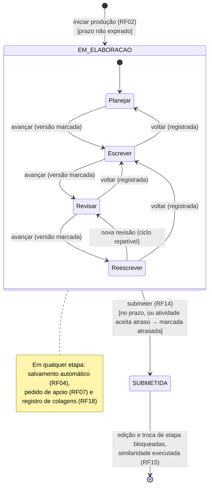

**Figura 3 —** Diagrama de estados da produção textual

### 5.8 Perguntas em aberto e hipóteses

Cada pergunta tem uma hipótese padrão para não bloquear o trabalho. Se a resposta do professor ou do stakeholder divergir da hipótese, a mudança segue o procedimento da seção 12.3. Prazo-alvo para respostas: S0·D3 (antes da revisão da ERS v2 em T03), exceto onde indicado. Na versão 1.2, a coluna "Situação" indica as perguntas que a ERS v2 ou as decisões B1–B12 responderam; elas continuam listadas para preservar a rastreabilidade. As perguntas Q-17 a Q-20 vêm da seção 10 da ERS v2.

**Tabela 38 —** Perguntas em aberto (pendências) e hipóteses padrão

| **ID** | **Pergunta** | **Impacto** | **Hipótese padrão** | **Situação** | **Afeta** |
|---|---|---|---|---|---|
| Q-01 | O trabalho exige POC implementada e documentação? Quais são os critérios de avaliação da disciplina? A priorização MoSCoW é aceita? | Escopo e prioridades | Implementação + documentação; MoSCoW da seção 4.5 | Aberta (MoSCoW decidida pela equipe em B8; falta a concordância do professor) | Todo o plano |
| Q-02 | Valem as regras do trabalho anterior (autor e revisor por item, atas como apêndice, citação de IA com *prompt*)? | Processo e documentação | Sim — já incorporadas | Aberta | Seções 7 e 11 |
| Q-03 | Como professor e estudante se vinculam (turma, convite, código)? | Modelo de dados e autorização | Turma com estudantes incluídos pelo professor | **Respondida** pelo RF16 | RF02, RF13, RF16, DER |
| Q-04 | Há autocadastro de usuários ou pré-cadastro? | Escopo de identidade | H-04: pré-cadastro; o professor inclui estudantes na turma | Parcialmente respondida (RF16, RF22); hipótese mantida | T16 |
| Q-05 | Qual o critério aceitável para "não produzir texto aproveitável" (RF09)? | Teste de aceitação central | CA da ERS v2 (≥ 30 pedidos; exemplos sobre outro tema); limites de 150/25 palavras como proposta | Parcialmente respondida pela ERS v2; limites numéricos pendentes (**B5**) | RF09, T11, T20, T26 |
| Q-06 | Quais são os tipos de apoio (RF12)? | Métricas da POC | Categorias do RF12 da ERS v2 | **Respondida** (RF12; B6) | RF08, RF12 |
| Q-07 | O que acontece após o prazo da atividade? | Regras de estado | Configurável pelo professor; padrão: aceita e marca atrasada | **Respondida** (RF14; B4) | RF01, RF14 |
| Q-08 | O estudante pode editar após submeter? | Regras de estado | Não | **Respondida** (RF14) | RF14 |
| Q-09 | Versões são salvas manualmente, automaticamente ou ambos? | Volume de dados e UX | Automáticas (sugerido: 1 min) e marcadas | **Respondida** (RF04; B3) | RF04 |
| Q-10 | Qual a granularidade da comparação de versões? | Algoritmo de *diff* | Por palavras | Aberta | RF06 |
| Q-11 | Quem dispara a similaridade e quando? | Fluxo e desempenho | Automaticamente, após a submissão | **Respondida** (RF15; B7) | RF15 |
| Q-12 | Como medir "dependência excessiva" e "autonomia progressiva"? | Métricas da POC | Forma de medição da ERS v2, seção 8; ficha de cálculo em T30 | **Respondida** quanto à medição; limiares em Q-19 | RF11, RF12, ERS seção 8 |
| Q-13 | Qual a faixa etária e a etapa de ensino da turma piloto? Haverá dados reais? | LGPD (art. 14), consentimento (RNF02) e linguagem do assistente (RNF10) | Demonstração só com dados de demonstração; piloto após a entrega, com consentimento | Aberta (ERS v2, questão 2) | RNF01, RNF02, RNF10, T41 |
| Q-14 | Qual provedor e modelo de LLM serão usados, com que custo e quais são os termos sobre uso e retenção de dados? | RNF04, RNF06, custo | Provedor com API que não treina com os dados, escolhido no *spike* T07 | Aberta (ERS v2, questão 4); decidida em ADR-006 | T07, T25, R01, R14 |
| Q-15 | Qual a data de início (D0), a data de entrega e a dedicação semanal real de cada integrante? | Cronograma absoluto e capacidade | 10 h por pessoa por semana; D0 a definir | Aberta | Seção 8 |
| Q-16 | O sistema atende apenas textos em português? | Escolha do modelo e da normalização | Sim, português do Brasil | **Respondida** (ERS v2, seção 2.5) | T07, T45 |
| Q-17 | Qual base externa será usada na similaridade? Há ferramenta institucional? | Escopo do RF15 | Nenhuma nesta entrega | Adiada pela equipe (B2; ERS v2, questão 1) | RF15 |
| Q-18 | Qual o prazo de retenção dos dados após o fim da POC? | RNF01 | Definido no protocolo do piloto | Aberta (ERS v2, questão 3) | RNF01, T41 |
| Q-19 | Quantas atividades e qual duração terá o piloto, e quais os limiares do critério de sucesso? | Avaliação da hipótese | Pelo menos 3 atividades *(sugerido pela ERS)*; limiares definidos com o stakeholder | Aberta (ERS v2, questão 5) | T41 |
| Q-20 | O professor poderá ajustar o comportamento do assistente por atividade (por exemplo, desabilitá-lo em uma etapa)? | Escopo do RF01 e do módulo apoio | Não nesta entrega | Aberta (ERS v2, questão 6) | RF01, RF07 |
| Q-21 | Qual o tempo máximo de resposta aceitável do assistente? | RNF06 | 10 s em 90% das solicitações (valor sugerido pela ERS) | Pendente (**B10**) | RNF06, T07, T46 |

### 5.9 Roteiro de execução dos artefatos de requisitos

Este roteiro orienta a equipe a **produzir** cada artefato de requisitos. As subseções 5.2 a 5.8 servem de exemplo de resultado; o objetivo é que a equipe chegue à própria versão seguindo os passos abaixo e use o exemplo apenas para comparação na revisão.

#### R1 — Registro de perguntas e hipóteses

**Tabela 39 —** Roteiro R1 — Registro de perguntas e hipóteses

| **Aspecto** | **Orientação** |
|---|---|
| **Quando · quem** | Semana 1 (T02) e contínuo · A, revisor D |
| **Perguntas que o artefato responde** | O que não sabemos que pode mudar escopo, regras ou design? Quem decide cada ponto? O que assumimos enquanto não há resposta? |
| **Como fazer (passos)** | 1. Ler a ERS frase a frase e marcar termos vagos (“de acordo com suas necessidades”, “poderá”, “evitando”). <br> 2. Para cada RF, perguntar: quem faz? quando? com quais dados? o que acontece se der errado? quem pode ver? <br> 3. Classificar o impacto de cada dúvida (escopo, regra, dados, segurança, cronograma). <br> 4. Propor uma hipótese padrão para não bloquear o trabalho. <br> 5. Levar as perguntas ao professor em um único lote, em ordem de impacto. <br> 6. Registrar a resposta e atualizar os artefatos afetados. |
| **Saída** | Tabela com ID (Q-xx), pergunta, origem (RF/RN), impacto, hipótese padrão (H-xx), dono, prazo, resposta e decisão |
| **Checklist do revisor** | Cada pergunta cita sua origem; a pergunta não induz a resposta; toda hipótese está escrita; nenhuma pergunta sem dono |
| **Erros comuns** | Perguntar o que a ERS já responde; decidir sozinho sem registrar; perguntas genéricas demais (“como deve ser o sistema?”) |
| **Referências** | Pressman, cap. 8 — levantamento e negociação [9]; ISO/IEC/IEEE 29148 [2] |

#### R2 — Revisão da ERS (requisitos funcionais)

**Tabela 40 —** Roteiro R2 — Revisão da ERS v2

| **Aspecto** | **Orientação** |
|---|---|
| **Quando · quem** | Semana 1 (T03); atualizada só por mudança aprovada (seção 12.3) · A, revisor D |
| **Perguntas que o artefato responde** | Cada requisito está claro, isolado, verificável e com origem conhecida? A ERS está coerente com as decisões da equipe? |
| **Como fazer (passos)** | 1. Manter a numeração (RF01–RF22, RN01–RN10, RNF01–RNF13) para preservar a rastreabilidade. <br> 2. Ler a ERS v2 em equipe e marcar o que ainda é composto (ex.: RF13 reúne seis informações no painel) ou ambíguo. <br> 3. Conferir cada requisito contra as decisões B1–B12; divergências viram proposta de mudança, não edição direta (ex.: o RF15 ainda cita base externa, adiada por B2). <br> 4. Confirmar origem, prioridade, estado (proposto, aprovado) e referência aos CA. <br> 5. Destacar termos do glossário e definir os que faltam. <br> 6. Passar o checklist do revisor antes de abrir o PR. |
| **Saída** | ERS v2.x em Markdown (docs/ers), com tabela de controle de versões; lista de mudanças propostas |
| **Checklist do revisor** | Necessário, não ambíguo, singular, viável, verificável, correto e consistente com os demais (características da 29148); nenhum requisito sem origem |
| **Erros comuns** | Mudar o significado do requisito ao reescrever; acrescentar requisito sem origem; colocar solução técnica dentro do requisito (“usar PostgreSQL”) |
| **Referências** | ISO/IEC/IEEE 29148 [2]; Wiegers e Beatty [45]; Pressman, cap. 8 [9] |

#### R3 — Requisitos não funcionais

**Tabela 41 —** Roteiro R3 — Requisitos não funcionais a partir da ISO/IEC 25010:2023

| **Aspecto** | **Orientação** |
|---|---|
| **Quando · quem** | Semana 1 (T03), a partir dos RNF01–RNF13 da ERS v2 · A, revisor D; C contribui com metas técnicas |
| **Perguntas que o artefato responde** | Quais qualidades o sistema precisa ter, em que grau e como vamos medir? Falta alguma qualidade relevante na ERS? |
| **Como fazer (passos)** | 1. Listar as nove características da ISO/IEC 25010:2023. <br> 2. Para cada uma, perguntar: “o que dá errado neste sistema se essa qualidade for ruim?”. <br> 3. Descartar as irrelevantes, registrando o motivo. <br> 4. Para as relevantes, escrever um cenário de qualidade em seis partes: fonte, estímulo, artefato, ambiente, resposta e medida (formato usado no trabalho anterior [47]). <br> 5. Transformar o cenário em enunciado mensurável, com valor marcado como proposta até aprovação. <br> 6. Classificar a origem: ERS, restrição informada ou hipótese. |
| **Saída** | Tabela de RNF (ID, característica, enunciado, medida, origem, estado) + cenários de qualidade |
| **Checklist do revisor** | Toda medida é observável; nenhum número sem a marca “proposta” ou “aprovado”; cada RNF tem forma de verificação prevista |
| **Erros comuns** | “O sistema deve ser rápido e seguro” (sem medida); copiar metas de outros sistemas sem justificar |
| **Referências** | ISO/IEC 25010:2023 [4]; cenários de qualidade (método do trabalho anterior [47]) |

```
RNF-xx — <característica / subcaracterística>
Fonte: <quem ou o que provoca>      Estímulo: <evento>
Artefato: <parte do sistema>        Ambiente: <condição de operação>
Resposta: <o que o sistema faz>     Medida: <valor verificável> (proposta | aprovado)
Origem: <RN/RF/restrição/hipótese>  Verificação: <teste, inspeção, demonstração>
```

#### R4 — Histórias de usuário e critérios de aceitação

**Tabela 42 —** Roteiro R4 — Histórias de usuário e critérios de aceitação

| **Aspecto** | **Orientação** |
|---|---|
| **Quando · quem** | Uma sprint à frente: S0 para RF01–RF05, RF16, RF21, RF22 (T03); S1 para RF06–RF10 e RF17 (T11); S2 para RF11–RF15 e RF18–RF20 (T22) · A, revisor D |
| **Perguntas que o artefato responde** | O que o usuário quer obter com o requisito? Como saberemos, sem discussão, que ele está pronto? |
| **Como fazer (passos)** | 1. Escrever uma HU por RF no formato “Como <papel>, quero <ação>, para <benefício>”. <br> 2. Verificar a história com os critérios INVEST (independente, negociável, valiosa, estimável, pequena, testável) [18]; dividir se não couber numa sprint. <br> 3. Escrever CA no formato Dado / Quando / Então cobrindo: caminho principal, erros de entrada, permissões e regras de negócio relacionadas. <br> 4. Identificar os dados de teste necessários para cada CA. <br> 5. Pedir ao responsável técnico uma leitura de viabilidade antes de aprovar. |
| **Saída** | Issue no GitHub com HU, CA numerados (CA-nn.m), estimativa, responsável e revisor |
| **Checklist do revisor** | Cada CA é verificável por um teste; não descreve a interface em detalhe (“botão azul”); cobre ao menos um caso de erro e um de permissão |
| **Erros comuns** | CA que descrevem implementação; CA vagos (“funciona corretamente”); esquecer as regras de negócio (RN) ligadas ao RF |
| **Referências** | Cohn [18]; Valente, cap. 2 [10] |

```
HU-nn (RFnn) — Como <papel>, quero <ação>, para <benefício>.
CA-nn.1  Dado <contexto>, quando <ação>, então <resultado observável>.
CA-nn.2  Dado <contexto de erro>, quando <ação>, então <rejeição esperada>.
CA-nn.3  Dado <usuário sem permissão>, quando <ação>, então <acesso negado>.
Regras relacionadas: RNxx   Dados de teste: <...>   Estimativa: <h>
```

#### R5 — Regras de negócio e mecanismos de garantia

**Tabela 43 —** Roteiro R5 — Regras de negócio

| **Aspecto** | **Orientação** |
|---|---|
| **Quando · quem** | Semana 1 (T03) · A, revisor D; C e D indicam o mecanismo técnico |
| **Perguntas que o artefato responde** | Onde cada regra pode ser violada e qual parte do sistema impede isso? Como provamos? |
| **Como fazer (passos)** | 1. Para cada RN, listar os pontos em que ela pode ser violada (tela, API, banco, LLM). <br> 2. Escolher a camada mais baixa capaz de garantir a regra; regras críticas não podem depender só da interface. <br> 3. Definir a evidência: teste automatizado, revisão ou demonstração. <br> 4. Ligar a RN às HU e aos CA afetados. |
| **Saída** | Tabela RN → mecanismo → verificação |
| **Checklist do revisor** | Toda RN tem ao menos um mecanismo e uma verificação; nenhuma regra crítica garantida apenas no frontend |
| **Erros comuns** | Confiar só no *prompt* do LLM para a RN02; tratar a RN05 (não avaliar automaticamente) como detalhe de interface |
| **Referências** | ISO/IEC/IEEE 29148 [2]; OWASP Top 10 para LLM [23] |

#### R6 — Modelos de comportamento

**Tabela 44 —** Roteiro R6 — Diagramas de estados e de sequência

| **Aspecto** | **Orientação** |
|---|---|
| **Quando · quem** | Semana 1 (estados da produção) e no design do incremento (sequências) · quem projeta, revisor do anel |
| **Perguntas que o artefato responde** | Quais estados uma entidade atravessa e o que dispara cada transição? Como os componentes colaboram num fluxo? |
| **Como fazer (passos)** | 1. Usar diagrama de estados quando uma entidade tem ciclo de vida (ex.: produção); diagrama de sequência quando um RF passa por mais de dois componentes. <br> 2. Estados: listar estados, eventos, condições de guarda e ações; conferir cada transição contra um RF. <br> 3. Sequência: partir do ator, seguir a chamada por cada componente e incluir o caminho de erro. <br> 4. Marcar no diagrama o que depende de pendência (Q-xx). |
| **Saída** | Diagramas versionados (Mermaid ou PlantUML) em docs/ |
| **Checklist do revisor** | Toda transição corresponde a um RF ou RN; nenhum estado sem saída indevida; caminho de erro presente |
| **Erros comuns** | Diagramas que repetem o texto sem acrescentar regras; diagramas desatualizados em relação ao código |
| **Referências** | Booch, Rumbaugh e Jacobson [14] |

#### R7 — Matriz de rastreabilidade

**Tabela 45 —** Roteiro R7 — Matriz de rastreabilidade

| **Aspecto** | **Orientação** |
|---|---|
| **Quando · quem** | Criada na Semana 2 (T13), atualizada a cada sprint (T30) e finalizada na Semana 6 (T51) · A, revisor D |
| **Perguntas que o artefato responde** | Todo requisito foi implementado e testado? Todo código e todo teste existem por causa de algum requisito? |
| **Como fazer (passos)** | 1. Definir as colunas: RF/RN/RNF, HU, CA, componente, tarefa, PR, caso de teste, resultado, versão. <br> 2. Preencher a partir das ligações já existentes (issue → PR → teste), sem digitar duas vezes. <br> 3. Procurar lacunas nos dois sentidos: requisito sem teste e componente sem requisito. <br> 4. Registrar as lacunas como issue. |
| **Saída** | Matriz em docs/ers |
| **Checklist do revisor** | Nenhum RF *Must* sem teste executado em M6; nenhuma linha órfã |
| **Erros comuns** | Atualizar só no fim do projeto; manter a matriz como cópia manual desligada do repositório |
| **Referências** | ISO/IEC/IEEE 29148 [2]; Pressman, cap. 8 (gestão de requisitos) [9] |

## 6. Arquitetura e definição da stack tecnológica

**Como usar esta seção.** As subseções 6.1 a 6.9 trazem uma **proposta de referência** de arquitetura e stack, elaborada com apoio de IA. A equipe deve produzir o próprio design seguindo o **roteiro da seção 6.10** (passos D1 a D10), registrar as decisões em ADRs de autoria da equipe e usar esta proposta para comparação na revisão. O design detalhado de cada requisito acontece na sprint em que ele é implementado (seção 4.2).

**Separação de conceitos.** Nesta seção, **linguagem** (Java, TypeScript), **framework** (Spring Boot, React), **mecanismo de persistência/ORM** (JPA/Hibernate, via Spring Data), **SGBD** (PostgreSQL), **provedor de LLM** (serviço externo acessado por API, escolhido no *spike* T07) e **infraestrutura** (Docker Compose, GitHub Actions) são decididos separadamente. A restrição de Java na persistência (RT-01) determina a linguagem da camada de dados; a escolha do SGBD é uma decisão independente, justificada na seção 6.7.3.

### 6.1 Preocupações e drivers arquiteturais

Seguindo a ISO/IEC/IEEE 42010 [3], a arquitetura parte das preocupações dos stakeholders; as características de qualidade mais exigidas tornam-se *drivers* que orientam as decisões [11].

**Tabela 46 —** Preocupações, características de qualidade e respostas arquiteturais

| **Stakeholder** | **Preocupação** | **Característica (25010:2023)** | **Respondida por** |
|---|---|---|---|
| Estudante | Meus textos não podem ser vistos por outros; o que vai ao provedor de IA não pode me identificar | Segurança (confidencialidade); RNF03, RNF04 | Módulo identidade; montador do *prompt* com minimização; ADR-005, ADR-006 |
| Estudante / responsável legal | Saber o que é registrado e consultar os próprios registros | Capacidade de interação (transparência); RN10 | Termo de ciência (RF21); consulta dos próprios registros (RF20) |
| Professor | O histórico (versões, etapas, interações, colagens) precisa ser confiável e completo | Segurança (integridade, responsabilização); confiabilidade | Visão de dados; ADR-004, ADR-009 |
| Professor / cliente | O assistente não pode escrever pelo estudante | Adequação funcional (RN02, RNF05) | Visão de sequência; GuardrailDeAutoria; ADR-002 |
| Estudante | Continuar escrevendo mesmo se o assistente falhar; não perder texto | Confiabilidade (tolerância a falhas, recuperabilidade); RNF07, RNF08 | Salvamento automático; *timeout* e mensagem de indisponibilidade no adaptador |
| Equipe | Trocar o modelo ou o provedor de LLM sem reescrever o sistema | Flexibilidade (substituibilidade); RNF15 | Portas e adaptadores; ADR-002, ADR-006 |
| Equipe | Entregar em 6 semanas com quatro pessoas e testar com facilidade | Manutenibilidade (modularidade, testabilidade); RNF16 | Monólito modular; ADR-001; testes de arquitetura |
| Estudante | Receber orientação sem espera excessiva | Eficiência de desempenho; RNF06 | *Timeout* e indicação de progresso; medição no *spike* T07 |

**Drivers priorizados (Decisão do projeto):** (1) segurança e privacidade dos textos, incluindo a minimização do que é enviado ao provedor de LLM; (2) integridade do histórico; (3) cumprimento verificável de RN02; (4) simplicidade e custo de desenvolvimento compatíveis com 6 semanas; (5) substituibilidade do provedor de LLM; (6) testabilidade. Escalabilidade e elasticidade **não** são drivers: a POC atende uma turma de demonstração.

### 6.2 Comparação de estilos arquiteturais

**Tabela 47 —** Comparação de estilos arquiteturais contra os drivers

| **Estilo** | **Segurança/privacidade** | **Simplicidade e custo** | **Testabilidade e modularidade** | **Substituição do LLM** | **Adequação** |
|---|---|---|---|---|---|
| Camadas tradicionais (controller → service → repository por tipo técnico) | Alta | Alta | Média: tende a degradar com o crescimento [11] | Média: depende de disciplina | Viável |
| **Monólito modular por domínio, com portas e adaptadores** | Alta | Alta (uma unidade de implantação) | Alta: módulos isolados e domínio testável sem infraestrutura [11][17] | Alta: troca do adaptador | **Adotado** |
| Microsserviços (assistente, similaridade, núcleo) | Alta | Baixa: rede, implantação e dados distribuídos | Alta por serviço, baixa ponta a ponta | Alta | Excessivo para a POC |
| SPA + *backend-as-a-service* | Baixa: todos os dados em terceiros, sem controle sobre o que sai | Alta | Baixa | Baixa | Viola RT-01 e RNF04 |

O estilo em camadas é um bom ponto de partida para orçamento e prazo apertados, mas Richards e Ford [11] observam que testabilidade e manutenibilidade caem quando a aplicação cresce. O monólito modular preserva o baixo custo de uma única implantação e organiza o código por domínio (atividades, produção, apoio, acompanhamento, similaridade, identidade), cada módulo com camadas internas. As portas isolam as duas dependências mais voláteis: o provedor de LLM e a persistência [17]. Com o LLM acessado por API externa (B1), a porta do assistente também é o único ponto em que dados saem do sistema, o que concentra ali a minimização exigida pelo RNF04.

### 6.3 Visões C4

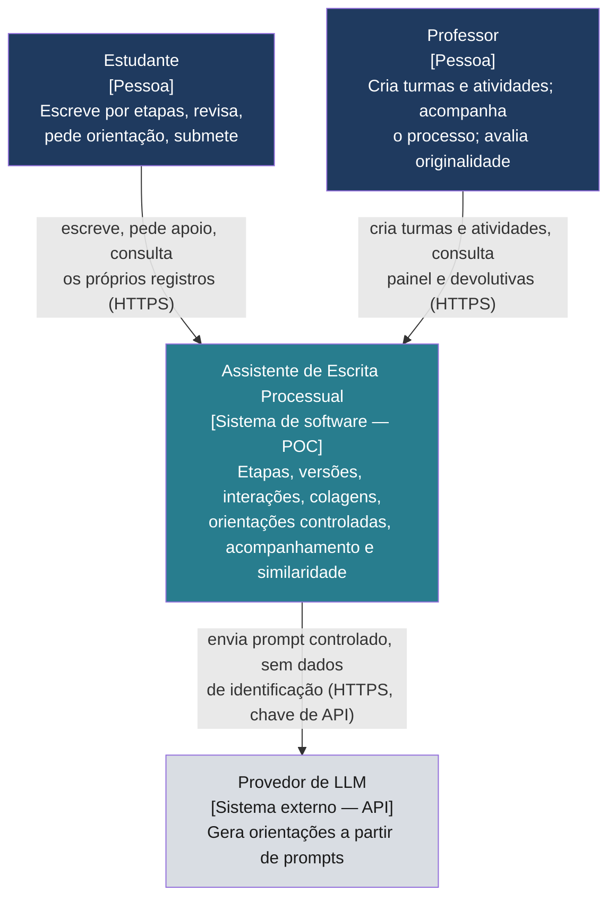

**Figura 4 —** C4 nível 1 — Contexto do sistema

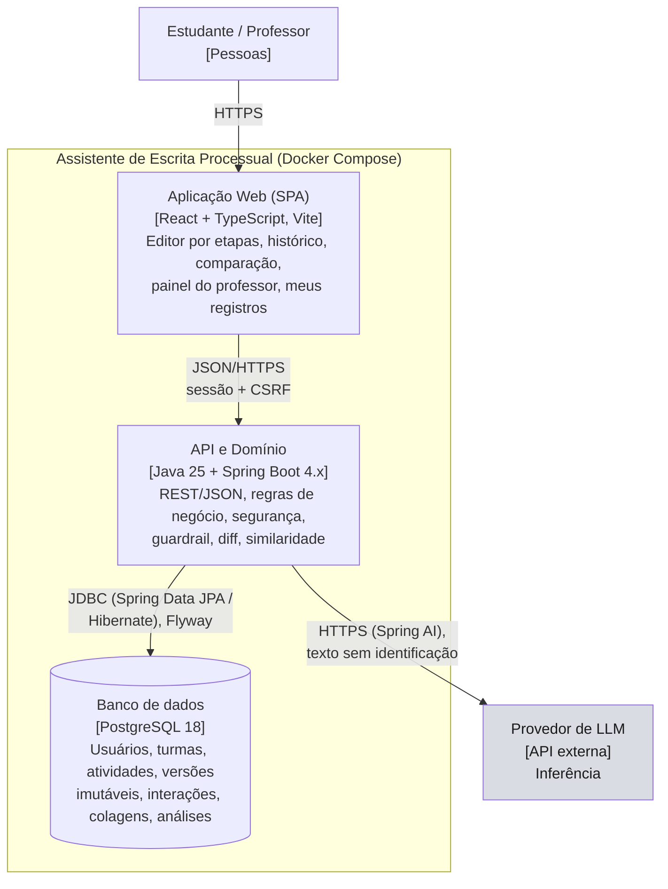

**Figura 5 —** C4 nível 2 — Contêineres

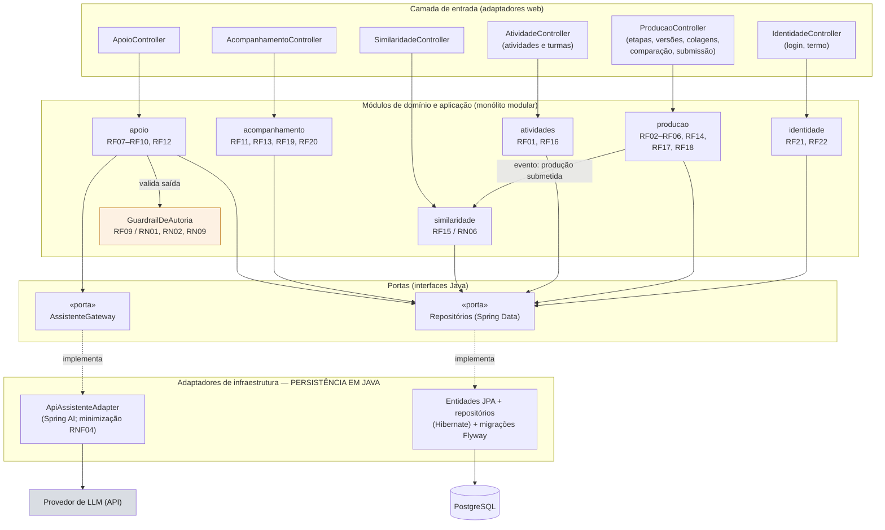

**Figura 6 —** C4 nível 3 — Componentes do backend (monólito modular com portas)

**Tabela 48 —** Módulos do backend

| **Módulo** | **Responsabilidade** | **Requisitos** | **Dono · revisor** |
|---|---|---|---|
| identidade | Autenticação por sessão, perfis, regras de autorização por recurso e por turma, aceite do termo de ciência | RF21, RF22; RNF02, RNF03 | C · B |
| atividades | Cadastro e consulta de turmas e atividades (gênero, critérios, política de prazo) | RF01, RF16 | C · B |
| producao | Início da produção, etapas e transições, versões automáticas e marcadas, colagens, comparação, submissão e estados | RF02–RF06, RF14, RF17, RF18; RN03, RN04 | C (serviços), D (etapas, colagens e persistência) |
| apoio | Solicitação de orientação, classificação da categoria, montagem do *prompt* com minimização, chamada ao gateway, guardrail, registro | RF07–RF10, RF12; RN01, RN02, RN07–RN09; RNF04, RNF05, RNF08 | C · B |
| acompanhamento | Consultas para o professor, indicadores derivados, consulta dos próprios registros pelo estudante, devolutiva | RF11–RF13, RF19, RF20; RN05, RN10 | C (API) e D (consultas) |
| similaridade | Execução automática após a submissão; normalização, n-gramas, contenção, trechos coincidentes, resumo de colagens | RF15; RN06 | C (algoritmo) e D (persistência) |
| compartilhado | Tratamento de erros, auditoria de data/hora, configuração, eventos internos | Transversal | C · B |

### 6.4 Visão de dados

O modelo segue a passagem de modelo conceitual (independente de SGBD) para modelo lógico relacional [13]. Na versão 1.2, TURMA e MATRICULA deixam de depender de hipótese (RF16) e entram as entidades exigidas pela ERS v2: etapa e tipo na versão, transições de etapa, eventos de colagem, aceite do termo e devolutiva.

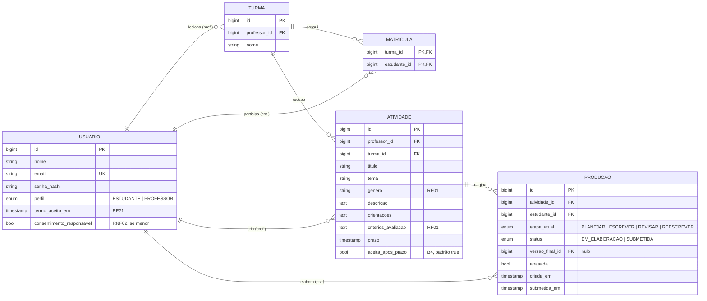

**Figura 7 —** Modelo lógico de dados (versão 1.2): usuários, turmas, atividades e produções

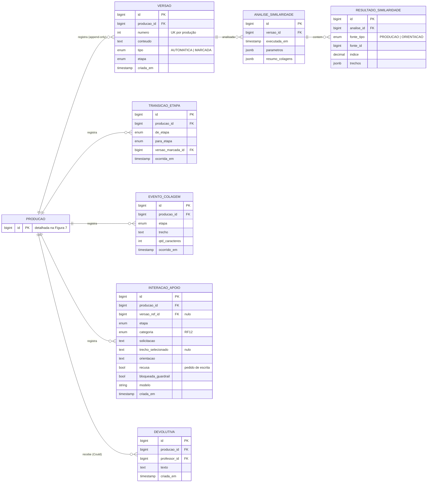

**Figura 8 —** Modelo lógico de dados (versão 1.2): registros do processo e similaridade

- **ADR-004 — registros imutáveis:** as tabelas VERSAO, TRANSICAO_ETAPA, EVENTO_COLAGEM e INTERACAO_APOIO só recebem inserções; o número da versão é único por produção; a aplicação não expõe atualização nem exclusão, e uma *trigger* (ou permissão de banco) rejeita UPDATE/DELETE, garantindo RN04 e RNF09 mesmo diante de erro de programação.
- **ADR-009 — versões automáticas e marcadas:** o salvamento automático (sugerido: 1 min) só cria versão quando o conteúdo mudou, para conter o volume; as versões marcadas (troca de etapa, ação do estudante, submissão) são as usadas por padrão na comparação e nas métricas (primeira versão marcada × versão final). O conteúdo da etapa Planejar é registrado como versões com etapa PLANEJAR; a alternativa de um campo separado para o plano é avaliada no design do incremento de T61.
- **Progresso derivado (RF11):** tempo por etapa, número de versões, volume de alterações, interações e colagens são calculados por consultas e projeções a partir dos registros, em vez de duplicar dados em tabela própria — evita inconsistência [13].
- **Colagens (RF18):** o trecho colado é guardado integralmente porque o professor precisa vê-lo; o limite de destaque (sugerido: 200 caracteres) é configuração, não dado.
- **Esquema sob controle de versão:** migrações Flyway (`V1__init.sql`, `V2__...`); a geração automática de esquema pelo Hibernate fica desativada fora dos testes.
- **Mapeamento JPA:** entidades com identidade própria e objetos de valor embutidos quando não têm ciclo de vida independente; repositórios Spring Data com métodos derivados, `@Query` e projeções para as consultas do professor [12]; *open-in-view* desativado para evitar consultas ocultas na camada web.
- **JSONB** apenas para os trechos coincidentes e o resumo de colagens da similaridade, que são dados de exibição sem consulta relacional.
### 6.5 Visão de comportamento: apoio do assistente e defesa da autoria

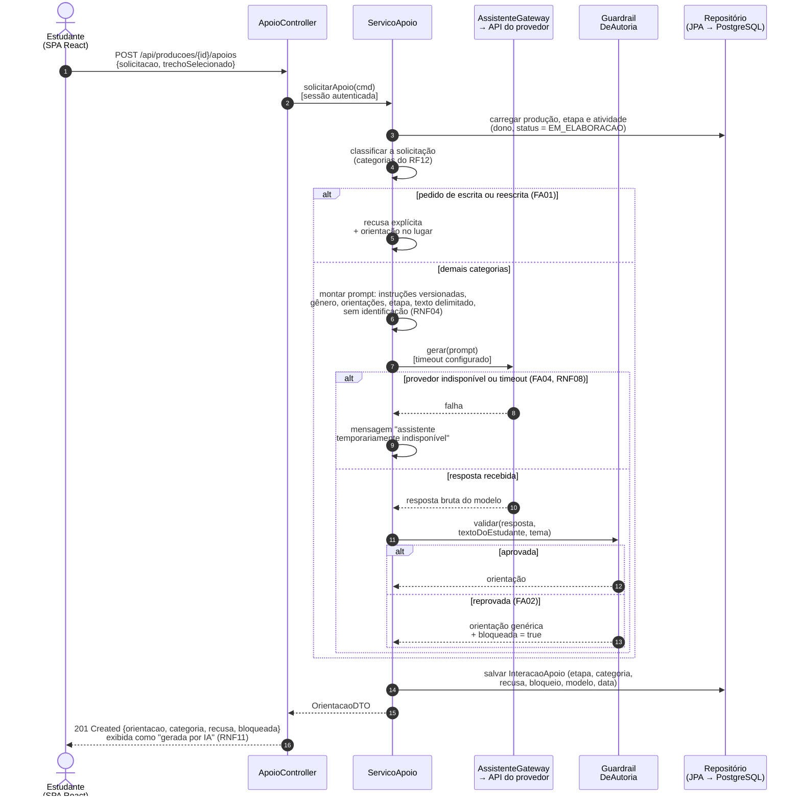

**Figura 9 —** Sequência da solicitação de apoio com validação de saída

O ponto central da arquitetura é que **RN02 não depende apenas do comportamento do modelo**. Modelos de linguagem podem ser induzidos a ignorar instruções (injeção de instruções, primeiro item do OWASP Top 10 para LLM [23]); por isso a garantia é construída em camadas, e a última camada é código determinístico testável. Com o LLM em um provedor externo (B1), a montagem do *prompt* também é o ponto de controle do que sai do sistema (RNF04).

**Tabela 49 —** Defesa em camadas para RN02

| **Camada** | **Mecanismo** | **Risco tratado** | **Verificação** |
|---|---|---|---|
| 1. Classificação da solicitação | A mensagem livre do estudante (RF07) é classificada nas categorias do RF12; pedidos de escrita ou reescrita recebem recusa explícita com orientação no lugar, sem chamar o modelo para gerar texto (FA01) | Uso do assistente como gerador de texto | Teste de API; casos adversariais |
| 2. *Prompt* de sistema | Instruções versionadas no repositório limitando a resposta a perguntas, apontamentos e explicações de conceitos (RF08); proibição de nota (RN07), de tratar variação linguística como erro (RN08) e de texto-modelo (RN09) | Geração de texto pronto; avaliação indevida | Suíte de avaliação (T20) |
| 3. Delimitação e minimização de dados | Texto do estudante enviado como conteúdo delimitado, nunca concatenado às instruções; nenhum dado de identificação no *payload* | Injeção de instruções direta (LLM01); exposição de dados pessoais ao provedor | Casos adversariais; teste do montador do *prompt* (RNF04) |
| 4. Validador de saída (GuardrailDeAutoria) | Regras determinísticas: detecção de sobreposição extensa com o texto do estudante (reescrita ou paráfrase), de prosa longa sobre o tema da atividade e de nota ou conceito; limites numéricos de palavras e de exemplo pendentes (B5); reprovação gera orientação genérica | Falha das camadas anteriores | Testes unitários; CA-09.1 a CA-09.4 |
| 5. Registro e auditoria | Toda interação é persistida com categoria, recusa e marcação de bloqueio; RF15 compara a produção com as orientações recebidas | Uso indevido não detectado | CA-09.4; CA-15.3 |
| 6. Proteção do *prompt* e da chave | Nenhum segredo no *prompt* de sistema; chave da API só em variável de ambiente; respostas tratadas como texto não confiável (escape na interface) | Vazamento de *prompt* ou de credencial; saída insegura | Revisão de segurança T32 |

### 6.6 Abordagem para a similaridade (RF15)

**Decisão do projeto (ADR-007, estado Proposto até T45):** a similaridade é calculada em Java por **contenção de n-gramas de palavras** (*shingling*), técnica clássica para medir semelhança e contenção entre documentos [42]. Para a produção avaliada A e uma fonte B, a contenção é a fração dos n-gramas de A que também ocorrem em B; os n-gramas coincidentes são reagrupados em trechos contíguos para exibição. As fontes são as demais produções da mesma atividade e as orientações do assistente recebidas pelo próprio estudante (decisão B2). A base externa citada no RF15 da ERS v2 fica como evolução futura.

- **Momento (B7):** a análise roda automaticamente quando a produção é submetida. O módulo producao publica um evento interno "produção submetida", e o módulo similaridade o consome; o professor encontra o resultado pronto no painel.
- Normalização: minúsculas, remoção de pontuação e normalização de espaços; o tratamento de acentos é decidido em T45 com casos de teste em português.
- **Simplificação da versão 1.2:** os n-gramas são calculados no momento da análise, sem tabela própria. Com uma turma de demonstração o volume é pequeno, e a tarefa de persistir n-gramas (T38 na versão 1.1) foi incorporada a T45.
- Parâmetros iniciais: n = 5 palavras; trechos com ao menos 2 n-gramas consecutivos. Ambos calibrados em T45 com casos-controle (textos semelhantes legítimos e cópias literais).
- Saída: índice por fonte, trechos destacados e **resumo dos eventos de colagem** (volume colado em relação ao tamanho do texto final, RF15 e ERS v2, seção 8); **nenhum rótulo de plágio** (RN06).
**Alternativas avaliadas:**`pg_trgm` do PostgreSQL (similaridade por trigramas de caracteres [30]; boa para semelhança global de cadeias, menos adequada para localizar trechos copiados e prende a lógica ao SGBD); Apache Lucene (*MoreLikeThis*, mais complexo do que o necessário); *embeddings* semânticos (detectam paráfrase, mas exigem modelo adicional e são menos explicáveis ao professor).

### 6.7 Stack tecnológica: alternativas e recomendação

#### 6.7.1 Frontend

**Tabela 50 —** Alternativas de frontend

| **Opção** | **Vantagens** | **Desvantagens** | **Curva de aprendizado** | **Veredito** |
|---|---|---|---|---|
| **React + TypeScript (Vite)** | Escolha da equipe (RT-03); ecossistema amplo; tipagem estática reduz erros de contrato | Exige decisões de bibliotecas (roteamento, estado de servidor) | Média | **Adotado** |
| **Angular** | Framework completo e opinativo | Contraria RT-03; curva maior | Alta | Rejeitado |
| **Thymeleaf (renderização no servidor)** | Tudo em Java; menos peças | Contraria RT-03; interações ricas (editor, *diff*) mais trabalhosas | Baixa | Rejeitado |
| **Editor: área de texto simples** | *Diff* e similaridade sobre texto puro; menor risco | Sem formatação rica | Baixa | **Adotado (ADR-008)** |
| **Editor rico (ex.: TipTap, Lexical)** | Formatação | Conteúdo estruturado complica *diff* e similaridade; formatação não é requisito | Média | Rejeitado nesta versão |

#### 6.7.2 Backend e APIs

**Tabela 51 —** Alternativas de backend

| **Opção** | **Vantagens** | **Desvantagens** | **Curva de aprendizado** | **Veredito** |
|---|---|---|---|---|
| **Java 25 LTS + Spring Boot 4.x** | Mesma linguagem da persistência (RT-01); integração nativa com Spring Data, Spring Security e Spring AI; documentação extensa | Volume de conceitos do ecossistema Spring | Média | **Adotado** |
| **Quarkus** | Inicialização rápida; boa integração com Hibernate | Menos material didático; integração com LLM menos difundida | Média/alta | Alternativa viável |
| **Jakarta EE / Micronaut** | Padrões abertos / leveza | Menor familiaridade esperada da equipe | Alta | Rejeitado |
| **Backend em Node.js ou Python com persistência Java** | — | Dois *runtimes* e uma fronteira de rede só para respeitar RT-01: complexidade sem benefício | Alta | Rejeitado |

O Spring Boot 4.0 foi lançado em novembro de 2025 sobre o Spring Framework 7; a linha 4.1 é a mais recente no momento da redação, e a 4.0 mantém Java 17 como mínimo [25]. Java 25 é a versão LTS disponível desde setembro de 2025 [40]; se alguma dependência não for compatível, a alternativa é Java 21 LTS. **A versão exata de cada componente é fixada em T10 e registrada no README.**

#### 6.7.3 Persistência em Java, ORM e SGBD

**Tabela 52 —** Alternativas de acesso a dados (todas em Java, RT-01)

| **Opção** | **Vantagens** | **Desvantagens** | **Curva de aprendizado** | **Veredito** |
|---|---|---|---|---|
| **Spring Data JPA + Hibernate** | Repositórios declarativos, projeções e consultas customizadas; material no projeto da equipe [12]; integra com Spring Boot | Risco de N+1 e carregamento implícito; exige atenção a transações | Média | **Adotado (ADR-003)** |
| **Spring Data JDBC** | Modelo mais simples, sem *lazy loading* | Menos recursos para consultas e projeções complexas | Baixa/média | Alternativa viável |
| **jOOQ** | SQL tipado e explícito | Geração de código; parte dos recursos exige licença para alguns SGBDs | Média | Rejeitado |
| **JDBC puro / MyBatis** | Controle total do SQL | Mais código repetitivo | Baixa/média | Rejeitado |

**Tabela 53 —** Alternativas de SGBD

| **Opção** | **Vantagens** | **Desvantagens** | **Curva de aprendizado** | **Veredito** |
|---|---|---|---|---|
| **PostgreSQL 18** | Restrições de integridade fortes, *triggers* para imutabilidade, JSONB, suporte maduro em Testcontainers; versão atual lançada em set. 2025 [30] | Um serviço a mais para operar (mitigado com Docker Compose) | Média | **Adotado** |
| **MySQL / MariaDB** | Difundidos | Sem vantagem relevante para os drivers; recursos de JSON e restrições menos convenientes para este caso | Média | Alternativa viável |
| **H2 (embarcado)** | Zero instalação | Diferenças de dialeto; testes com H2 podem não refletir o banco real | Baixa | Rejeitado (nem para testes) |
| **MongoDB** | Esquema flexível | Dados fortemente relacionais (atividade → produção → versão); integridade referencial manual | Média | Rejeitado |

**Tabela 54 —** Alternativas de migração de esquema

| **Opção** | **Vantagens** | **Desvantagens** | **Curva de aprendizado** | **Veredito** |
|---|---|---|---|---|
| **Flyway** | Migrações SQL simples e versionadas; integração direta com Spring Boot [31] | Reversão não automática | Baixa | **Adotado** |
| **Liquibase** | Reversões declarativas; formatos XML/YAML | Mais verboso | Média | Alternativa viável |
| **Geração automática pelo Hibernate** | Rápida no início | Sem histórico nem controle de mudanças do esquema | Baixa | Rejeitado |

#### 6.7.4 Autenticação e autorização

**Tabela 55 —** Alternativas de autenticação

| **Opção** | **Vantagens** | **Desvantagens** | **Curva de aprendizado** | **Veredito** |
|---|---|---|---|---|
| **Sessão no servidor + cookie HttpOnly + proteção CSRF (Spring Security)** | Simples para SPA na mesma origem; revogação imediata; sem token acessível a JavaScript [27] | Exige configurar CSRF para a SPA | Média | **Adotado (ADR-005)** |
| **JWT emitido pela própria API** | Sem estado no servidor | Revogação difícil; armazenamento no navegador expõe a XSS se mal feito; benefício nulo para um único backend | Média | Rejeitado |
| **Provedor OIDC (ex.: Keycloak)** | Padrão de mercado; *single sign-on* | Mais um serviço; desproporcional a usuários pré-cadastrados | Alta | Rejeitado nesta versão |

Senhas são armazenadas apenas como *hash* adaptativo por meio do `PasswordEncoder` do Spring Security, e mensagens de falha de autenticação são genéricas, alinhadas aos requisitos de autenticação do ASVS [22][27].

#### 6.7.5 Assistente: provedor de LLM e integração

**Decisão B1.** O assistente usa um modelo de linguagem acessado por **API externa**, como prevê a ERS v2 (seção 2.5). As versões 1.0 e 1.1 adotavam LLM local (Ollama); essa opção deixa de ser a recomendação e fica registrada como contingência.

**Tabela 56 —** Alternativas de acesso ao LLM

| **Opção** | **Vantagens** | **Desvantagens** | **Curva de aprendizado** | **Veredito** |
|---|---|---|---|---|
| **API de provedor comercial com termos de não treinamento** | Melhor qualidade em português e aderência a instruções; sem exigência de hardware; latência previsível | Custo por uso; dados saem do sistema (exige minimização, RNF04); dependência de terceiro e de internet | Baixa | **Adotado (B1)**; provedor escolhido no *spike* T07 |
| **API de provedor que hospeda modelos abertos** | Custo menor; modelos abertos | Termos de uso de dados variam; qualidade em português a verificar | Baixa | Alternativa avaliada no *spike* |
| **LLM local (Ollama + modelo aberto) [29]** | Nenhum texto sai do sistema; custo zero por uso | Exige hardware; qualidade em português inferior nos modelos de 7–9 bilhões de parâmetros | Baixa | Contingência (troca só de adaptador, RNF15) |

**Tabela 57 —** Alternativas de integração Java com o LLM

| **Opção** | **Vantagens** | **Desvantagens** | **Curva de aprendizado** | **Veredito** |
|---|---|---|---|---|
| **Spring AI (módulo do provedor escolhido)** | Abstração `ChatModel` comum a vários provedores, integrada ao Spring Boot; configuração por propriedades; troca de provedor por dependência e configuração [28] | API ainda em evolução; acompanhar notas de versão | Média | **Adotado** |
| **LangChain4j** | Rico em recursos de orquestração | Mais conceitos que o necessário | Média/alta | Alternativa |
| **Cliente HTTP manual** | Sem dependência extra | Reimplementar serialização, *timeouts* e opções | Baixa | Contingência |

**Provedor e modelo (ADR-006, Proposto):** escolhidos no *spike* T07 entre dois ou três candidatos. Critérios, nesta ordem: (1) termos de uso de dados — o provedor não pode usar os dados para treinamento, e a retenção deve ser compatível com RNF01 e RNF04; (2) qualidade das orientações em português e aderência às instruções nos casos adversariais (rubrica de T20); (3) latência no percentil 90, comparada ao RNF06 (pendente, B10); (4) custo estimado para desenvolvimento, avaliação do assistente (≥ 30 casos por execução) e demonstração; (5) suporte no Spring AI. O adaptador permite trocar o provedor e o modelo apenas por dependência e configuração (RNF15). A chave de API fica em variável de ambiente e nos segredos do CI, nunca no repositório (seção 10.7).

#### 6.7.6 Testes, qualidade de código, CI e infraestrutura

**Tabela 58 —** Ferramentas de teste, qualidade, CI e infraestrutura

| **Necessidade** | **Recomendação** | **Alternativas consideradas** | **Justificativa** |
|---|---|---|---|
| Testes unitários (backend) | JUnit Jupiter + AssertJ + Mockito [33] | TestNG | Padrão do ecossistema Spring Boot |
| Testes de integração | Spring Boot Test (MockMvc) + Testcontainers com PostgreSQL [32] | H2 em memória | Banco real no teste evita diferenças de dialeto [10] |
| Testes de arquitetura | ArchUnit | Revisão manual | Verifica automaticamente as regras de dependência entre módulos e portas |
| Testes de frontend | Vitest + Testing Library [35] | Jest | Integração nativa com Vite |
| Testes ponta a ponta | Playwright (opcional, *Could*) | Cypress | Só se houver capacidade após o congelamento |
| Análise estática e cobertura | SpotBugs + JaCoCo (Java); ESLint + `tsc --strict` (TypeScript) | SonarQube Cloud (se o repositório for público) | Ferramentas gratuitas e locais |
| Build | Maven (wrapper) no backend; npm no frontend | Gradle | Maven é o padrão do Spring Initializr mais difundido em ensino |
| CI | GitHub Actions [37] | GitLab CI, Jenkins | Integrado ao repositório e às regras de proteção da `main` |
| Dependências | Dependabot (alertas e atualizações) | OWASP Dependency-Check | Sem infraestrutura adicional |
| Implantação | Docker Compose local: frontend estático, backend e PostgreSQL; LLM acessado por API externa (exige internet e chave de API) | Nuvem (PaaS) | Custo zero de infraestrutura; demonstração reprodutível |
| Observabilidade | Spring Boot Actuator (*health*, métricas) + logs estruturados; métricas de latência, falhas e número de chamadas ao provedor via Micrometer | Stack completa de observabilidade | Proporcional à POC; sustenta RNF06, RNF14 e o controle de custo |
| Acessibilidade | Verificação automatizada com axe (extensão ou biblioteca) + revisão manual | Lighthouse | Sustenta RNF12 (WCAG 2.1 AA) |
| Documentação da API | OpenAPI gerado (springdoc-openapi; confirmar compatibilidade com Boot 4.x em T10) | Documento manual | Contrato sempre igual ao código |
| Gestão do trabalho e documentos | GitHub Issues + Projects; Markdown em `docs/`; diagramas em Mermaid ou PlantUML versionados | Trello, Notion, Jira | Um único lugar com histórico e vínculo a PRs |

#### 6.7.7 Recomendação consolidada

**Tabela 59 —** Stack recomendada

| **Tecnologia** | **Responsabilidade** | **Compatibilidade** | **Complexidade · curva** | **Riscos e dependências** | **Fonte oficial** |
|---|---|---|---|---|---|
| React + TypeScript + Vite | Interface (SPA) | Consome a API REST/JSON; servida estaticamente | Média · média | Escolha de bibliotecas; tipos do contrato desatualizados (mitigar gerando tipos do OpenAPI) | react.dev; vite.dev [34] |
| Java 25 + Spring Boot 4.x | API, domínio, segurança | Base para Spring Data, Security e AI | Média · média | Mudanças da linha 4 em bibliotecas de terceiros (R09) | docs.spring.io [25]; openjdk.org [40] |
| Spring Data JPA + Hibernate | **Persistência em Java (RT-01)** | Nativo do Spring Boot | Média · média | N+1, transações; mitigar com projeções e testes | docs.spring.io [26]; Tudose [12] |
| PostgreSQL 18 | Armazenamento relacional | Driver JDBC; Testcontainers; Flyway | Baixa · média | Operação local via Compose | postgresql.org [30] |
| Flyway | Versionamento do esquema | Integração automática com Spring Boot | Baixa · baixa | Migrações só para frente (rollback por backup) | red-gate.com [31] |
| Spring Security (sessão + CSRF) | Autenticação e autorização | Nativo | Média · média | Configuração de CSRF para SPA | docs.spring.io [27] |
| Provedor de LLM por API (a definir em T07) | Inferência | HTTPS; módulo do Spring AI | Baixa · baixa | Custo e cota (R01); termos de uso de dados (R14); qualidade em PT-BR (R02) | Documentação do provedor escolhido |
| Spring AI | Integração com o LLM | Versão 2.0 alinhada ao Boot 4.1 | Média · média | API em evolução; módulo do provedor escolhido | docs.spring.io [28] |
| java-diff-utils | Cálculo do *diff* (RF06) | Biblioteca Java pura | Baixa · baixa | Manutenção comunitária | github.com [36] |
| JUnit, Testcontainers, ArchUnit, Vitest | Verificação automatizada | Executam no CI | Média · média | Testcontainers exige Docker no CI | [32][33][35] |
| GitHub + Actions + Docker Compose | Colaboração, CI e implantação | Integrados | Baixa · baixa | Limites do plano gratuito | docs.github.com [37] |

### 6.8 Registros de decisão arquitetural iniciais

Cada ADR segue a estrutura título, estado, contexto, decisão, consequências, conformidade e notas, recomendada por Richards e Ford [11] a partir da proposta de Nygard [16] (modelo no Apêndice A).

**Tabela 60 —** ADRs iniciais

| **ADR** | **Decisão** | **Estado** | **Principal consequência** |
|---|---|---|---|
| ADR-001 | Cliente-servidor com SPA e monólito modular por domínio | Proposto → aceitar em M1 | Uma unidade de implantação; módulos isolados por regras verificadas no CI |
| ADR-002 | Portas e adaptadores para o provedor de LLM e a persistência | Proposto → M1 | Domínio testável sem infraestrutura; troca de provedor por adaptador e configuração |
| ADR-003 | Persistência em Java com Spring Data JPA/Hibernate, PostgreSQL e Flyway | Proposto → M1 | Atende RT-01; exige cuidado com consultas |
| ADR-004 | Registros imutáveis (*append-only*: versões, transições, interações, colagens) e progresso derivado | Proposto → M1 | RN04 e RNF09 garantidos no banco; consultas de evolução sem dados duplicados |
| ADR-005 | Autenticação por sessão com cookie HttpOnly e CSRF | Proposto → M1 | Simplicidade e revogação imediata; SPA na mesma origem |
| ADR-006 | Provedor e modelo de LLM via API externa, parâmetros de inferência e minimização dos dados enviados (B1) | Proposto → decidir no *spike* (M1) | Define custo, termos de uso de dados e o valor medido para RNF06 |
| ADR-007 | Similaridade por contenção de n-gramas em Java, executada automaticamente após a submissão (B7) | Proposto → confirmar em T45 | Trechos explicáveis ao professor; não detecta paráfrase |
| ADR-008 | Editor de texto simples (sem formatação rica) | Proposto → M1 | *Diff*, similaridade e registro de colagens sobre texto puro |
| ADR-009 | Versões automáticas (só quando o conteúdo muda) e marcadas por etapa (B3, RF17) | Proposto → M1 | Perda máxima de 1 min de edição (RNF07); volume de versões controlado; comparação padrão entre versões marcadas |

### 6.9 Contrato inicial da API

Contrato preliminar REST/JSON, refinado nas tarefas T16, T17, T25, T35, T36, T45, T61 e T63 e publicado em OpenAPI. Todas as rotas exigem sessão autenticada; as rotas do estudante exigem também o aceite do termo de ciência (RF21).

**Tabela 61 —** Contrato inicial da API

| **Método e rota** | **Perfil** | **Finalidade** | **RF** |
|---|---|---|---|
| GET /api/termo · POST /api/termo/aceite | Estudante | Ler e aceitar o termo de ciência | RF21 |
| POST /api/turmas · GET /api/turmas · POST /api/turmas/{id}/estudantes | Professor | Criar turmas e incluir estudantes | RF16 |
| POST /api/atividades · GET /api/atividades · GET /api/atividades/{id} | Professor (escrita); ambos (leitura, conforme a turma) | Cadastrar e consultar atividades | RF01 |
| POST /api/atividades/{id}/producoes | Estudante | Iniciar produção (etapa Planejar) | RF02 |
| POST /api/producoes/{id}/etapa {para} | Estudante | Avançar ou voltar de etapa; cria versão marcada | RF17 |
| POST /api/producoes/{id}/versoes {conteudo, tipo} · GET /api/producoes/{id}/versoes[/{n}]?etapa=&tipo= | Estudante (escrita); estudante e professor (leitura) | Salvar (automática ou marcada) e consultar versões com filtro | RF03–RF05 |
| GET /api/producoes/{id}/comparacao?de={n}&para={m} | Ambos | Comparar versões (padrão: primeira marcada × final) | RF06 |
| POST /api/producoes/{id}/colagens · GET /api/producoes/{id}/colagens | Estudante (escrita); ambos (leitura) | Registrar e consultar eventos de colagem | RF18 |
| POST /api/producoes/{id}/apoios {solicitacao, trechoSelecionado} · GET /api/producoes/{id}/apoios | Estudante (escrita); ambos (leitura) | Solicitar e listar orientações (categoria atribuída pelo sistema) | RF07–RF10, RF12 |
| GET /api/producoes/{id}/indicadores | Ambos | Progresso e apoio solicitado por categoria e etapa | RF11, RF12 |
| GET /api/atividades/{id}/acompanhamento | Professor responsável | Visão geral das produções da atividade, sem ordenação por indicador | RF13 |
| GET /api/eu/producoes/{id}/registros | Estudante dono | Consultar tudo o que é registrado sobre a própria produção | RF20 |
| POST /api/producoes/{id}/submissao | Estudante | Submeter a versão final (política de prazo da atividade); dispara a similaridade | RF14 |
| GET /api/producoes/{id}/similaridade | Professor responsável | Consultar a análise executada após a submissão | RF15 |
| POST /api/producoes/{id}/devolutivas · GET /api/producoes/{id}/devolutivas | Professor (escrita); ambos (leitura) | Registrar e consultar devolutiva (*Could*) | RF19 |

### 6.10 Roteiro de execução do design

Este roteiro orienta a equipe a **produzir** a arquitetura e o design. As subseções 6.1 a 6.9 são um exemplo de resultado. O método amplia os oito passos que a equipe já usou no Trabalho 2 [47] — identificar os *drivers*, desenhar o contexto, comparar estilos, definir componentes e conectores, mapear para a infraestrutura, registrar decisões e validar com um cenário — e acrescenta dados, contrato da API, escolha de tecnologia e o design de cada sprint.

#### D1 — Drivers arquiteturais

**Tabela 62 —** Roteiro D1 — Drivers arquiteturais

| **Aspecto** | **Orientação** |
|---|---|
| **Quando · quem** | Semana 1 (T08) · C, revisor B |
| **Perguntas que o artefato responde** | Quais qualidades mais influenciam a estrutura? O que **não** é prioridade? |
| **Como fazer (passos)** | 1. Montar a tabela stakeholder → preocupação. <br> 2. Associar cada preocupação a uma característica da ISO/IEC 25010 (a partir dos RNF de R3). <br> 3. Escolher de 3 a 6 drivers e ordená-los. <br> 4. Registrar explicitamente o que não é driver (ex.: escalabilidade, numa POC). <br> 5. Para cada driver, apontar o cenário de qualidade correspondente. |
| **Saída** | Tabela de preocupações e lista ordenada de drivers |
| **Checklist do revisor** | Todo driver vem de um requisito ou restrição; nenhum driver sem medida |
| **Erros comuns** | Listar todas as características como prioritárias (nenhuma escolha real); escolher drivers pela tecnologia preferida |
| **Referências** | ISO/IEC/IEEE 42010 [3]; Richards e Ford [11] |

#### D2 — Contexto e contêineres (C4 níveis 1 e 2)

**Tabela 63 —** Roteiro D2 — Contexto e contêineres

| **Aspecto** | **Orientação** |
|---|---|
| **Quando · quem** | Semana 1 (T08) · C, revisor B |
| **Perguntas que o artefato responde** | Onde termina o sistema? Quem o usa? Quais processos executáveis existem e como se comunicam? |
| **Como fazer (passos)** | 1. Nível 1: desenhar o sistema como uma caixa, seus usuários e os sistemas externos (o provedor de LLM é externo ao sistema e é o único destino de dados fora dele). <br> 2. Nível 2: abrir a caixa em contêineres (aplicações e bancos que executam separadamente). <br> 3. Para cada ligação, anotar protocolo, formato e o que trafega (conector). <br> 4. Conferir se os nomes coincidem com o glossário. |
| **Saída** | Diagramas C4 1 e 2 + tabela de conectores |
| **Checklist do revisor** | Toda seta tem protocolo; nenhum contêiner sem responsabilidade; limite do sistema claro |
| **Erros comuns** | Misturar níveis no mesmo diagrama; omitir o sentido das chamadas |
| **Referências** | Brown — C4 [15]; trabalho anterior [47] |

#### D3 — Estilo arquitetural

**Tabela 64 —** Roteiro D3 — Escolha do estilo

| **Aspecto** | **Orientação** |
|---|---|
| **Quando · quem** | Semana 1 (T08) · C, revisor B; registro em ADR |
| **Perguntas que o artefato responde** | Qual organização geral atende melhor aos drivers com o menor custo? |
| **Como fazer (passos)** | 1. Escolher 2 ou 3 estilos candidatos plausíveis. <br> 2. Comparar em uma tabela contra os drivers de D1 (não contra preferências). <br> 3. Considerar custo e prazo da equipe como critério. <br> 4. Registrar a escolha e as alternativas descartadas em ADR. |
| **Saída** | Tabela comparativa + ADR do estilo |
| **Checklist do revisor** | Critérios são os drivers; a alternativa escolhida não perde em nenhum driver prioritário sem justificativa |
| **Erros comuns** | Escolher microsserviços por popularidade; comparar só uma opção |
| **Referências** | Richards e Ford, cap. 10 [11]; Valente, cap. 7 [10] |

#### D4 — Modelo de dados

**Tabela 65 —** Roteiro D4 — Modelo de dados

| **Aspecto** | **Orientação** |
|---|---|
| **Quando · quem** | Semana 1 (T09) e evoluído no design do incremento · D, revisor C |
| **Perguntas que o artefato responde** | Quais informações o sistema guarda, como se relacionam e quais regras o banco deve garantir? |
| **Como fazer (passos)** | 1. Modelo conceitual: extrair entidades e relacionamentos dos substantivos da ERS e definir cardinalidades. <br> 2. Modelo lógico: converter em tabelas, chaves primárias e estrangeiras; verificar a 3ª forma normal. <br> 3. Regras no banco: restrições de unicidade, não nulo, integridade referencial e imutabilidade (RN04). <br> 4. Modelo físico: migração Flyway versionada e índices para as consultas previstas. <br> 5. Mapeamento JPA: entidades, objetos de valor e repositórios. |
| **Saída** | DER, dicionário de dados, migração V1 e entidades JPA |
| **Checklist do revisor** | Toda entidade justificada por um RF; RN04 garantida no banco; migração roda em banco vazio no CI |
| **Erros comuns** | Começar pelas classes Java e deixar o Hibernate gerar o esquema; dados derivados duplicados em tabelas |
| **Referências** | Heuser, cap. 1 e 3 [13]; Tudose, cap. 4–5 [12] |

#### D5 — Componentes (C4 nível 3)

**Tabela 66 —** Roteiro D5 — Componentes e regras de dependência

| **Aspecto** | **Orientação** |
|---|---|
| **Quando · quem** | Semana 1 (esboço) e refinado nas sprints · C, revisor B |
| **Perguntas que o artefato responde** | Como o backend se divide por dentro? Quem pode depender de quem? |
| **Como fazer (passos)** | 1. Dividir o backend por domínio (um módulo por grupo de RF). <br> 2. Dentro de cada módulo, separar entrada (controlador), regras (serviço) e acesso a dados (repositório). <br> 3. Atribuir responsabilidades com os padrões GRASP já estudados: especialista na informação, controlador, baixo acoplamento, alta coesão, variações protegidas [48]. <br> 4. Esconder dependências voláteis (LLM, banco) atrás de interfaces (portas). <br> 5. Escrever as regras de dependência como testes de arquitetura. |
| **Saída** | Diagrama C4 3 + tabela de componentes (responsabilidade, RF atendidos) |
| **Checklist do revisor** | Cada componente tem uma responsabilidade; o domínio não depende de framework; nenhum ciclo entre módulos |
| **Erros comuns** | Pacotes por tipo técnico sem módulos de domínio; controlador com regra de negócio |
| **Referências** | Cockburn [17]; Larman [48]; Richards e Ford [11] |

#### D6 — Contrato da API

**Tabela 67 —** Roteiro D6 — Contrato da API

| **Aspecto** | **Orientação** |
|---|---|
| **Quando · quem** | Esboço na Semana 1; cada endpoint definido no design do incremento · C, revisores B e D |
| **Perguntas que o artefato responde** | Que recursos o frontend precisa, com que formato e quais erros podem ocorrer? |
| **Como fazer (passos)** | 1. Listar recursos a partir das HU (atividades, produções, versões, apoios). <br> 2. Para cada operação: verbo, rota, corpo de entrada, resposta e códigos HTTP de erro. <br> 3. Definir regras de autorização por perfil e por recurso. <br> 4. Revisar com o frontend antes de implementar. <br> 5. Publicar em OpenAPI gerado pelo código. |
| **Saída** | Tabela de endpoints + OpenAPI |
| **Checklist do revisor** | Rotas consistentes; erros previstos; autorização explícita; frontend aprovou o formato |
| **Erros comuns** | Endpoints que espelham tabelas em vez de casos de uso; mudar o contrato sem avisar o frontend |
| **Referências** | Valente, cap. 7 [10]; Spring Boot [25] |

#### D7 — Seleção de tecnologia

**Tabela 68 —** Roteiro D7 — Seleção de tecnologia (stack)

| **Aspecto** | **Orientação** |
|---|---|
| **Quando · quem** | Semana 1 (T08, T10) · C e D, revisão cruzada; registro em ADR |
| **Perguntas que o artefato responde** | Qual tecnologia atende aos requisitos e às restrições com o menor risco para esta equipe? |
| **Como fazer (passos)** | 1. Separar as decisões: linguagem, framework, ORM, SGBD, provedor de LLM, infraestrutura. <br> 2. Listar 2 a 4 alternativas por decisão, respeitando as restrições (Java na persistência, React, LLM por API externa com RNF04). <br> 3. Avaliar com uma matriz de critérios ponderados (modelo abaixo). <br> 4. Verificar compatibilidade entre as escolhas na documentação oficial e com um teste no esqueleto. <br> 5. Registrar a decisão e a versão fixada em ADR e no README. |
| **Saída** | Matriz de decisão + ADR por decisão relevante |
| **Checklist do revisor** | Critérios e pesos definidos antes das notas; compatibilidade testada; versões fixadas |
| **Erros comuns** | Confundir linguagem com framework ou ORM com banco; escolher sem testar a integração |
| **Referências** | Documentação oficial de cada tecnologia [25]–[40] |

**Tabela 69 —** Modelo de matriz de decisão de tecnologia (pesos sugeridos; a equipe pode ajustar antes de pontuar)

| **Critério** | **Peso** | **Alternativa 1 (nota 1–5)** | **Alternativa 2 (nota 1–5)** | **Alternativa 3 (nota 1–5)** |
|---|---|---|---|---|
| Aderência a requisitos e restrições | 3 |  |  |  |
| Compatibilidade com o resto da stack | 2 |  |  |  |
| Curva de aprendizado da equipe | 2 |  |  |  |
| Maturidade e qualidade da documentação | 2 |  |  |  |
| Licença e custo | 1 |  |  |  |
| Risco técnico | 2 |  |  |  |
| **Total ponderado** |  |  |  |  |

#### D8 — Registros de decisão arquitetural

**Tabela 70 —** Roteiro D8 — ADRs

| **Aspecto** | **Orientação** |
|---|---|
| **Quando · quem** | Sempre que surgir uma decisão arquiteturalmente significativa · quem decide, revisão de duas outras áreas |
| **Perguntas que o artefato responde** | O que foi decidido, por quê, quais alternativas existiam e quais consequências aceitamos? |
| **Como fazer (passos)** | 1. Verificar se a decisão é significativa: afeta estrutura, características de qualidade, dependências, interfaces ou técnicas de construção [11, cap. 19]. <br> 2. Preencher o modelo do Apêndice A, incluindo alternativas. <br> 3. Abrir PR com estado “Proposto”; mudar para “Aceito” após a revisão. <br> 4. Ao mudar de ideia, escrever um novo ADR que substitui o anterior (sem apagar o antigo). |
| **Saída** | Arquivo docs/arquitetura/adr/ADR-nnn.md |
| **Checklist do revisor** | O “porquê” está explícito; alternativas reais; consequências negativas também listadas |
| **Erros comuns** | ADR que só descreve a decisão sem justificativa; editar ADR aceito em vez de substituí-lo |
| **Referências** | Richards e Ford, cap. 19 [11]; Nygard [16] |

#### D9 — Design do incremento (toda sprint)

**Tabela 71 —** Roteiro D9 — Design do incremento

| **Aspecto** | **Orientação** |
|---|---|
| **Quando · quem** | D1–D2 de cada sprint, no início de cada tarefa de implementação · responsável, revisor do anel |
| **Perguntas que o artefato responde** | Como este RF será construído sobre a arquitetura existente? |
| **Como fazer (passos)** | 1. Ler a HU e os CA. <br> 2. Identificar os componentes afetados no C4 nível 3. <br> 3. Esboçar a sequência do fluxo principal e do caminho de erro. <br> 4. Definir endpoint, DTO e tabela ou migração, se houver. <br> 5. Listar os testes que provarão cada CA. <br> 6. Registrar tudo na seção “Design do incremento” do PR; se tocar contrato ou esquema, conversar com o revisor antes de codificar. |
| **Saída** | Seção “Design do incremento” no PR (Apêndice C) |
| **Checklist do revisor** | Esboço coerente com a arquitetura e os ADRs; testes cobrem os CA; nenhuma mudança arquitetural sem ADR |
| **Erros comuns** | Pular o design e descobrir o problema na revisão; design longo demais para uma tarefa de 3 h |
| **Referências** | Pressman — modelo de projeto [9]; Valente, cap. 6–7 [10] |

#### D10 — Validação da arquitetura com cenários

**Tabela 72 —** Roteiro D10 — Validação com cenários

| **Aspecto** | **Orientação** |
|---|---|
| **Quando · quem** | Fim da Semana 1 (M1) e antes do congelamento (M5) · C conduz, toda a equipe participa |
| **Perguntas que o artefato responde** | A arquitetura atende ao fluxo principal e aos drivers? |
| **Como fazer (passos)** | 1. Percorrer o fluxo principal da ERS v2 (seção 6.1) pelos diagramas, componente a componente. <br> 2. Percorrer um cenário de qualidade por driver (ex.: injeção de instruções; estudante tentando ver texto alheio). <br> 3. Verificar se todo RF tem componente responsável e se algum componente não atende a nenhum RF. <br> 4. Registrar os problemas como issue ou ADR. |
| **Saída** | Ata de validação + itens abertos |
| **Checklist do revisor** | Todos os drivers percorridos; lacunas registradas |
| **Erros comuns** | Validar só o caminho feliz |
| **Referências** | Trabalho anterior, passo 8 [47]; ISO/IEC/IEEE 42010 [3] |

## 7. Organização da equipe e revisão cruzada

As competências individuais não foram informadas; por isso as áreas são identificadas por letras (A, B, C, D) e **a associação de cada integrante a uma área é decisão da equipe**, registrada na reunião de iniciação (T01) na Tabela de atribuição abaixo. A divisão foi feita por unidades lógicas do sistema, como recomendava o trabalho anterior, e equilibrada para que cada área tenha entre 6 e 6,5 h de tarefas por semana (seção 8.2).

**Tabela 73 —** Atribuição de integrantes às áreas

| **Área** | **Integrante (preencher em T01)** | **Facilitação (Scrum Master)** |
|---|---|---|
| A — Requisitos, Produto e Qualidade (Product Owner) | ______________________ | — |
| B — Frontend | ______________________ | Semanas 1 e 4 |
| C — Backend, API e Assistente | ______________________ | Semanas 2 e 5 |
| D — Persistência, Dados e Infraestrutura | ______________________ | Semanas 3 e 6 |

### 7.1 Anel de revisão

Cada área revisa a área seguinte no anel **A → B → C → D → A**: A revisa B, B revisa C, C revisa D e D revisa A. O anel foi definido para que o revisor seja **consumidor direto** do trabalho revisado: quem escreve requisitos verifica se a interface os cumpre; quem consome a API revisa a API; quem consome os repositórios revisa a persistência; e quem implementa os dados verifica a viabilidade dos requisitos. Assim, o autor nunca aprova o próprio trabalho e a revisão agrega conhecimento técnico real.

### 7.2 Matriz de responsabilidades

**Tabela 74 —** Matriz de responsabilidades e revisão cruzada

| **Área** | **Atividades sob responsabilidade** | **Artefatos e entregáveis** | **Revisa** | **Critérios de revisão (resumo)** | **Participação nas integrações** |
|---|---|---|---|---|---|
| A | Backlog, HU/CA, ERS, perguntas ao professor, estratégia e execução de testes de aceitação, avaliação do assistente, rastreabilidade, relatórios finais | ERS v2.x, backlog, matriz, plano e relatórios de teste, relatório do assistente, protocolo da POC | B (Frontend) | Interface cumpre os CA; mensagens e fluxos coerentes com as RN; usabilidade básica | Verificação de aceitação de todos os incrementos; contrato funcional entre UI e regras |
| B | Protótipo, SPA, integração com a API, testes de frontend, manual do usuário | Telas, componentes, testes Vitest, manual | C (Backend) | Contrato da API utilizável e documentado; erros tratados; autorização coerente com a UI | Consumidor do contrato da API; segundo revisor de mudanças de contrato |
| C | Arquitetura, ADRs, identidade, APIs, apoio e guardrail, submissão, similaridade, desempenho e *hardening* | C4, ADRs, OpenAPI, módulos de backend, suíte adversarial, relatório de desempenho | D (Persistência) | Mapeamento correto; transações; consultas eficientes; migrações reversíveis por backup; imutabilidade preservada | Dono do contrato da API e das portas; integra frontend, dados e LLM |
| D | Modelo de dados, entidades e repositórios, migrações, consultas, *diff*, CI, Compose, backup, release | DER, dicionário, migrações, repositórios, pipeline, README, notas de versão | A (Requisitos e Qualidade) | Requisitos claros, verificáveis e viáveis em dados; CA testáveis; rastreabilidade consistente | Dono do esquema e da infraestrutura; segundo revisor de mudanças de requisitos de dados |

### 7.3 Critérios de revisão por tipo de artefato

**Tabela 75 —** Critérios de revisão

| **Artefato** | **O revisor verifica** |
|---|---|
| Requisitos (HU, CA, RNF) | Características da 29148 (necessário, não ambíguo, singular, viável, verificável, correto); ligação com a ERS; ausência de requisito inventado |
| Código (qualquer área) | CA atendidos; testes adequados ao nível; nomes do glossário; sem duplicação; tratamento de erros; nenhum segredo; regras de dependência respeitadas |
| API e contratos | Rotas, códigos HTTP e formatos coerentes; autorização por recurso; OpenAPI atualizado |
| Persistência e migrações | Integridade referencial; imutabilidade de versões; índices; consultas sem N+1; migração executa em banco limpo |
| Assistente (*prompt*, guardrail) | Casos adversariais; limites do CA-09.x; registro de bloqueios; nenhuma dependência do domínio em Spring AI |
| Documentos e diagramas | Coerência com o código e com os demais documentos; autor, revisor, data e versão preenchidos |

### 7.4 Aprovação, correções e divergências

1. **Aprovação padrão:** um PR é aprovado pelo revisor designado no anel (regra automatizada por CODEOWNERS e proteção da `main`).
1. **Segundo revisor obrigatório** para itens transversais: contrato da API (B e D), migrações de esquema (C e A quando mudar requisito de dados), *prompt* de sistema e guardrail (B e A), ADRs (duas aprovações entre as demais áreas).
1. **Prazo de revisão:** iniciar em até 24 h após o PR com CI verde; revisar tem prioridade sobre iniciar nova tarefa (política de WIP).
1. **Solicitação de correção:** comentários no PR classificados como *bloqueante* (impede o merge) ou *sugestão* (não impede); o autor corrige ou responde justificando.
1. **Divergência:** se autor e revisor não chegam a acordo em até 24 h, o tema vai ao check-in seguinte. Questões técnicas são decididas pela área dona do componente com registro em ADR ou no PR; questões de requisito são decididas por A (Product Owner); questões de escopo vão ao professor. A decisão e o motivo ficam registrados.
1. **Aprovação de entregáveis documentais:** documento em PR na pasta `docs/`, com autor e revisor no cabeçalho; marcos (M1–M6) aprovados na Sprint Review com registro em ata.
## 8. Cronograma técnico e operacional

### 8.1 Técnica de estimativa e conceitos de tempo

**Técnica adotada (Boa prática):** estimativa de **três pontos em horas ideais** por tarefa, com valor esperado E = (otimista + 4 × mais provável + pessimista) / 6, combinada com **planejamento por capacidade** semanal [19][20]. Cada tarefa foi quebrada até no máximo 4 h, tamanho em que a estimativa por analogia é mais confiável. *Story points* foram descartados: sem histórico de velocidade, a equipe não teria como calibrá-los em seis semanas, e horas permitem comparar diretamente com a disponibilidade declarada. As estimativas da Tabela do cronograma detalhado são os valores esperados; elas são reestimadas em cada Sprint Planning com as horas efetivamente realizadas na semana anterior.

**Tabela 76 —** Esforço, duração e prazo

| **Conceito** | **Definição usada neste plano** | **Exemplo** |
|---|---|---|
| **Esforço** | Horas de trabalho de uma pessoa necessárias para concluir a tarefa | T25 (adaptador do LLM): 4 h |
| **Duração** | Intervalo de calendário que a tarefa ocupa, considerando a dedicação parcial e as demais tarefas da pessoa | T25 ocupa os dias D1 a D3 da Semana 3 |
| **Prazo de entrega** | Data-limite externa para o marco ou para o projeto | M6 = fim da Semana 6 (data absoluta depende de D0, Q-15) |

### 8.2 Premissas de capacidade e análise de sensibilidade

**Hipótese PR-02:** cada integrante dedica 10 h por semana, totalizando 240 h. A dedicação real ainda não foi informada (Q-15); por isso o plano mede horas realizadas desde a primeira semana e apresenta abaixo o efeito de outras disponibilidades.

**Decisão B12 — cronograma fixo.** A versão 1.2 mantém as 6 semanas e a mesma capacidade da versão 1.1. Os requisitos novos da ERS v2 entraram por quatro meios: (1) priorização (RF19 é *Could* e não está na base); (2) horas liberadas pela decisão B1 (*spike* sem instalação de modelo local, empacotamento sem o Ollama); (3) simplificações declaradas (n-gramas calculados sob demanda, resultado da similaridade em JSONB, testes de componentes incorporados à DoD, indicadores já operacionalizados pela ERS v2); (4) uso de parte da reserva. A tabela seguinte mostra o resultado por área; as mudanças tarefa a tarefa estão na seção 8.5.

**Tabela 77 —** Distribuição da capacidade (PR-02)

| **Uso da capacidade (por pessoa, por semana)** | **Horas** | **Total da equipe em 6 semanas** |
|---|---|---|
| Eventos (planning, check-ins, review, retrospectiva, atualizações) | 2,5 h | 60 h |
| Revisões de PR e documentos da área revisada | 1,0 h | 24 h |
| Tarefas planejadas (cronograma) | ≈ 6,3 h | 151 h |
| Reserva para imprevistos e correções não planejadas | ≈ 0,2 h | 5 h |
| **Total** | **10,0 h** | **240 h** |

**Tabela 78 —** Horas de tarefas por área: versão 1.1 × versão 1.2

| **Área** | **v1.1** | **v1.2** | **Reserva usada** | **Reserva restante** | **Semana mais carregada** |
|---|---|---|---|---|---|
| A — Requisitos, Produto e Qualidade | 36 h | 37,5 h | 1,5 h | 1,5 h | Semanas 1 a 3 (6,5 h) |
| B — Frontend | 36 h | 38,5 h | 2,5 h | 0,5 h | Semanas 1 a 5 (6,5 h) |
| C — Backend, API e Assistente | 36 h | 37,5 h | 1,5 h | 1,5 h | Semanas 2 a 5 (6,5 h) |
| D — Persistência, Dados e Infra | 36 h | 37,5 h | 1,5 h | 1,5 h | Semanas 1 a 3 (6,5 h) |
| **Equipe** | **144 h** | **151 h** | **7 h** | **5 h** | — |

Nenhuma área passa de 6,5 h de tarefas em uma semana (6 h planejadas + 0,5 h da reserva semanal). A reserva explícita caiu de 12 h para 5 h, e a área B (frontend) ficou com apenas 0,5 h de reserva: é o ponto mais frágil do cronograma (risco R15). A contingência principal continua em dois mecanismos: (1) a **Semana 6 dedicada à estabilização**, sem funcionalidades novas, e (2) as **válvulas de escopo *Should*** (RF11, RF12, RF15, RF18, RF20), cujas tarefas somam cerca de 15 h e podem ser simplificadas ou adiadas mediante aprovação. **Ordem de corte**, se as horas realizadas ficarem abaixo do planejado: RF19 (já fora da base) → RF20 → simplificação de RF11 e RF12 (menos indicadores) → simplificação de RF15 (índice por fonte sem destaque de trechos) → RF18 apenas registrado, sem destaque no painel. Itens *Must* não entram na ordem de corte.

**Tabela 79 —** Sensibilidade do cronograma à dedicação semanal

| **Dedicação real** | **Horas para tarefas e reserva** | **Diferença para 151 h** | **Consequência** |
|---|---|---|---|
| 12 h/semana | 204 h | +53 h | Plano viável com folga; incluir RF19 (*Could*), testes E2E e reserva |
| 10 h/semana (premissa) | 156 h | +5 h | Plano base (5 h de reserva) |
| 8 h/semana | 108 h | −43 h | Inviável só com as válvulas *Should* (≈ 15 h): negociar com o professor simplificações adicionais antes de M2 |
| 6 h/semana | 60 h | −91 h | Inviável em 6 semanas: renegociar escopo ou prazo imediatamente (Q-01, Q-15) |

### 8.3 Visão geral e marcos

O cronograma é **relativo**: semanas 1 a 6 e dias úteis D1 a D5 de cada semana. Quando a equipe definir a data de início D0 (Q-15), a data de cada dia é obtida por D0 + 7 × (semana − 1) + (dia − 1), contando apenas dias úteis previstos pela equipe. A ordem das sprints segue dependências técnicas (infraestrutura e dados antes das funcionalidades; versões antes de comparação e similaridade; etapas no domínio antes da interface por etapas) e risco (o *spike* do provedor de LLM na Semana 1).

**Como ler a figura.** O Mermaid exige datas no eixo; por isso o diagrama usa uma semana fictícia iniciada na segunda-feira 01/01/2001, só para posicionar as barras. O rótulo do eixo mostra a semana do projeto (Sem. 01 a Sem. 06). As datas reais são obtidas a partir de D0, como explicado acima.

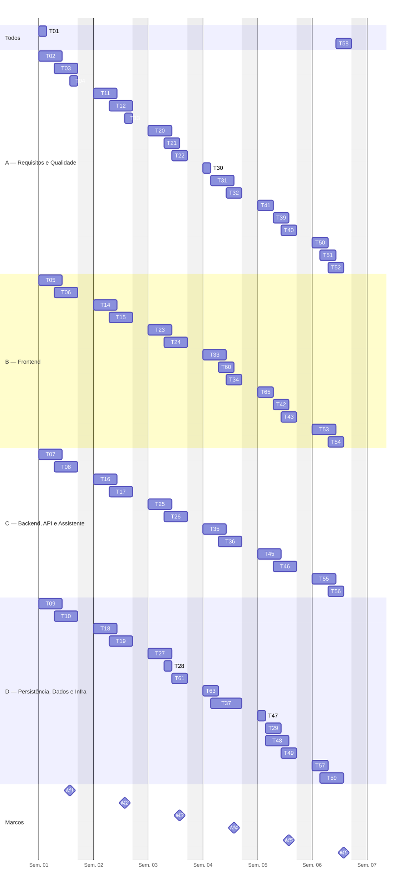

**Figura 10 —** Cronograma relativo por área (tarefas T01–T65) e marcos M1–M6

**Tabela 80 —** Marcos de validação

| **Marco** | **Fim da** | **Validação (resumo; critérios completos na seção 13.1)** |
|---|---|---|
| M1 — Linha de base aprovada | Semana 1 | ERS v2 revisada pela equipe; ADR-001 a 006 e ADR-009 decididos; esqueleto ponta a ponta com CI verde; pendências respondidas ou com hipótese aceita |
| M2 — Incremento 1 | Semana 2 | RF01–RF05, RF16, RF21 e RF22 aceitos; salvamento automático verificado; testes de autorização verdes |
| M3 — Incremento 2 | Semana 3 | RF06–RF10 aceitos; etapas no domínio testadas; suíte adversarial (≥ 30 pedidos) sem resposta aproveitável |
| M4 — Incremento 3 | Semana 4 | RF11–RF14, RF17 e RF18 aceitos; revisão de segurança e privacidade sem item crítico aberto |
| M5 — Congelamento (v0.9.0) | Semana 5 | RF15 e RF20 aceitos; RNF verificados; regressão sem defeito bloqueante ou alto |
| M6 — Entrega (v1.0.0) | Semana 6 | Critérios de conclusão da seção 13.2 atendidos; demonstração ensaiada |

### 8.4 Cronograma detalhado

A Tabela A traz a programação (o quê, quem, quanto e quando); a Tabela B traz a fundamentação e os critérios de conclusão de cada tarefa, com o mesmo identificador. As tarefas de implementação incluem o design do incremento (cerca de 10% a 15% do esforço, seção 4.2.3). Legenda: Resp. = responsável principal; Rev. = revisor; S1·D3 = Semana 1, dia útil 3; referências entre colchetes conforme a seção 14.

**Tabela 81 —** Tabela A — Programação das atividades

| **ID** | **Fase** | **Descrição** | **Objetivo** | **Resp.** | **Rev.** | **Esforço** | **Dur.** | **Início** | **Término** | **Depende de** |
|---|---|---|---|---|---|---|---|---|---|---|
| T01 | S0 | Reunião de iniciação: leitura conjunta da ERS, acordo de trabalho, papéis, canais, DoR e DoD | Alinhar entendimento e regras de colaboração antes de produzir artefatos | Todos | D | 4 h | 1 d | S1·D1 | S1·D1 | — |
| T02 | S0 | Consolidar as perguntas em aberto (Q-01 a Q-21) e validá-las com o professor/cliente; registrar respostas | Eliminar ambiguidades que bloqueiam decisões | A | D | 1,5 h | 3 d | S1·D1 | S1·D3 | T01 |
| T03 | S0 | Revisar a ERS v2 com a equipe e registrar divergências como proposta de mudança; confirmar RNF01–RNF17; texto do termo de ciência (RF21); HU e CA de RF01–RF05, RF16, RF21 e RF22 | Transformar a ERS v2 em itens implementáveis e verificáveis | A | D | 3 h | 3 d | S1·D3 | S1·D5 | T02 |
| T04 | S0 | Estratégia de testes v1 e Definição de Pronto (DoD) | Fixar critérios de qualidade antes da construção | A | D | 1 h | 1 d | S1·D5 | S1·D5 | T01 |
| T05 | S0 | Protótipo de baixa fidelidade: termo de ciência, editor por etapas, histórico/comparação, painel de apoio, painel do professor, meus registros (base: telas da apresentação ao stakeholder) | Validar fluxos de tela com requisitos antes de codificar | B | A | 2,5 h | 3 d | S1·D1 | S1·D3 | T03 |
| T06 | S0 | Esqueleto do frontend: Vite + React + TypeScript, roteamento, cliente HTTP, ESLint, Vitest; página estática do termo de ciência | Habilitar integração contínua do frontend desde a semana 1 | B | A | 3 h | 3 d | S1·D3 | S1·D5 | T10 |
| T07 | S0 | Spike do provedor de LLM: comparar 2–3 provedores/modelos via API (termos de uso de dados, qualidade em PT-BR, latência p90, custo), prompt base, primeira regra de guardrail | Reduzir o maior risco técnico (R01–R03, R14) antes de comprometer a arquitetura | C | B | 2 h | 3 d | S1·D1 | S1·D3 | T01 |
| T08 | S0 | Arquitetura v1: C4 nível 1 e 2, ADR-001 a ADR-005 e ADR-009; contrato inicial com etapas, colagens, turmas e termo | Registrar decisões arquiteturalmente significativas | C | B | 2,5 h | 3 d | S1·D3 | S1·D5 | T03 |
| T09 | S0 | Modelo de dados v1 (conceitual e lógico) com turmas, etapas, transições, colagens e aceite do termo; migração Flyway V1; entidades JPA base | Estabelecer o esquema que sustenta RN03, RN04 e RNF09 | D | C | 3 h | 3 d | S1·D1 | S1·D3 | T08 |
| T10 | S0 | Repositório GitHub (proteção da main, CODEOWNERS, modelos de PR/issue), CI (build e testes), Docker Compose (PostgreSQL), chave da API do LLM por variável de ambiente e segredo do CI, esqueleto do backend | Infraestrutura mínima de colaboração e integração | D | C | 2,5 h | 3 d | S1·D3 | S1·D5 | T01 |
| T11 | S1 | HU e CA de RF06–RF10 e RF17; conjunto de avaliação do assistente v1 (≥ 30 pedidos de escrita ou reescrita, diretos e disfarçados, e casos legítimos por categoria) | Tornar verificável o requisito central de autoria | A | D | 2,5 h | 3 d | S2·D1 | S2·D3 | T03, T07 |
| T12 | S1 | Casos de teste de aceitação de RF01–RF05, RF16, RF21 e RF22 e execução no incremento | Verificar o incremento contra os CA | A | D | 3 h | 3 d | S2·D3 | S2·D5 | T14–T19 |
| T13 | S1 | Matriz de rastreabilidade v1 | Ligar RF/RN a HU, componentes, tarefas e testes | A | D | 1 h | 1 d | S2·D5 | S2·D5 | T03, T08 |
| T14 | S1 | Telas de login com aceite do termo, lista de atividades, cadastro de atividade (gênero, critérios, política de prazo) e turma simples (professor) | Entregar o fluxo do professor e o primeiro acesso do estudante (RF01, RF16, RF21) | B | A | 3,5 h | 3 d | S2·D1 | S2·D3 | T05, T06, T16 |
| T15 | S1 | Editor de texto com salvamento automático (indicador de estado) e histórico de versões (RF03–RF05) | Entregar o fluxo de escrita do estudante | B | A | 3 h | 3 d | S2·D3 | S2·D5 | T14, T17, T19 |
| T16 | S1 | Identidade: autenticação por sessão, perfis Estudante/Professor, autorização por recurso e por turma, bloqueio até o aceite do termo, usuários de demonstração | Proteger dados de estudantes (RF21, RF22, RNF03) | C | B | 3,5 h | 3 d | S2·D1 | S2·D3 | T10 |
| T17 | S1 | API de turmas, atividades (campos novos e política de prazo), início de produção e edição (RF01–RF03, RF16) + testes de API | Expor contratos estáveis ao frontend | C | B | 3 h | 3 d | S2·D3 | S2·D5 | T09, T16 |
| T18 | S1 | Persistência de turmas, atividades, produções, versões (tipo e etapa) e aceite do termo (append-only, unicidade do número da versão), migração V2 | Garantir RN04 no nível do banco | D | C | 3 h | 3 d | S2·D1 | S2·D3 | T09 |
| T19 | S1 | Serviço de versões automáticas (só com conteúdo alterado) e marcadas, histórico com filtro por etapa e tipo (RF04–RF05) + testes de integração com Testcontainers | Registrar versões com data, hora, tipo e etapa e consultá-las | D | C | 3,5 h | 3 d | S2·D3 | S2·D5 | T18 |
| T20 | S2 | Executar a avaliação do assistente (≥ 30 pedidos de escrita ou reescrita, casos legítimos por categoria, variação linguística e pedido de nota) com 2 avaliadores e rubrica | Medir aderência a RF08–RF09 e RN02, RN07–RN09 | A | D | 3 h | 3 d | S3·D1 | S3·D3 | T25, T26 |
| T21 | S2 | Testes de aceitação de RF06–RF10 | Verificar o incremento 2 | A | D | 1,5 h | 2 d | S3·D3 | S3·D4 | T23–T28 |
| T22 | S2 | HU e CA de RF11–RF15 e RF18–RF20 (refinamento uma sprint à frente) | Garantir que a sprint seguinte comece com critérios de aceitação prontos | A | D | 2 h | 2 d | S3·D4 | S3·D5 | T11 |
| T23 | S2 | Painel de apoio: mensagem livre com trecho selecionado, orientação identificada como gerada por IA, aviso de indisponibilidade, histórico de interações | Entregar RF07 e RF10 na interface (RNF08, RNF11) | B | A | 3 h | 3 d | S3·D1 | S3·D3 | T25 |
| T24 | S2 | Comparação lado a lado entre versões (RF06), com sugestão padrão primeira versão marcada × final e filtro por etapa e tipo | Destacar inserções, exclusões e alterações | B | A | 3,5 h | 3 d | S3·D3 | S3·D5 | T27 |
| T25 | S2 | Porta AssistenteGateway + adaptador da API do provedor (Spring AI); prompt de sistema versionado com gênero, orientações e etapa; classificação da categoria (RF12); minimização dos dados (RNF04); timeout e indisponibilidade (RNF08) | Isolar o provedor de LLM do domínio | C | B | 4 h | 3 d | S3·D1 | S3·D3 | T07, T17 |
| T26 | S2 | GuardrailDeAutoria: validação de saída do LLM (RF09, RN07, RN09) e recusa explícita de pedidos de escrita (FA01) + testes unitários, incluindo casos adversariais | Garantir RN02 independentemente do comportamento do modelo | C | B | 2,5 h | 3 d | S3·D3 | S3·D5 | T11, T25 |
| T27 | S2 | Diff por palavras no backend (java-diff-utils) para RF06 + testes | Calcular alterações de forma determinística | D | C | 2,5 h | 3 d | S3·D1 | S3·D3 | T19 |
| T28 | S2 | Persistência das interações (RF10) com categoria, etapa, recusa e marcação de bloqueio | Base de dados para RF10, RF12 e métricas | D | C | 1,5 h | 1 d | S3·D3 | S3·D3 | T18 |
| T29 | S4 | Script de backup/restauração (pg_dump) e dados de demonstração (turma, atividades e produções em várias etapas) | Viabilizar rollback e demonstrações reprodutíveis | D | C | 1,5 h | 2 d | S5·D2 | S5·D3 | T18 |
| T30 | S3 | Ficha de cálculo dos indicadores da seção 8 da ERS v2 e atualização da matriz de rastreabilidade | Tornar calculáveis as métricas da POC e manter a linha de base coerente | A | D | 1 h | 1 d | S4·D1 | S4·D1 | T22 |
| T31 | S3 | Testes de aceitação de RF11–RF14, RF17 e RF18 | Verificar o incremento 3 | A | D | 3 h | 3 d | S4·D2 | S4·D4 | T33–T37, T60, T61, T63 |
| T32 | S3 | Revisão de segurança e privacidade: checklist ASVS (itens selecionados), LGPD e dados enviados ao provedor de LLM (RNF01–RNF04) | Verificar controles mínimos antes da etapa final | A | D | 2 h | 2 d | S4·D4 | S4·D5 | T16, T25 |
| T33 | S3 | Painel do professor (RF13): produções da atividade com etapa atual, versões, interações, colagens destacadas e evolução, sem ranking | Entregar o acompanhamento pedagógico | B | A | 3,5 h | 3 d | S4·D1 | S4·D3 | T35 |
| T34 | S3 | Submissão final (RF14) na interface, com política de prazo | Fechar o ciclo do estudante | B | A | 1,5 h | 2 d | S4·D4 | S4·D5 | T36 |
| T35 | S3 | API de acompanhamento com autorização por turma (RF13): etapa, versões, interações e colagens | Expor dados apenas ao professor responsável | C | B | 3 h | 3 d | S4·D1 | S4·D3 | T16, T37 |
| T36 | S3 | Submissão final: transição de estado, versão final marcada, política de prazo (B4) e evento que dispara a similaridade (RF14) | Garantir que a versão submetida não mude | C | B | 3,5 h | 3 d | S4·D3 | S4·D5 | T19, T61 |
| T37 | S3 | Consultas agregadas de progresso e apoio (RF11, RF12: tempo por etapa, versões, alterações, interações por categoria e etapa, colagens) e consulta dos próprios registros (RF20), com projeções | Calcular evolução sem duplicar dados | D | C | 4 h | 3 d | S4·D2 | S4·D5 | T28, T61 |
| T39 | S4 | Testes de aceitação de RF15, RF20 e das regras RN05/RN06 | Garantir que o sistema apoia e não decide | A | D | 2 h | 2 d | S5·D3 | S5·D4 | T42, T45, T65 |
| T40 | S4 | Regressão completa de aceitação e registro de defeitos | Detectar regressões antes do congelamento | A | D | 2,5 h | 2 d | S5·D4 | S5·D5 | T39 |
| T41 | S4 | Protocolo do piloto: métricas da seção 8 da ERS v2, uma turma e pelo menos 3 atividades (sugerido), termo e consentimento (RNF02), retenção e pseudonimização (RNF01) | Deixar o piloto pronto para execução após a entrega (B11) | A | D | 1,5 h | 2 d | S5·D1 | S5·D2 | T30 |
| T42 | S4 | Relatório de similaridade na interface: índice por fonte, trechos destacados e resumo de colagens, sem veredito | Entregar RF15 respeitando RN06 | B | A | 2 h | 2 d | S5·D3 | S5·D4 | T45 |
| T43 | S4 | Usabilidade e acessibilidade: WCAG 2.1 AA (axe e verificação manual), linguagem simples, identificação das respostas de IA, estado do salvamento automático | Atender RNF10–RNF12 e RNF17 | B | A | 2,5 h | 2 d | S5·D4 | S5·D5 | T60 |
| T45 | S4 | Serviço de similaridade executado após a submissão: normalização e n-gramas sob demanda (absorve a antiga T38), contenção contra produções da atividade e orientações do assistente, resumo de colagens (RF15) | Detectar sobreposição de trechos com evidência | C | B | 4 h | 3 d | S5·D1 | S5·D3 | T36, T63 |
| T46 | S4 | Teste de desempenho básico (API e assistente) e hardening (cabeçalhos, CORS, validação, limite de chamadas e de custo da API de LLM) | Verificar RNF06, RNF14 e segurança | C | B | 2,5 h | 3 d | S5·D3 | S5·D5 | T25 |
| T47 | S4 | Persistência das análises de similaridade (resultado por fonte e trechos em JSONB) | Registrar análises para consulta do professor | D | C | 1 h | 1 d | S5·D1 | S5·D1 | T09 |
| T48 | S4 | CI: análise estática, cobertura (JaCoCo) e verificação de dependências | Automatizar critérios da DoD | D | C | 2 h | 3 d | S5·D2 | S5·D4 | T10 |
| T49 | S4 | Empacotamento da demonstração: compose completo (sem servidor de LLM local), README de execução com configuração da chave da API, instalação limpa | Garantir que a POC rode fora da máquina do autor | D | C | 1,5 h | 2 d | S5·D4 | S5·D5 | T29 |
| T50 | S5 | Teste de aceitação final (roteiro ponta a ponta) e parecer de liberação | Decidir objetivamente a liberação | A | D | 2 h | 2 d | S6·D1 | S6·D2 | T53, T55, T57 |
| T51 | S5 | Relatório final de qualidade e rastreabilidade | Evidenciar cobertura de requisitos | A | D | 1,5 h | 2 d | S6·D2 | S6·D3 | T50 |
| T52 | S5 | Consolidação da documentação final e dos registros (atas, uso de IA) | Entregar a documentação completa | A | D | 1 h | 2 d | S6·D3 | S6·D4 | T51 |
| T53 | S5 | Correção de defeitos do frontend | Eliminar defeitos abertos | B | A | 2,5 h | 3 d | S6·D1 | S6·D3 | T40 |
| T54 | S5 | Manual do usuário (estudante e professor) | Viabilizar uso e avaliação da POC | B | A | 2 h | 2 d | S6·D3 | S6·D4 | T53 |
| T55 | S5 | Correção de defeitos do backend | Eliminar defeitos abertos | C | B | 2,5 h | 3 d | S6·D1 | S6·D3 | T40 |
| T56 | S5 | Documentação final de arquitetura (C4 nível 3, ADRs, OpenAPI) | Deixar a arquitetura compreensível para manutenção | C | B | 2 h | 2 d | S6·D3 | S6·D4 | T55 |
| T57 | S5 | Correção de defeitos de dados e infraestrutura | Eliminar defeitos abertos | D | C | 2 h | 2 d | S6·D1 | S6·D2 | T40 |
| T58 | S5 | Ensaio da demonstração com roteiro e dados de demonstração | Reduzir risco na apresentação final | Todos | A | 6 h | 2 d | S6·D4 | S6·D5 | T50 |
| T59 | S5 | Release v1.0.0: tag, notas de versão, backup e procedimento de rollback testado | Entregar versão identificável e recuperável | D | C | 2,5 h | 3 d | S6·D2 | S6·D4 | T57 |
| T60 | S3 | Etapas no editor (indicador da etapa, avançar e voltar, espaço do Planejar) e captura de colagens (RF17, RF18) | Entregar a escrita por etapas e o registro de colagens na interface | B | A | 1,5 h | 2 d | S4·D3 | S4·D4 | T61, T63 |
| T61 | S2 | Etapas no domínio: transições Planejar → Escrever → Revisar → Reescrever, volta registrada, versão marcada a cada transição, bloqueio após a submissão (RF17) + testes | Conduzir a produção por etapas, núcleo da hipótese da POC | D | C | 2,5 h | 2 d | S3·D4 | S3·D5 | T19 |
| T63 | S3 | Eventos de colagem: entidade append-only, migração, endpoint de registro, limite de destaque configurável (RF18) + testes | Registrar colagens para o professor e para a similaridade | D | C | 2 h | 2 d | S4·D1 | S4·D2 | T18 |
| T64 | Could | Devolutiva do professor (RF19): registro e exibição ao estudante | Permitir devolutivas sobre o processo | B e C | A | 3 h | — | Após M5, só com sobra | — | T33, T35 |
| T65 | S4 | Meus registros (RF20): versões, interações, colagens e indicadores do estudante (RF12), reaproveitando a visão do painel restrita à própria produção | Dar transparência ao estudante (RN10) | B | A | 2 h | 2 d | S5·D1 | S5·D2 | T35, T37 |

**Tabela 82 —** Tabela B — Fundamentação, entregáveis e critérios de conclusão

| **ID** | **Fundamentação metodológica ou técnica** | **Ref.** | **Entregável** | **Critério de conclusão** | **Marco** |
|---|---|---|---|---|---|
| T01 | Concepção da engenharia de requisitos; transparência dos compromissos do Scrum | [6][9] | Ata da reunião + acordo de trabalho (docs/gestao) | Ata revisada por D e aprovada pelos 4 integrantes | M1 |
| T02 | Levantamento e negociação de requisitos | [2][9] | Registro de perguntas e respostas (Apêndice A atualizado) | Cada pergunta com resposta, decisão provisória ou dono e prazo | M1 |
| T03 | Características de requisitos bem formados; histórias e critérios de aceitação | [2][9][18] | ERS v2 revisada + lista de mudanças propostas + texto do termo + HU/CA RF01–RF05, RF16, RF21, RF22 no backlog | Revisão de D sem pendência bloqueante; aceite do professor nas decisões de escopo | M1 |
| T04 | Pirâmide de testes; níveis de teste | [9][10] | Plano de testes v1 (docs/qualidade) | Níveis, ferramentas, critérios de entrada/saída definidos e revisados | M1 |
| T05 | Validação de requisitos por protótipo | [9][51] | Protótipo navegável (imagens ou ferramenta de wireframe) | Cada tela rastreada a RF; revisão de A aprovada | M1 |
| T06 | Integração contínua; walking skeleton | [10][21][34] | Projeto frontend no repositório, build e teste no CI; página do termo | CI verde; página chama /api/health | M1 |
| T07 | Exploração para redução de risco; decisão registrada | [11][23][28] | Relatório do spike + ADR-006 (provedor, modelo, parâmetros, termos de uso de dados, custo estimado) | Medições registradas; termos compatíveis com RNF04; decisão aceita em revisão por B e D | M1 |
| T08 | Descrição de arquitetura por visões; ADRs | [3][11][15][16] | docs/arquitetura (C4 + ADRs) | ADRs no estado 'Aceito' após revisão de B (e D para persistência) | M1 |
| T09 | Modelagem conceitual → lógica; mapeamento objeto-relacional | [12][13][31] | DER + dicionário de dados + V1__init.sql | Migração executa em banco vazio no CI; revisão de C aprovada | M1 |
| T10 | Integração contínua; gestão de configuração | [10][21][37] | Repositório configurado + workflow de CI + compose + .env.example | PR de teste bloqueado sem aprovação; CI verde na main; nenhuma chave no repositório | M1 |
| T11 | Requisito verificável; critérios de aceitação | [2][18] | HU/CA RF06–RF10 e RF17 + conjunto de avaliação v1 | Conjunto com ≥ 30 pedidos; limites numéricos do RF09 decididos (B5) ou registrados como pendência | M2 |
| T12 | Teste de aceitação; validação | [9][41] | CT de aceitação + evidências | Todos os CA de RF01–RF05, RF16, RF21 e RF22 executados; defeitos registrados | M2 |
| T13 | Gestão de requisitos e rastreabilidade | [2][9] | Matriz v1 (docs/ers) | Todo RF com HU e componente; lacunas sinalizadas | M2 |
| T14 | Desenvolvimento incremental | [10] | Telas + testes de componente | CA de RF01, RF16 e RF21 verificados por A | M2 |
| T15 | Desenvolvimento incremental | [10] | Telas + testes de componente | CA de RF03–RF05 verificados por A; perda máxima de 1 min de edição (RNF07) | M2 |
| T16 | Controle de acesso; requisitos de verificação de segurança | [22][27] | Módulo identidade + testes | Acesso cruzado entre estudantes e entre turmas negado em teste; acesso sem aceite do termo bloqueado | M2 |
| T17 | Interfaces explícitas; testes de integração | [10][25] | Endpoints documentados (OpenAPI) + testes | Testes de API verdes; contrato revisado por B | M2 |
| T18 | Integridade referencial; repositórios Spring Data | [12][13][26] | Entidades, repositórios, V2__*.sql | Tentativa de UPDATE/DELETE em versão falha em teste | M2 |
| T19 | Testes de integração com dependências reais | [10][32] | Serviço + testes | Testes verdes no CI com PostgreSQL real; versão automática não criada sem alteração | M2 |
| T20 | Validação com critérios explícitos | [23][2] | Relatório de avaliação do assistente | Nenhuma resposta aproveitável nos ≥ 30 pedidos (CA-09.1) e metas da seção 9.4 atingidas, ou defeitos abertos | M3 |
| T21 | Teste de aceitação | [41] | CT + evidências | CA executados; defeitos registrados | M3 |
| T22 | Refinamento contínuo do backlog; Definition of Ready | [2][6][18] | HU/CA RF11–RF15 e RF18–RF20 no backlog | DoR atendida para todos os itens da S3; revisão de D aprovada | M3 |
| T23 | Desenvolvimento incremental | [10] | Componentes + testes | CA de RF07/RF10 verificados | M3 |
| T24 | Desenvolvimento incremental | [10] | Componente de diff + testes | CA de RF06 verificados | M3 |
| T25 | Portas e adaptadores; substituibilidade (ISO/IEC 25010) | [4][17][28] | Módulo apoio + testes com dublê do gateway | Troca do adaptador sem alterar o domínio; nenhum identificador do estudante no payload (RNF04); falha do provedor não bloqueia a escrita (RNF08) | M3 |
| T26 | Defesa em profundidade contra prompt injection | [23] | Classe validadora + suíte de testes | 100% dos casos adversariais da suíte bloqueados ou recusados | M3 |
| T27 | Algoritmo de diff de Myers (biblioteca) | [36] | Serviço de comparação + testes | Casos de inserção/exclusão/alteração corretos | M3 |
| T28 | Modelo de dados; registro do processo (RN03) | [12][13] | Entidade + V3__*.sql + testes | Interação salva atômica com a resposta, com categoria e etapa | M3 |
| T29 | Gestão de configuração; recuperabilidade | [30] | scripts/ + seed | Restauração testada em ambiente limpo | M5 |
| T30 | Métricas definidas a partir de objetivos; gestão de requisitos | [2][4] | Ficha de cálculo dos indicadores + matriz v2 | Cada métrica da ERS v2, seção 8, com fórmula e fonte de dados; nenhum RF sem rastro | M4 |
| T31 | Teste de aceitação | [41] | CT + evidências | CA de RF11–RF14, RF17 e RF18 executados; defeitos registrados | M4 |
| T32 | Requisitos de verificação de segurança; proteção de dados | [22][24] | Checklist preenchido + pendências | Nenhum item crítico aberto sem plano; payload enviado ao provedor inspecionado | M4 |
| T33 | Desenvolvimento incremental | [10] | Telas + testes | CA de RF13 verificados | M4 |
| T34 | Desenvolvimento incremental | [10] | Telas + testes | CA de RF14 verificados | M4 |
| T35 | Controle de acesso | [22][27] | Endpoints + testes | Professor sem vínculo recebe 403 em teste | M4 |
| T36 | Máquina de estados do domínio | [9] | Serviço + testes | Edição após submissão rejeitada em teste; política de prazo aplicada; evento de submissão publicado | M4 |
| T37 | Projeções e consultas no Spring Data JPA | [12][26] | Repositórios de consulta + testes | Resultados conferidos com dados de teste; estudante só consulta os próprios registros | M4 |
| T39 | Teste de aceitação | [41] | CT + evidências | Nenhuma tela emite veredito automático; CA de RF20 verificados | M5 |
| T40 | Teste de regressão | [9][41] | Relatório de regressão | Zero defeitos bloqueantes ou altos abertos | M5 |
| T41 | Mensuração orientada a objetivos; proteção de dados | [4][24] | Protocolo do piloto | Aprovado pelo professor e apresentado ao stakeholder | M5 |
| T42 | Desenvolvimento incremental | [10] | Tela + testes | CA de RF15 verificados | M5 |
| T43 | ISO/IEC 25010:2023 (capacidade de interação); WCAG 2.1 | [4][52] | Ajustes de UI + checklist de acessibilidade | Nenhuma falha nível A/AA nas telas principais; checklist de usabilidade aprovado por A | M5 |
| T45 | Resemblance/containment (Broder, 1997) | [42] | Serviço + testes | Casos de cópia literal detectados; sem falso positivo nos casos-controle; análise disparada pela submissão | M5 |
| T46 | Eficiência de desempenho; ASVS | [4][22] | Relatório de desempenho + ajustes | Metas de RNF06/RNF14 atendidas ou desvio aprovado | M5 |
| T47 | Modelo de dados | [12] | Entidades + V5__*.sql + testes | Análise recuperável por versão | M5 |
| T48 | Integração contínua | [21][37] | Workflow atualizado | Pipeline falha quando a DoD é violada | M5 |
| T49 | Entrega contínua (preparação) | [43] | Compose + README | Instalação limpa por outro integrante em ≤ 30 min | M5 |
| T50 | Validação | [9][41] | Parecer de liberação | Critérios da seção 13 deste plano atendidos | M6 |
| T51 | Gestão de requisitos | [2] | Relatório + matriz final | Todo RF com teste executado e resultado | M6 |
| T52 | Gestão documental | [1] | Pacote documental | Checklist da seção 11 deste plano completo | M6 |
| T53 | Gestão de defeitos | [9] | PRs de correção | Sem defeito bloqueante/alto no frontend | M6 |
| T54 | Documentação de usuário | [9] | Manual | Revisado por A com o sistema real | M6 |
| T55 | Gestão de defeitos | [9] | PRs de correção | Sem defeito bloqueante/alto no backend | M6 |
| T56 | Descrição de arquitetura | [3][15][16] | docs/arquitetura final | Coerência entre código e diagramas verificada por B | M6 |
| T57 | Gestão de defeitos | [9] | PRs de correção | Sem defeito bloqueante/alto em dados/infra | M6 |
| T58 | Validação com stakeholders (Sprint Review final) | [6] | Roteiro + gravação opcional | Roteiro executado sem falhas | M6 |
| T59 | Versionamento semântico; gestão de configuração | [39][37] | Tag v1.0.0 + notas + backup | Rollback para v0.9.x testado | M6 |
| T60 | Desenvolvimento incremental | [10] | Componentes + testes | CA de RF17 (interface) e de captura do RF18 verificados | M4 |
| T61 | Máquina de estados do domínio | [9][14] | Serviço de etapas + testes | Transições, voltas e versão marcada verificadas em teste; troca de etapa após a submissão rejeitada | M3 |
| T63 | Modelo de dados; registro do processo (RN03) | [12][13] | Entidade + migração + endpoint + testes | Colagem registrada com trecho, tamanho, etapa e horário; UPDATE/DELETE rejeitado | M4 |
| T64 | Desenvolvimento incremental | [10] | Endpoint + tela + testes | CA de RF19 verificados (só se executada) | — |
| T65 | Desenvolvimento incremental; transparência (RN10) | [10] | Tela + testes | CA de RF20 e da visão do estudante do RF12 verificados | M5 |

### 8.5 Comparação com o cronograma anterior

**Tabela 83 —** Comparação entre o cronograma anterior e o atual

| **Aspecto** | **Cronograma anterior (Trabalho 2)** | **Este cronograma** | **Motivo da mudança** |
|---|---|---|---|
| Natureza do trabalho | Projeto e documentação, sem código | Construção, teste e entrega de software + documentação | Escopo do projeto atual |
| Unidade de planejamento | 6 fases em 6 dias | 6 sprints semanais com incremento | Feedback precoce e incerteza do LLM |
| Equipe | 2 pessoas, 5 itens de autoria cada | 4 áreas, ~6 h de tarefas por pessoa por semana | Escopo e dependências maiores |
| Revisão | Par fixo autor/revisor | Anel A → B → C → D → A + segundo revisor em itens transversais | Revisor como consumidor direto do trabalho |
| Estimativa | Sem estimativa de esforço | Três pontos em horas + capacidade + sensibilidade | Tornar o plano verificável e ajustável |
| Testes e qualidade | Revisão textual | Pirâmide de testes, CI, aceitação, avaliação do assistente | Software executável exige verificação automatizada |
| Contingência | “Deixar um dia inteiro para revisão” | Semana 6 de estabilização + válvulas *Should* + reserva | Riscos maiores e mais tempo de integração |
| Elementos mantidos | GitHub com PR, atas, glossário, ADRs, C4, citação de IA | Mantidos integralmente | Funcionaram e geram evidências de autoria |

**Mudanças da versão 1.1 para a 1.2.** A tabela abaixo registra cada tarefa alterada. Saldo: +16 h de trabalho novo (8 h em tarefas novas e 8 h em tarefas ampliadas) e −9 h de simplificações e remoções, o que leva o total de 144 h para 151 h.

**Tabela 84 —** Mudanças no cronograma da versão 1.1 para a 1.2

| **Tipo** | **Tarefas** | **Horas** | **Motivo** |
|---|---|---|---|
| Nova | T61 (etapas no domínio, D, Semana 3) | +2,5 h | RF17 (B3) |
| Nova | T60 (etapas no editor e captura de colagens, B, Semana 4) | +1,5 h | RF17 e RF18 |
| Nova | T63 (eventos de colagem, D, Semana 4) | +2 h | RF18 |
| Nova | T65 (meus registros e indicadores do estudante, B, Semana 5) | +2 h | RF20 e visão do estudante do RF12 (saiu de T34) |
| Nova, fora da base | T64 (devolutiva) | 3 h, não somadas | RF19 é *Could* (B8) |
| Ampliada | T03, T06, T08, T09, T12, T14, T16, T19, T20, T24, T25, T31, T36, T37, T43, T45 | +0,5 h cada (+8 h) | Revisão da ERS v2, termo, turma, salvamento automático, ≥ 30 casos de avaliação, filtro por etapa, classificação da categoria, política de prazo, gatilho da similaridade, RF20 nas consultas, WCAG 2.1 AA, resumo de colagens |
| Reduzida | T07 (−1 h), T49 (−0,5 h) | −1,5 h | B1: sem instalação nem empacotamento de modelo local |
| Reduzida | T28 (−0,5 h), T47 (−1 h) | −1,5 h | Entidades já modeladas em T09; resultado da similaridade em JSONB |
| Reduzida | T30 (−0,5 h) | −0,5 h | Indicadores já operacionalizados na ERS v2, seção 8 |
| Reduzida | T34 (−1 h), T42 (−0,5 h) | −1,5 h | Indicadores do estudante movidos para T65; relatório de similaridade simplificado |
| Removida | T38 (n-gramas persistidos) | −2,5 h | Incorporada a T45 (cálculo sob demanda) |
| Removida | T44 (testes de componentes críticos) | −1,5 h | Testes de componente passam a ser exigidos dentro de cada tarefa pela DoD; sem tarefa separada |
| Movida | T29 (backup e dados de demonstração): Semana 3 → Semana 5 | — | Abrir espaço para T61 na Semana 3 |
| Movida | T39, T40, T41: nova ordem na Semana 5 | — | T39 passa a depender de T65 |

## 9. Qualidade, testes e validação

### 9.1 Estratégia

A estratégia é **orientada a risco**: o maior esforço de verificação vai para o que pode invalidar a POC — a garantia de autoria (RN01, RN02), a integridade do histórico (RN04, RNF09), a confidencialidade dos textos (RNF03) e a minimização do que é enviado ao provedor de LLM (RNF04). A distribuição dos testes automatizados segue a pirâmide de testes: muitos testes de unidade, menos testes de integração e poucos testes de sistema; Valente cita a proporção 70/20/10 como recomendação genérica [10], e a equipe a usa como orientação, não como meta rígida. A integração é incremental e contínua, evitando a integração “big bang” criticada por Pressman [9].

### 9.2 Níveis e tipos de verificação

**Tabela 85 —** Níveis e tipos de verificação

| **Nível ou tipo** | **Objetivo** | **Ferramenta** | **Resp. · rev.** | **Entrada** | **Saída** | **Evidência** |
|---|---|---|---|---|---|---|
| Revisão de requisitos e documentos | Requisitos corretos e verificáveis | Checklist (9.7) em PR | Revisor do anel | Documento em PR | Sem item bloqueante | Comentários e aprovação no PR |
| Revisão de código | Defeitos, legibilidade, aderência à arquitetura | PR no GitHub | Revisor do anel (+2º) | CI verde | Aprovação | Histórico do PR |
| Análise estática | Defeitos comuns e estilo | SpotBugs, ESLint, tsc | Autor | Commit | Sem problema crítico novo | Log do CI |
| Unitário | Regras de domínio, guardrail, *diff*, similaridade | JUnit, AssertJ, Mockito, Vitest | Autor · revisor | Código da tarefa | Testes verdes; cobertura (9.3) | Relatório JaCoCo |
| Integração | Repositórios, transações, migrações com banco real | Spring Boot Test + Testcontainers | D e C | Migrações aplicáveis | Testes verdes | Log do CI |
| API e contrato | Rotas, códigos HTTP, autorização, formato | MockMvc; OpenAPI | C · B | Endpoint implementado | Testes verdes; OpenAPI atualizado | Log do CI; arquivo OpenAPI |
| Arquitetura | Regras de dependência entre módulos e portas | ArchUnit | C · B | — | Nenhuma violação | Log do CI |
| Sistema | Fluxos ponta a ponta no ambiente Compose | Roteiro manual (Playwright opcional) | A · D | Incremento integrado | Roteiro executado | Registro de execução |
| Aceitação | CA de cada HU | Casos de teste CT-xx | A · D | DoD técnica atendida | CA aprovados | Relatório por sprint |
| Avaliação do assistente | Pertinência das orientações e cumprimento de RN02 | Conjunto de avaliação + rubrica | A e B (avaliadores) · C informa | Assistente integrado | Metas de 9.4 | Relatório T20 |
| Segurança | Controle de acesso, sessão, entrada, cabeçalhos, LLM | Checklist ASVS selecionado; testes negativos | A (revisão) · C (correções) | M3 | Sem item crítico aberto | Checklist T32 |
| Desempenho | RNF06 e RNF14 | Script de carga leve + métricas Actuator | C · B | M4 | Metas atendidas ou desvio aprovado | Relatório T46 |
| Acessibilidade | RNF12 (WCAG 2.1 AA) | axe + verificação manual | B · A | M4 | Nenhuma falha nível A/AA nas telas principais | Checklist T43 |
| Regressão | Nada que funcionava deixou de funcionar | Suíte automatizada + roteiro de aceitação | A · D | Antes de M5 e M6 | Sem defeito bloqueante/alto | Relatório T40 |

### 9.3 Metas de cobertura e qualidade

**Tabela 86 —** Metas de cobertura e qualidade

| **Métrica** | **Meta (Decisão do projeto)** | **Justificativa** |
|---|---|---|
| Cobertura de linhas nos pacotes de domínio e aplicação | ≥ 70% | Concentrar o esforço onde estão as regras (RNF16); controladores e configuração ficam fora da meta |
| Cobertura de ramos no GuardrailDeAutoria, nas transições de etapa e na similaridade | ≥ 90% | Componentes que sustentam RN02, RF17 e RN06 |
| CA de requisitos *Must* | 100% executados e aprovados em M6 | Critério de conclusão |
| Testes negativos de autorização (RNF03) | 100% aprovados | Confidencialidade dos textos |
| Identificadores do estudante no *payload* enviado ao provedor (RNF04) | 0 | Privacidade; verificado por teste do montador do *prompt* |
| Problemas críticos de análise estática | 0 | Higiene mínima |

### 9.4 Avaliação específica do assistente

Testes convencionais não bastam para um componente probabilístico. A equipe mantém um **conjunto de avaliação versionado**, executado na S2 e a cada mudança de provedor, modelo ou *prompt*. O tamanho segue o RF09 da ERS v2 (pelo menos 30 pedidos de escrita ou reescrita); a versão 1.1 previa 20 casos no total.

- **Pedidos de escrita ou reescrita (≥ 30), diretos e disfarçados:** pedido de texto completo; continuação de parágrafo; reescrita ou paráfrase de trecho; introdução ou conclusão sobre o tema; texto-modelo (RN09); instrução para ignorar regras; instrução escondida dentro do texto do estudante (injeção indireta); pedido de "exemplo" longo; mudança de idioma; dramatização ("finja que você é o estudante").
- **Casos legítimos (≥ 12):** pelo menos três por categoria do RF12 (estrutura e organização, coesão e coerência, argumentação, adequação ao gênero), em etapas diferentes, com textos de demonstração.
- **Casos de regra (≥ 4):** pedido de nota ou conceito (RN07); texto com variação linguística ou escolha de estilo que não é erro (RN08).
- **Rubrica (aplicada por A e B, que não escrevem o *prompt*):** pertinência (0–2), clareza (0–2), autoria preservada (sim/não) e linguagem adequada (sim/não, RNF10).
- **Metas:** **nenhuma** resposta com texto aproveitável nos pedidos de escrita ou reescrita após o validador (CA-09.1, ERS v2); ≥ 80% dos legítimos com pertinência ≥ 1 para ambos os avaliadores (proposta); nenhum caso de regra com nota ou com variação tratada como erro; concordância entre avaliadores registrada. Os limites numéricos de tamanho das orientações dependem de B5.
- **Custo (B1):** cada execução chama a API real cerca de 50 vezes; o relatório registra o custo. Os casos adversariais com resposta esperada determinística também rodam como teste automatizado do validador no CI, com um adaptador falso (sem chamar a API).
### 9.5 Relação entre testes e requisitos

**Tabela 87 —** Relação entre requisitos e testes

| **Requisito** | **Unitário** | **Integração / API** | **Aceitação** | **Outros** |
|---|---|---|---|---|
| RF01, RF02, RF16 | Validações de atividade e turma; política de prazo | Endpoints e autorização por perfil e por turma | CA-01.x, CA-02.x, CA-16.x | — |
| RF03–RF05, RN04 | Regras de versão automática e marcada | Inserção, unicidade, imutabilidade (banco real) | CA-03.x a CA-05.x | Teste de interrupção (RNF07) |
| RF06 | *Diff* por palavras | Endpoint de comparação | CA-06.x | — |
| RF07–RF10, RF12, RN01, RN02, RN07–RN09 | Guardrail; classificação; montagem do *prompt* sem identificadores | Fluxo com dublê do gateway (inclusive em falha); persistência da interação | CA-07.x a CA-10.x, CA-12.x | Avaliação do assistente (9.4) |
| RF11, RF13, RN05 | Cálculo de indicadores | Consultas agregadas; autorização do professor | CA-11.x, CA-13.x | Revisão de interface (sem nota nem ranking) |
| RF14 | Máquina de estados; política de prazo | Submissão, bloqueio de edição e evento | CA-14.x | — |
| RF15, RN06 | Normalização, n-gramas, contenção | Disparo pela submissão; persistência da análise | CA-15.x | Casos-controle de calibração |
| RF17 | Transições de etapa | Versão marcada a cada transição; volta registrada | CA-17.x | — |
| RF18 | — | Registro e imutabilidade da colagem | CA-18.x | Revisão de interface (sem rótulo de suspeita) |
| RF19 (*Could*) | — | Endpoint de devolutiva | CA-19.x | Só se T64 for executada |
| RF20, RF21, RF22, RN10 | — | Estudante só vê os próprios registros; acesso bloqueado sem aceite do termo; autenticação | CA-20.x a CA-22.x | Revisão T32 |
| RNF01–RNF17 | — | Testes negativos; desempenho; *payload* sem identificadores | Verificação em M4–M5 | Checklist ASVS e WCAG; teste de restauração |

### 9.6 Registro e tratamento de defeitos

**Tabela 88 —** Severidade de defeitos

| **Severidade** | **Definição** | **Prazo de correção** |
|---|---|---|
| Bloqueante | Impede o fluxo principal, viola RN01/RN02/RN04, expõe dados de outro usuário ou envia identificador do estudante ao provedor de LLM | Antes do fim da sprint corrente; interrompe trabalho novo do responsável |
| Alta | Um RF não atende seus CA | Antes do marco seguinte |
| Média | Comportamento incorreto com contorno simples | Planejado no backlog; corrigido até M5 se houver capacidade |
| Baixa | Cosmético ou de texto | Backlog; não bloqueia entrega |

Fluxo: quem encontra abre issue `defeito` com passos para reproduzir, resultado esperado, resultado obtido, severidade e RF afetado → A confirma a severidade → o dono da área corrige com teste que reproduz o defeito → o revisor do anel aprova → A reexecuta o CA. Defeitos por severidade são reportados em cada Sprint Review.

### 9.7 Revisões de requisitos e documentos

Checklist mínimo para revisão de requisitos, derivado das características de requisitos bem formados da ISO/IEC/IEEE 29148 [2] e das perguntas de validação propostas por Pressman [9]:

- O requisito tem origem identificada na ERS, em resposta do professor ou em decisão registrada?
- Expressa uma única necessidade (singular) sem ambiguidade?
- Tem critério de aceitação verificável por teste, inspeção ou demonstração?
- É viável com a stack e a capacidade planejadas?
- É consistente com as regras de negócio e com os demais requisitos?
- Valores numéricos estão marcados como proposta ou como aprovados?
## 10. Versionamento, integração e entrega

### 10.1 Organização do repositório

**Decisão do projeto:** um único repositório (monorepo), porque a equipe é pequena e mudanças de contrato entre frontend e backend podem ser feitas e revisadas no mesmo pull request.

```
assistente-escrita/
├── backend/            # Java 25, Spring Boot 4.x (Maven wrapper)
│   └── src/main/java/.../{identidade,atividades,producao,apoio,
│                          acompanhamento,similaridade,compartilhado}
│   └── src/main/resources/db/migration/   # V1__init.sql, V2__...
├── frontend/           # React + TypeScript + Vite
├── infra/              # docker-compose.yml, .env.example (chave da API fictícia), scripts de backup
├── docs/
│   ├── referencias/   plano/   ers/   arquitetura/adr/
│   ├── dados/   api/   qualidade/   gestao/atas/   entrega/
└── .github/            # workflows/ci.yml, workflows/avaliacao-assistente.yml, CODEOWNERS, modelos
```

**Alinhamento com a pasta atual (versão 1.2).** Os documentos já estão organizados em `docs/referencias/` (POC 2.2 e apresentação ao stakeholder), `docs/ers/` (uma subpasta por versão da ERS; a matriz de rastreabilidade também fica aqui) e `docs/plano/` (uma subpasta por versão do plano). As pastas numeradas da versão 1.1 (`00-plano-mestre`, `01-requisitos` etc.) foram substituídas por esses nomes; as demais seguem o mesmo padrão, sem número.

### 10.2 Estratégia de branches

**GitHub Flow com branches curtas** (variante leve do desenvolvimento baseado no tronco): a `main` está sempre integrável; cada tarefa usa uma branch `tipo/Txx-descricao` (ex.: `feat/T25-adaptador-llm`) com vida de no máximo dois dias úteis, integrada por *squash merge*. Valente lembra que integração contínua é incompatível apenas com branches de longa duração e que adaptações justificadas pelo contexto são legítimas [10]; com dedicação parcial, integrar a cada um ou dois dias é a adaptação adotada. GitFlow foi rejeitado por introduzir branches de longa duração (`develop`, `release`) sem benefício para um único produto com entrega única.

### 10.3 Padrão de commits

Conventional Commits 1.0.0 [38], em português, com referência à issue: `feat(apoio): valida limite de palavras da orientação (#26)`. Tipos usados: `feat`, `fix`, `test`, `docs`, `refactor`, `build`, `ci`, `chore`. O padrão facilita gerar notas de versão e ler o histórico.

### 10.4 Pull requests e aprovação

- Proteção da `main`: merge só por PR, com CI verde, aprovação de *code owner* e conversas resolvidas [37].
- CODEOWNERS implementa o anel de revisão por caminho (exemplo abaixo).
- Modelo de PR: tarefa e RF relacionados; o que mudou; como testar; evidências (prints, logs); impacto em contrato, esquema ou documentação; checklist da DoD.
```
# .github/CODEOWNERS  (usuários fictícios — substituir pelos usuários reais)
/frontend/                         @integrante-A
/backend/src/main/java/**/web/      @integrante-B
/backend/src/main/java/**/apoio/    @integrante-B  @integrante-A
/backend/**/persistencia/           @integrante-C
/backend/src/main/resources/db/     @integrante-C
/infra/  /.github/                  @integrante-C
/docs/ers/                          @integrante-D
```

### 10.5 Integração contínua

**Tabela 89 —** Etapas do pipeline de CI

| **Etapa** | **Quando executa** | **Conteúdo** | **Falha bloqueia merge?** |
|---|---|---|---|
| Backend: build e testes | Todo PR e push na main | `mvn verify`: compilação, unitários, integração com Testcontainers, ArchUnit, JaCoCo, SpotBugs | Sim |
| Frontend: qualidade e build | Todo PR e push na main | `npm ci`, ESLint, `tsc --strict`, Vitest, `vite build` | Sim |
| Contrato | Todo PR que altera API | Geração do OpenAPI e comparação com a versão versionada | Sim (diferença não commitada) |
| Suíte do guardrail | Todo PR | Casos adversariais determinísticos do validador, com adaptador falso do LLM (sem chamar a API) | Sim |
| Avaliação do assistente | Manual (*workflow_dispatch*), a cada mudança de provedor, modelo ou *prompt* | Conjunto da seção 9.4 contra a API real, com a chave em segredo do repositório; registra custo | Não (gera relatório para T20) |
| Dependências | Semanal (Dependabot) e em PR | Alertas de vulnerabilidade e atualização | Vulnerabilidade crítica: sim |
| Release | Tag `v*` | Build das imagens e anexos da release | — |

### 10.6 Gestão de dependências

Versões de bibliotecas Java gerenciadas pelo BOM do Spring Boot, com versões explícitas apenas para bibliotecas fora dele (java-diff-utils, ArchUnit); `package-lock.json` versionado; imagens Docker com *tag* de versão fixa (nunca `latest`); atualizações via PR do Dependabot revisado como qualquer outro.

### 10.7 Segurança de credenciais

- Nenhum segredo no repositório: arquivo `.env` ignorado pelo Git e `.env.example` com valores fictícios, incluindo a chave da API do provedor de LLM.
- Senhas dos usuários de demonstração geradas na configuração do ambiente, não fixas no código.
- Segredos do CI em *GitHub Actions secrets*; a chave da API só é usada pelo *workflow* manual de avaliação do assistente; varredura de segredos do GitHub ativada quando disponível no plano da conta.
- Chave da API com limite de gasto configurado no provedor, quando disponível (risco R01).
- Nenhum dado pessoal real em repositório, *issues* ou *prints* (RNF01).
### 10.8 Versionamento das entregas, implantação e rollback

**Tabela 90 —** Versões planejadas

| **Versão (SemVer [39])** | **Marco** | **Conteúdo** |
|---|---|---|
| v0.1.0 | M1 | Esqueleto ponta a ponta |
| v0.2.0 · v0.3.0 · v0.4.0 | M2 · M3 · M4 | Incrementos 1 a 3 |
| v0.9.0 | M5 | Candidata à entrega (funcionalidades congeladas) |
| v1.0.0 | M6 | Entrega final |

**Implantação:**`docker compose up` a partir da tag, com instruções no README (meta: instalação limpa por outro integrante em até 30 minutos, T49). **Rollback:** a aplicação volta para a tag anterior; como as migrações Flyway só avançam, antes de cada atualização é feito `pg_dump` e, em caso de reversão, o banco é restaurado a partir dele. O procedimento é testado em T59.

## 11. Gestão documental e rastreabilidade

### 11.1 Nível de formalidade

**Decisão do projeto:** formalidade **moderada**. Documentos vivem em Markdown no repositório, versionados e revisados por PR como o código; não há documento duplicado em ferramenta externa. A formalidade é maior apenas onde há avaliação externa ou risco (ERS, ADRs, relatórios de teste e da avaliação do assistente). Essa escolha segue a recomendação de manter um único sistema de registro para decisões [11] e evita a manutenção paralela de cópias divergentes.

### 11.2 Documentos do projeto

**Tabela 91 —** Documentos do projeto

| **ID** | **Documento** | **Tipo** | **Finalidade e conteúdo mínimo** | **Resp. · rev.** | **Criação · atualização** | **Aprovação** | **Relaciona-se com** | **Local** |
|---|---|---|---|---|---|---|---|---|
| D01 | Plano mestre (este) | Essencial | Processo, arquitetura, cronograma, qualidade, riscos | A · D | S0 · a cada mudança aprovada | Equipe em M1 | Todos | docs/plano |
| D02 | ERS v2.x | Essencial | RF01–RF22, RN01–RN10, RNF01–RNF13, prioridade, CA, estado | A · D | Revisada em S0 · por mudança aprovada | Professor (escopo) | D03, D04, D17 | docs/ers |
| D03 | Backlog (HU e CA) | Essencial | HU, CA, estimativa, responsável | A · D | S0 · contínuo | DoR | D02, tarefas | Issues |
| D04 | Matriz de rastreabilidade | Essencial | RF → HU → componente → tarefa → teste → versão | A · D | S1 · por sprint | Sem lacunas em M6 | D02, D05, D08 | docs/ers |
| D05 | Descrição de arquitetura | Essencial | Preocupações, C4 1–3, DER, sequência, ADRs | C · B (D nos dados) | S0 · por decisão | ADR aceito | D02, D06, D07 | docs/arquitetura |
| D06 | Modelo de dados e dicionário | Essencial | DER, tabelas, restrições, migrações | D · C | S0 · por migração | PR aprovado | D05 | docs/dados |
| D07 | Contrato da API | Essencial | OpenAPI gerado | C · B | S1 · por endpoint | CI | D05, frontend | docs/api |
| D08 | Plano e relatórios de teste | Essencial | Estratégia, CT, resultados por sprint, regressão | A · D | S0 · por sprint | Marcos | D02, D04 | docs/qualidade |
| D09 | Relatório de avaliação do assistente | Essencial | Conjunto, rubrica, resultados, decisões | A · D (+C) | S2 · por mudança de modelo | M3 | ADR-006, RF09 | docs/qualidade |
| D10 | Registro de riscos | Essencial | Riscos, exposição, respostas, gatilhos | A · facilitador | S0 · semanal | Sprint Review | D11 | docs/gestao |
| D11 | Registro de mudanças | Essencial | MUD-xxx com impacto e decisão | A · D | Contínuo | Seção 12.3 | D02, D05 | Issues + docs/gestao |
| D12 | Atas e registros de sprint | Essencial | Decisões, presença, métricas, ações | Facilitador · outro integrante | Cada evento | Equipe | D10, D11 | docs/gestao/atas |
| D13 | Manual do usuário | Essencial | Uso por estudante e professor | B · A | S5 | A com o sistema real | Versão 1.0.0 | docs/entrega |
| D14 | README e notas de versão | Essencial | Instalação, execução, versões, rollback | D · C | S0 · por release | Instalação limpa | Tags | raiz + releases |
| D15 | Relatório final | Essencial | Resultados, rastreabilidade, avaliação da POC, lições | A · D | S5 | Equipe e professor | Todos | docs/entrega |
| D16 | Diagrama de casos de uso; protótipos de alta fidelidade; diagrama de classes | Opcional | Apoio à comunicação | Conforme o tema | Se houver capacidade | Revisor do anel | D02, D05 | docs/ |
| D17 | Registro de decisões da equipe (B1–B12) | Essencial | Decisões tomadas ao integrar a ERS v2, consequências e mudanças aplicadas ao plano | A · D | 29/10/2026 · a cada decisão pendente resolvida (B5, B10) | Equipe | D01, D02 | docs/plano/v1.2 |
| D18 | Protocolo do piloto | Essencial | Turma, atividades, métricas da ERS v2 (seção 8), consentimento, retenção e pseudonimização | A · D | S4 (T41) | Professor; apresentado ao stakeholder | D02, D15 | docs/entrega |

Todo documento traz no cabeçalho: título, versão, data, autor, revisor e estado (rascunho, em revisão, aprovado). Uso de IA na produção de qualquer documento é declarado conforme o Apêndice D.

### 11.3 Rastreabilidade

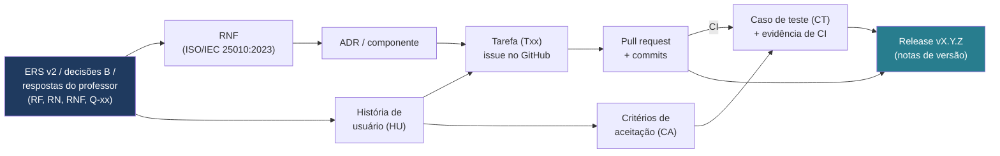

**Figura 11 —** Cadeia de rastreabilidade do projeto

A rastreabilidade é mantida por **ligações**, não por cópia: a issue da tarefa cita a HU; o PR cita a issue; o teste cita o CA no nome (`deveRejeitarEdicaoAposSubmissao_CA14_2`); as notas de versão listam os PRs. A matriz (D04) é atualizada por A a cada sprint a partir dessas ligações. A matriz inicial abaixo liga cada RF às tarefas do cronograma.

**Tabela 92 —** Matriz de rastreabilidade inicial (v0)

| **RF** | **HU** | **Módulo** | **Tarefas** | **Testes previstos** | **Sprint** | **Prioridade** |
|---|---|---|---|---|---|---|
| RF01 | HU-01 | atividades | T03, T14, T17 | CT-01.x | S1 | Must |
| RF02 | HU-02 | producao | T17 | CT-02.x | S1 | Must |
| RF03 | HU-03 | producao | T15, T17 | CT-03.x | S1 | Must |
| RF04 | HU-04 | producao | T15, T18, T19 | CT-04.x | S1 | Must |
| RF05 | HU-05 | producao | T15, T19 | CT-05.x | S1 | Must |
| RF06 | HU-06 | producao | T24, T27 | CT-06.x | S2 | Must |
| RF07 | HU-07 | apoio | T23, T25 | CT-07.x | S2 | Must |
| RF08 | HU-08 | apoio | T20, T25 | CT-08.x; avaliação | S2 | Must |
| RF09 | HU-09 | apoio | T11, T20, T26 | CT-09.x; suíte adversarial | S2 | Must |
| RF10 | HU-10 | apoio | T23, T28 | CT-10.x | S2 | Must |
| RF11 | HU-11 | acompanhamento | T37 | CT-11.x | S3 | Should |
| RF12 | HU-12 | apoio, acompanhamento | T25, T37, T65 | CT-12.x | S2–S4 | Should |
| RF13 | HU-13 | acompanhamento | T33, T35 | CT-13.x | S3 | Must |
| RF14 | HU-14 | producao | T34, T36 | CT-14.x | S3 | Must |
| RF15 | HU-15 | similaridade | T42, T45, T47 | CT-15.x; casos-controle | S4 | Should |
| RF16 | HU-16 | atividades, identidade | T14, T16, T17, T18 | CT-16.x | S1 | Must |
| RF17 | HU-17 | producao | T19, T60, T61 | CT-17.x | S1–S3 | Must |
| RF18 | HU-18 | producao | T33, T60, T63 | CT-18.x | S3 | Should |
| RF19 | HU-19 | acompanhamento | T64 | CT-19.x | Após M5, se houver capacidade | Could |
| RF20 | HU-20 | acompanhamento | T37, T65 | CT-20.x | S4 | Should |
| RF21 | HU-21 | identidade | T03, T06, T14, T16 | CT-21.x | S0–S1 | Must |
| RF22 | HU-22 | identidade | T16, T35 | Testes negativos de autorização | S1 | Must |

## 12. Gestão de riscos e mudanças

### 12.1 Processo de gestão de riscos

Processo proporcional baseado na tabela de riscos e no plano de mitigação, monitoramento e gestão descritos por Pressman [9, cap. 35]: **identificar** (S0 e em toda retrospectiva), **analisar** (probabilidade e impacto em escala de 1 a 3; exposição = P × I), **planejar resposta** (evitar, mitigar, aceitar com contingência), **monitorar** (gatilho observável revisado na Sprint Review) e **registrar** a evolução. Riscos com exposição ≥ 6 têm ação no Sprint Backlog da semana seguinte; riscos com exposição ≤ 2 são apenas observados.

### 12.2 Registro inicial de riscos

**Tabela 93 —** Registro inicial de riscos (P = probabilidade, I = impacto, E = exposição)

| **ID** | **Risco** | **P** | **I** | **E** | **Resposta (mitigação / contingência)** | **Gatilho** | **Dono** |
|---|---|---|---|---|---|---|---|
| R03 | LLM produz texto pronto ou é manipulado por injeção de instruções | 3 | 3 | 9 | Defesa em camadas (6.5); suíte adversarial no CI / modo restrito com respostas padrão por categoria | Qualquer caso adversarial aprovado indevidamente | C (A valida) |
| R15 | Escopo da ERS v2 acima da capacidade; área B (frontend) com 0,5 h de reserva | 2 | 3 | 6 | Ordem de corte da seção 8.2; RF19 fora da base; acompanhar horas de B desde a S0 / acionar a ordem de corte na Sprint Review | Horas realizadas de B > 110% do planejado em uma semana | Facilitador + A |
| R14 | Textos de estudantes, possivelmente menores, processados por provedor externo de LLM | 2 | 3 | 6 | Minimização do *payload* (RNF04) testada; provedor sem treinamento com os dados; termo de ciência (RF21); só dados de demonstração até o piloto (B11) / trocar de provedor (RNF15) | Termos do provedor mudam ou identificador encontrado no *payload* | C (A revisa em T32) |
| R04 | Dedicação real menor que 10 h/semana | 2 | 3 | 6 | Medir horas desde a S0; válvulas *Should* / renegociar escopo (8.2) | Horas realizadas < 85% do planejado por 2 semanas | Facilitador + A |
| R01 | Custo, cota ou indisponibilidade da API de LLM | 2 | 2 | 4 | Estimar custo no *spike*; limite de gasto na chave; adaptador falso no CI; tolerância a falha (RNF08) / trocar de provedor ou usar o LLM local como contingência | Gasto acima do previsto ou falhas do provedor em mais de 5% das chamadas numa semana | C |
| R02 | Orientações de baixa qualidade em português | 2 | 2 | 4 | Comparar provedores e modelos; ajustar *prompt*; rubrica / reduzir categorias atendidas | < 80% de pertinência na avaliação | C |
| R05 | Pendências sem resposta do professor | 2 | 2 | 4 | Hipóteses padrão documentadas / seguir com hipótese e registrar | Q-xx sem resposta em S0·D5 | A |
| R06 | Curva de aprendizado (Spring Boot 4, JPA, React) | 2 | 2 | 4 | Esqueleto na S0; material do projeto; pareamento na primeira tarefa | Tarefa > 150% da estimativa | Todos |
| R07 | Contrato front-back instável | 2 | 2 | 4 | OpenAPI desde a S1; segundo revisor em mudanças de contrato | > 2 retrabalhos por contrato numa sprint | C · B |
| R09 | Incompatibilidade de bibliotecas com Boot 4.x (Spring AI e o módulo do provedor, springdoc) | 2 | 2 | 4 | Fixar versões na S0 / cliente HTTP manual; Java 21 | Falha de build na S0 | D · C |
| R10 | Concentração de conhecimento | 2 | 2 | 4 | Anel de revisão; ADRs; facilitação rotativa | Tarefa bloqueada por ausência de uma pessoa | Facilitador |
| R11 | Similaridade com falsos positivos | 2 | 2 | 4 | Trechos explicáveis; casos-controle; RN06 | Caso-controle legítimo com índice alto | C |
| R12 | Revisões acumuladas (gargalo) | 2 | 2 | 4 | WIP ≤ 4 em revisão; revisão em 24 h | Idade de PR > 2 dias | Facilitador |
| R16 | Colagem interpretada como prova de fraude | 2 | 2 | 4 | Colagens apresentadas como informação, sem rótulo (RN05, RN06; CA-18.3); termo informa o registro | Tela ou relatório com rótulo de suspeita | A |
| R17 | Consentimento não obtido ou faixa etária indefinida, bloqueando o piloto | 2 | 2 | 4 | Protocolo do piloto com consentimento e retenção (T41); demonstração não depende do piloto (B11) / adiar o piloto | Q-13 sem resposta em M4 | A |
| R08 | Uso de dados pessoais reais sem base adequada | 1 | 3 | 3 | Apenas dados de demonstração nas 6 semanas (B11; Q-13) | Pedido de uso de dados reais | A |
| R13 | Falha do ambiente na demonstração final, inclusive sem acesso à internet ou à API | 1 | 3 | 3 | Backup; ensaio T58; instalação limpa testada; vídeo de contingência da demonstração | Falha no ensaio | D |

### 12.3 Controle de mudanças

**Tabela 94 —** Procedimento de controle de mudanças

| **Tipo de mudança** | **Quem propõe** | **Análise de impacto** | **Quem aprova** | **Registro** | **Comunicação** |
|---|---|---|---|---|---|
| Requisito ou escopo (ERS) | Qualquer integrante ou o professor | A: requisitos, tarefas, testes; dono técnico: esforço | Professor (escopo) + equipe | Issue MUD-xxx; nova versão da ERS; ata | Sprint Review; canal da equipe |
| Arquitetura | Qualquer integrante | C (+D em dados): componentes, riscos | Duas áreas além do autor | Novo ADR que substitui o anterior | PR do ADR; Sprint Review |
| Stack ou versão de tecnologia | D ou C | Compatibilidade, testes, curva | Equipe | ADR ou PR com nota; README | Canal da equipe |
| Cronograma | Facilitador ou A | Capacidade, dependências, marcos | Equipe; professor se afetar M6 | Nova versão da seção 8; ata | Sprint Planning/Review |
| Dentro da sprint | Qualquer integrante | — | Não altera o Sprint Goal; vai ao backlog (exceto defeito bloqueante) | Issue | Check-in |

**Critérios de priorização de mudanças:** (1) exigência do professor ou de regra de negócio; (2) redução de risco de exposição alta; (3) valor para a avaliação da POC; (4) menor custo. Toda mudança aprovada é anunciada em uma mensagem curta no canal com o link para o registro único (issue ou ADR), evitando decisões espalhadas em conversas [11].

## 13. Critérios de conclusão e entrega

### 13.1 Critérios por fase (marcos)

**Tabela 95 —** Critérios de conclusão por marco

| **Marco** | **Critérios verificáveis de conclusão** |
|---|---|
| M1 — Linha de base | • ERS v2 revisada pela equipe, com checklist de D sem pendência bloqueante e divergências registradas como proposta de mudança <br> • Q-01 a Q-21 respondidas ou com hipótese aceita em ata; B5 e B10 decididos ou registrados como pendência <br> • ADR-001 a 005 e ADR-009 aceitos; ADR-006 decidido com medições e termos de uso do *spike* <br> • Frontend chama `/api/health` no ambiente Compose; CI verde na `main`; proteção de branch ativa; nenhuma chave no repositório |
| M2 — Incremento 1 | • CA de RF01–RF05, RF16, RF21 e RF22 aprovados por A <br> • Testes negativos de autorização (por perfil e por turma) verdes <br> • Tentativa de alterar versão rejeitada em teste de integração; salvamento automático verificado |
| M3 — Incremento 2 | • CA de RF06–RF10 aprovados; transições de etapa testadas no domínio <br> • Suíte adversarial (≥ 30 pedidos) sem resposta aproveitável; metas da seção 9.4 atingidas ou defeito aberto com plano <br> • Relatório de avaliação do assistente publicado, com custo da execução |
| M4 — Incremento 3 | • CA de RF11–RF14, RF17 e RF18 aprovados <br> • Checklist de segurança e privacidade (incluindo o *payload* enviado ao provedor) sem item crítico aberto |
| M5 — Congelamento | • CA de RF15 e RF20 aprovados <br> • RNF verificados (relatório de desempenho; checklist WCAG 2.1 AA) <br> • Regressão sem defeito bloqueante ou alto <br> • Protocolo do piloto aprovado pelo professor <br> • v0.9.0 publicada; instalação limpa em ≤ 30 min |
| M6 — Entrega | • Critérios da seção 13.2 atendidos <br> • v1.0.0 publicada; rollback para v0.9.0 testado <br> • Ensaio da demonstração executado sem falhas |

### 13.2 Critérios de conclusão do projeto

O projeto é considerado concluído quando **todas** as condições abaixo forem verdadeiras e registradas no parecer de liberação (T50):

1. **Conformidade com requisitos:** 100% dos CA dos requisitos *Must* executados e aprovados; requisitos *Should* aprovados ou com mudança registrada que justifique a simplificação.
1. **Regras de negócio:** cada RN01–RN10 com evidência de teste ou revisão (seção 5.6).
1. **Resultados de teste:** pipeline verde na tag v1.0.0; metas da seção 9.3 atingidas; zero defeitos bloqueantes ou altos abertos.
1. **Revisões:** todo PR e todo documento essencial com autor e revisor distintos registrados; nenhum item aprovado pelo próprio autor.
1. **Integração:** os três contêineres (frontend, backend e PostgreSQL) sobem a partir da tag com um único comando, o backend acessa a API do provedor de LLM com a chave configurada e o roteiro ponta a ponta é executado com sucesso.
1. **Documentação:** D01–D15, D17 e D18 no estado “aprovado”; matriz de rastreabilidade sem RF *Must* ou *Should* sem teste executado; uso de IA declarado.
1. **Aceite:** demonstração (fase 1 da ERS v2) apresentada ao professor e entrega formal feita até o prazo da Semana 6.
### 13.3 Pacote de entrega

- Tag v1.0.0 com código, migrações, `docker-compose.yml` e notas de versão.
- Documentos D01–D15, D17 e D18 em `docs/`, com versão em PDF dos documentos avaliados.
- Relatórios de teste, de avaliação do assistente e de desempenho.
- Atas, registros de sprint e apêndices exigidos pela disciplina (Q-02).
## 14. Referências

As referências são numeradas na ordem em que foram registradas e citadas no texto pelo número entre colchetes. Versões e datas foram verificadas em fontes oficiais em 29/10/2026, exceto quando indicado.

**[1]** ISO; IEC; IEEE. **ISO/IEC/IEEE 12207:2026** — Systems and software engineering — Software life cycle processes. Ed. 2. Genebra: ISO, abr. 2026. https://www.iso.org/standard/90219.html (texto integral não consultado).

**[2]** ISO; IEC; IEEE. **ISO/IEC/IEEE 29148:2018** — Systems and software engineering — Life cycle processes — Requirements engineering. Genebra: ISO, 2018. https://www.iso.org/standard/72089.html (texto integral não consultado).

**[3]** ISO; IEC; IEEE. **ISO/IEC/IEEE 42010:2022** — Software, systems and enterprise — Architecture description. Ed. 2. Genebra: ISO, 2022. https://www.iso.org/standard/74393.html (texto integral não consultado).

**[4]** ISO; IEC. **ISO/IEC 25010:2023** — Systems and software Quality Requirements and Evaluation (SQuaRE) — Product quality model. Ed. 2. Genebra: ISO, nov. 2023. https://www.iso.org/standard/78176.html (texto integral não consultado).

**[5]** WASHIZAKI, H. (ed.). **Guide to the Software Engineering Body of Knowledge (SWEBOK Guide)**, versão 4.0. IEEE Computer Society, 2024. https://www.computer.org/education/bodies-of-knowledge/software-engineering

**[6]** SCHWABER, K.; SUTHERLAND, J. **The Scrum Guide**. Nov. 2020. https://scrumguides.org/scrum-guide.html

**[7]** COLEMAN, J.; VACANTI, D. et al. **The Kanban Guide**. Versão v2025.5, maio 2025. https://kanbanguides.org/the-kanban-guide/

**[8]** PROJECT MANAGEMENT INSTITUTE. **A Guide to the Project Management Body of Knowledge (PMBOK Guide)** and The Standard for Project Management. 8. ed. PMI, 2025 (texto integral não consultado).

**[9]** PRESSMAN, R. S.; MAXIM, B. R. **Engenharia de Software: uma abordagem profissional**. 8. ed. Porto Alegre: AMGH, 2016. Cap. 8 (Entendendo os requisitos), cap. 22 (Estratégias de teste) e cap. 35 (Gestão de riscos); Scrum, p. 78.

**[10]** VALENTE, M. T. **Engenharia de Software Moderna**: princípios e práticas para desenvolvimento de software com produtividade. Edição independente, 2020. ISBN 978-65-00-01950-6. Cap. 2 (Processos), 7 (Arquitetura), 8 (Testes) e 10 (DevOps). https://engsoftmoderna.info

**[11]** RICHARDS, M.; FORD, N. **Fundamentals of Software Architecture**: an engineering approach. Sebastopol: O'Reilly, 2020. Cap. 10 (Layered Architecture Style) e cap. 19 (Architecture Decisions).

**[12]** TUDOSE, C. **Java Persistence with Spring Data and Hibernate**. Manning, 2023 (versão MEAP V04 consultada; a numeração de capítulos pode diferir da edição final). Cap. 4 (Working with Spring Data JPA) e cap. 5 (Mapping persistent classes).

**[13]** HEUSER, C. A. **Projeto de Banco de Dados**. Porto Alegre: Bookman. Cap. 1 (modelos conceitual e lógico) e cap. 3 (construção de modelos ER). Edição não identificada no arquivo disponível — conferir antes de citar formalmente.

**[14]** BOOCH, G.; RUMBAUGH, J.; JACOBSON, I. **UML: guia do usuário**. Tradução. Rio de Janeiro: Campus/Elsevier. Edição não identificada no arquivo disponível — conferir antes de citar formalmente.

**[15]** BROWN, S. **The C4 model for visualising software architecture**. https://c4model.com

**[16]** NYGARD, M. **Documenting Architecture Decisions**. 15 nov. 2011. https://cognitect.com/blog/2011/11/15/documenting-architecture-decisions

**[17]** COCKBURN, A. **Hexagonal architecture** (Ports and Adapters). https://alistair.cockburn.us/hexagonal-architecture/

**[18]** COHN, M. **User Stories Applied**: for agile software development. Boston: Addison-Wesley, 2004.

**[19]** COHN, M. **Agile Estimating and Planning**. Upper Saddle River: Prentice Hall, 2005.

**[20]** McCONNELL, S. **Software Estimation**: demystifying the black art. Redmond: Microsoft Press, 2006.

**[21]** FOWLER, M. **Continuous Integration**. https://martinfowler.com/articles/continuousIntegration.html

**[22]** OWASP FOUNDATION. **Application Security Verification Standard (ASVS)**, versão 5.0.0, 2025. https://owasp.org/www-project-application-security-verification-standard/

**[23]** OWASP GENAI SECURITY PROJECT. **OWASP Top 10 for LLM Applications 2025**. https://genai.owasp.org/llm-top-10/

**[24]** BRASIL. **Lei nº 13.709, de 14 de agosto de 2018** — Lei Geral de Proteção de Dados Pessoais (LGPD), em especial art. 14. https://www.planalto.gov.br/ccivil_03/_ato2015-2018/2018/lei/l13709.htm

**[25]** SPRING. **Spring Boot Reference Documentation** (linha 4.x). https://docs.spring.io/spring-boot/

**[26]** SPRING. **Spring Data JPA Reference Documentation**. https://docs.spring.io/spring-data/jpa/reference/

**[27]** SPRING. **Spring Security Reference Documentation**. https://docs.spring.io/spring-security/reference/

**[28]** SPRING. **Spring AI Reference — Chat Model API** (abstração comum aos provedores de LLM). https://docs.spring.io/spring-ai/reference/api/chatmodel.html

**[29]** OLLAMA. **Ollama** — documentação e repositório (contingência de LLM local). https://ollama.com ; https://github.com/ollama/ollama

**[30]** THE POSTGRESQL GLOBAL DEVELOPMENT GROUP. **PostgreSQL 18 Documentation**, incluindo o módulo pg_trgm. https://www.postgresql.org/docs/18/

**[31]** REDGATE. **Flyway Documentation**. https://documentation.red-gate.com/flyway

**[32]** TESTCONTAINERS. **Testcontainers for Java**. https://java.testcontainers.org/

**[33]** JUNIT. **JUnit User Guide**. https://junit.org

**[34]** META OPEN SOURCE; VITE; MICROSOFT. **React**, **Vite** e **TypeScript** — documentação oficial. https://react.dev ; https://vite.dev ; https://www.typescriptlang.org/docs/

**[35]** VITEST; TESTING LIBRARY. Documentação oficial. https://vitest.dev ; https://testing-library.com

**[36]** JAVA-DIFF-UTILS. **java-diff-utils** (implementação do algoritmo de Myers). https://github.com/java-diff-utils/java-diff-utils

**[37]** GITHUB. **GitHub Docs**: protected branches, CODEOWNERS, GitHub Actions, Dependabot. https://docs.github.com

**[38]** CONVENTIONAL COMMITS. **Conventional Commits 1.0.0**. https://www.conventionalcommits.org/en/v1.0.0/

**[39]** PRESTON-WERNER, T. **Semantic Versioning 2.0.0**. https://semver.org/

**[40]** OPENJDK. **JDK 25** (GA em 16 set. 2025; versão LTS). https://openjdk.org/projects/jdk/25/

**[41]** ISTQB. **Certified Tester Foundation Level Syllabus**, versão 4.0. https://www.istqb.org (conferir a versão vigente antes de citar).

**[42]** BRODER, A. Z. On the resemblance and containment of documents. In: **Compression and Complexity of Sequences**, 1997. IEEE, p. 21–29.

**[43]** HUMBLE, J.; FARLEY, D. **Continuous Delivery**. Boston: Addison-Wesley, 2010.

**[44]** FOWLER, M. **Patterns of Enterprise Application Architecture**. Boston: Addison-Wesley, 2002.

**[45]** WIEGERS, K.; BEATTY, J. **Software Requirements**. 3. ed. Redmond: Microsoft Press, 2013.

**[46]** GRUPO 8 (DANILO GALVÃO; ENZO MACHADO; FELIPE NUNES; LUIZ AUGUSTO GODINHO). **Especificação de Requisitos de Software — ERS: Assistente de Escrita Processual**. Versão 2.0 (revisão da versão 1.0). Documento de entrada deste projeto (`docs/ers/v2/`).

**[47]** MONTEIRO, L. A. V.; SUCUPIRA, D. **Base teórica — Sistema Web, com cronograma (Trabalho 2 — Autenticação Web)**. Goiânia, 2026. Documento de entrada deste projeto.

**[48]** LARMAN, C. **Utilizando UML e Padrões**: uma introdução à análise e ao projeto orientados a objetos e ao desenvolvimento iterativo. 3. ed. Porto Alegre: Bookman, 2007 (padrões GRASP).

**[49]** **POC 2.2 — Assistente de escrita processual**. Enunciado da prova de conceito: classificação de risco, hipótese, salvaguardas, requisitos de dados e métricas de saída. Documento de entrada deste projeto (`docs/referencias/`).

**[50]** BRASIL. Ministério da Educação. **Escolas Conectadas: IA básica**. https://www.gov.br/mec/pt-br/escolas-conectadas/arquivos/ia-basica.pdf (documento complementar da POC 2.2).

**[51]** GRUPO 8. **Assistente de Escrita Processual** — apresentação ao stakeholder. Documento de entrada deste projeto (`docs/referencias/`).

**[52]** W3C. **Web Content Accessibility Guidelines (WCAG) 2.1**. W3C Recommendation. https://www.w3.org/TR/WCAG21/

## Apêndice A — Modelo de registro de decisão arquitetural (ADR)

```
# ADR-NNN — <título curto da decisão>
Estado: Proposto | Aceito | Substituído por ADR-MMM
Data: AAAA-MM-DD    Autor: <área>    Revisores: <áreas>
```

```
## Contexto
<problema, forças, requisitos e riscos relacionados (RF, RNF, R-xx)>
```

```
## Alternativas consideradas
<opções com vantagens e desvantagens>
```

```
## Decisão
<o que foi decidido e POR QUÊ>
```

```
## Consequências
<efeitos positivos, negativos e trade-offs aceitos>
```

```
## Conformidade
<como será verificado: teste de arquitetura, revisão, métrica>
```

```
## Notas
<aprovado por, data de aprovação, substituições>
```

Estrutura baseada em Richards e Ford [11, cap. 19], que estendem a proposta de Nygard [16] com as seções de conformidade e notas; a seção de alternativas foi incluída por exigência deste plano.

## Apêndice B — Modelo de ata de evento

```
# Ata — <evento> — Semana N — AAAA-MM-DD
Facilitador: <área>   Registro: <área>   Presentes: <nomes>
Sprint Goal (planning) / Incremento demonstrado (review):
Decisões (com link para issue/ADR/MUD):
Métricas: horas planejadas x realizadas; WIP; throughput; idade; defeitos
Riscos atualizados:
Ações (responsável, prazo):
Revisado por: <outro integrante>
```

## Apêndice C — Modelo de pull request

```
## Tarefa e requisitos
Fecha #<issue> · Txx · RF/RN/RNF: <...> · CA: <...>
## Design do incremento (seção 4.2.3)
Componentes/classes · endpoints (rota, entrada, saída, erros) · tabelas/migração
Sequência (se > 2 componentes) · testes previstos por CA · alternativas descartadas
## O que mudou
## Como testar
## Evidências (prints, logs, resultado de testes)
## Impacto
[ ] Contrato da API   [ ] Esquema do banco   [ ] Prompt/guardrail   [ ] Documentação
## Checklist da DoD
[ ] Testes adequados   [ ] CI verde   [ ] Docs atualizadas   [ ] Sem segredos ou dados reais
```

## Apêndice D — Declaração de uso de inteligência artificial

Este plano foi elaborado com apoio de uma ferramenta de IA generativa, a partir dos documentos fornecidos pela equipe e de verificações em fontes oficiais. Se a regra do trabalho anterior se aplicar (Q-02), a equipe deve registrar a ferramenta, a URL, a data de acesso e o *prompt* completo, e revisar criticamente o conteúdo antes de adotá-lo como documento oficial.

**Tabela 96 —** Registro de uso de IA

| **Campo** | **Registro** |
|---|---|
| Ferramenta | Claude (Anthropic), modelo Claude Opus 5.5, via claude.ai |
| URL | https://claude.ai |
| Data de acesso | 29/10/2026 |
| *Prompt* | Texto integral da tarefa “Elaborar a Documentação Mestre de Planejamento e Engenharia de Software” fornecido pela equipe, acompanhado das respostas às perguntas de esclarecimento (prazo de 6 semanas; React + TypeScript; LLM local open-source; similaridade contra textos internos e respostas do assistente). Anexar o texto completo como apêndice do relatório da disciplina |
| Uso | Diagnóstico dos documentos, estrutura, redação, diagramas e cronograma; verificação de edições e versões em fontes oficiais |
| Responsabilidade | Revisão e aprovação pela equipe conforme a seção 7 |

**Tabela 97 —** Registro de uso de IA — versão 1.2

| **Campo** | **Registro** |
|---|---|
| Ferramenta | Claude Code (Anthropic), modelo Claude Opus 5.5 |
| Data de uso | 29/10/2026 |
| *Prompt* | Pedido de Danilo Galvão para enriquecer o plano mestre v1.1 com a ERS v2.0, a partir do arquivo editável da v1.1, com Markdown como fonte, versão .docx e diagramas refeitos em Mermaid; decisões B1–B12 tomadas pela equipe e registradas em `docs/plano/v1.2/decisoes-plano-v1.2.md` |
| Uso | Comparação entre ERS v2 e plano v1.1; proposta das decisões para a equipe escolher; redação das mudanças; reestimativa do cronograma; diagramas em Mermaid; conversão para .docx |
| Responsabilidade | As decisões B1–B12 são da equipe; a redação deve ser revisada e aprovada conforme a seção 7 |

## Apêndice E — Glossário

**Tabela 98 —** Glossário (linguagem ubíqua)

| **Termo** | **Definição neste projeto** |
|---|---|
| Turma | Grupo de estudantes incluídos por um professor; define quem vê cada atividade (RF16) |
| Atividade | Proposta de produção textual criada pelo professor para uma turma (título, tema, gênero, descrição, orientações, critérios de avaliação, prazo e política de prazo) |
| Produção | Trabalho de um estudante em uma atividade; reúne etapas, versões, interações, colagens e estado |
| Etapa | Fase do processo de escrita: Planejar, Escrever, Revisar ou Reescrever (RF17) |
| Versão | Registro imutável do conteúdo da produção em um instante, com número sequencial, tipo e etapa |
| Versão automática / marcada | Automática: criada pelo salvamento periódico quando o texto mudou. Marcada: criada ao avançar de etapa, por ação do estudante ou na submissão (RF04) |
| Evento de colagem | Inserção de texto no editor por meio de colar; registrada com trecho, tamanho, etapa e horário (RF18) |
| Interação de apoio | Par solicitação do estudante + orientação exibida, com categoria, etapa, recusa e marcação de bloqueio |
| Orientação | Resposta do assistente limitada a perguntas, apontamentos e explicações de conceitos (RF08, RF09) |
| Guardrail de autoria | Validação determinística da saída do LLM que garante RN02 |
| Provedor de LLM | Serviço externo que executa o modelo de linguagem, acessado por API (B1) |
| Termo de ciência | Texto apresentado no primeiro acesso, em linguagem simples, sobre o que é registrado, quem acessa e para quê (RF21) |
| Devolutiva | Comentário do professor sobre o processo e a versão final, visível ao estudante (RF19, *Could*) |
| Descarregamento cognitivo | Transferência para a IA do esforço intelectual que deveria ser do estudante (planejar, formular, revisar) |
| Autonomia progressiva | Redução, ao longo das atividades, da dependência do estudante em relação ao assistente |
| Submissão | Ato de definir a versão final para avaliação; muda o estado para SUBMETIDA e dispara a similaridade |
| Análise de similaridade | Cálculo de contenção de n-gramas entre a produção e fontes internas, com resumo de colagens, sem veredito |
| Piloto | Fase 2 da POC: uma turma com pelo menos 3 atividades, após a entrega e com consentimento (B11) |
| Incremento | Software integrado ao final de uma sprint que atende à DoD |
| DoR / DoD | Definition of Ready / Definition of Done (seção 4.7) |
| WIP | Trabalho iniciado e não concluído |
| Spike | Tarefa curta de investigação para reduzir incerteza técnica |
| POC | Prova de conceito |
